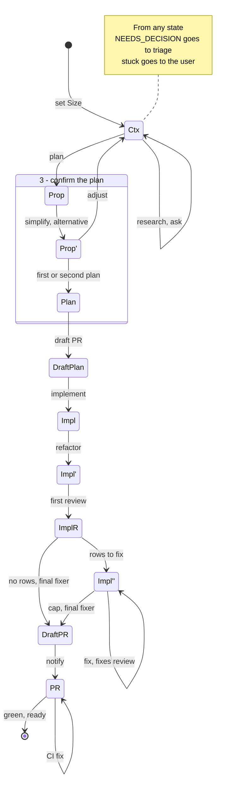
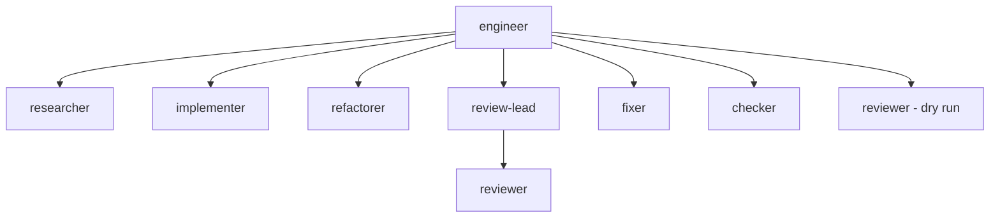
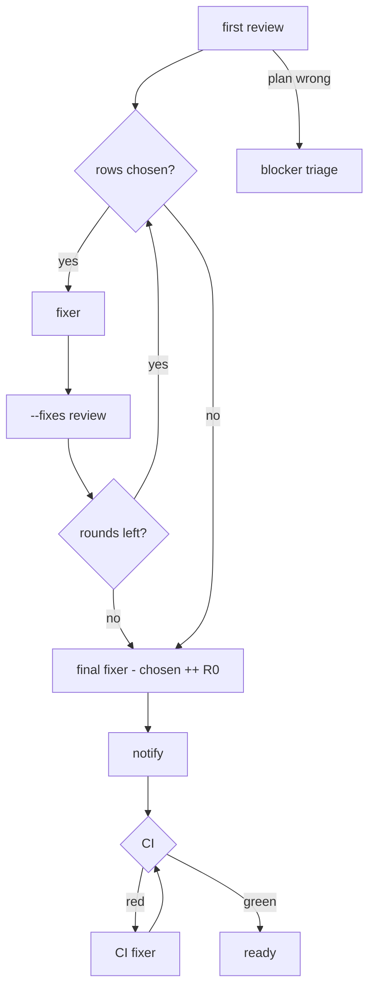
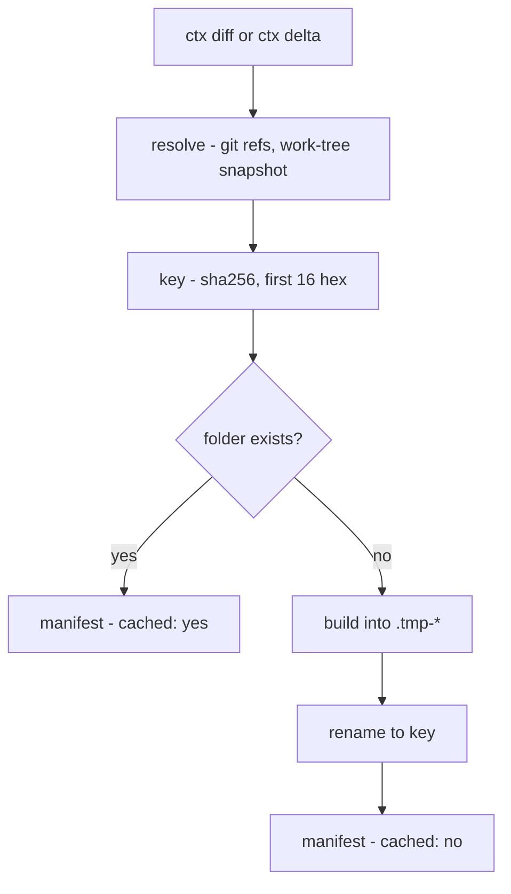

# The engineer flow is a state machine where agents research and ask on demand

`/engineer` used to run a fixed lifecycle: research and ask up front, build,
review once, fix once, hand over. A question a worker hit mid-build had no way
back to the user. Now each step is a state with named arrows. A Quality mode or
a Size only skips arrows. A worker hands a blocking question back, and the
engineer sorts it.

Amended by #317, #318, #324, #326 and #328. This text describes the current
flow.

The spec is the `## States` table in
`programs/agents/skills/custom/engineer/SKILL.md`, with detail in its
`references/blockers.md`, `references/review.md` and `references/trivial.md`.
The steps keep their numbers 1 to 10, so `/10x-engineer`, `trivial.md` and a
resume read the same. Where this ADR and the skill differ, the skill wins.

## The state machine

| Step | State | Spec |
|---|---|---|
| 1-2 | Ctx | `engineer/SKILL.md` Research, Interview |
| 3 | Prop, Prop', Plan | Confirm the plan |
| 4 | DraftPlan | Open a draft PR |
| 5 | Impl | Implement |
| 6 | Impl' | Refactor |
| 7 | ImplR | `references/review.md` First review |
| 8 | Impl'' | `references/review.md` Rounds 2+, Final fixer |
| 9 | DraftPR | Describe and notify: R0 already wrote the body |
| 10 | PR | Hand over, `references/review.md` CI fix |

- **Adjust** goes back to Ctx and keeps what was learned. Proposals rerun only
  when the approach changed.
- **POC, or an alternative that returns the identity**, asks yes or no
  instead of first or second.
- **Stuck guard** (`engineer/SKILL.md` Rules): the same failing check or the
  same review row in 2 rounds in a row asks the user. Delegated, it hands back
  `NEEDS_DECISION stuck: <check or row>`. A re-plan does not reset it.

**Quality and Size only drop arrows** ("Quality and Size skip arrows, never
add them", `engineer/SKILL.md` States). What each mode drops lives in one
place each: the Quality table in `programs/agents/instructions/topics/quality.md`
and the Trivial skip list in `engineer/references/trivial.md`. This ADR links
them and does not copy them. Every mode keeps:

- the quick security review,
- the blocker arrows,
- fact-gap research,
- the final fixer.

`programs/agents/lib/passes/modes.nix`, in the `agents` check, fails the build
when a mode row, a `<mode>:` branch or a Trivial switch appears outside the
table.

> **Formal view.** States are objects and steps are morphisms of a category.
> Each step is a Kleisli arrow `S -> Either Blocker S'`: `NEEDS_DECISION` is
> the `Left`, and composition short-circuits on it. A mode is a forgetful map
> onto a subcategory: it keeps every object and drops arrows, never adds one.
> The kept arrows above lie in the image of every mode.

## Who runs what

| Step | Role | Count | Reads | Writes | Hands back |
|---|---|---|---|---|---|
| 1, fact gap | `researcher` | Quality row, background, one first | code, docs, web | `research-<topic>.md` | ranked index |
| 3 | `researcher`, proposal mode | one runs simplify, then alternative on its output | `plan.md` | `proposal-<mode>.md` | the plans |
| 4 | engineer | - | plan | branch, draft PR, `report.md` | - |
| 5 | `implementer` | one per slice, a successor at 150k | plan, slice, notes | commits | stop rule line |
| 6 | `refactorer` | 1, fresh | `ctx diff` | commits | proposals |
| 7, 8 | `review-lead` | 1 fresh per round | `requirements.md`, `ctx` | nothing | the report |
| 7, 8 | `reviewer` | spawned by review-lead, foreground | `ctx` folder | nothing | findings |
| 7 | `reviewer`, dry run | 1 for a skill change, Quality row | branch `SKILL.md` | nothing | steps it could not follow |
| 8, final, CI | `fixer` | 1 per round | rows, R0, failing check | commits, PR body | stop rule line |
| 10 | `checker` | when a full check is due | one check | nothing | PASS or FAIL |

Role definitions: `programs/agents/roles/<role>/role.nix` and `role.md`.

Only the engineer and the review-lead spawn. The implementer spawns no agent
(`roles/implementer/role.md`), and the fixer spawns nobody
(`roles/fixer/role.md`). Subagents cannot ask the user
(https://code.claude.com/docs/en/sub-agents), so asking on demand is a
hand-back.

> **Formal view.** The engineer is the only interpreter of effects that reach
> the user: asking, spawning, triage. A worker is a function from its brief and
> the worktree to commits plus a hand-back value. The spawn tree has depth 2,
> and only the review-lead fans out below the root.

## The review loop

Spec: `engineer/references/review.md`.

- **Requirements.** `requirements.md` is written once per plan: acceptance
  criteria, each plan decision, out of scope, `security-sensitive`. Every
  review, Trivial included, gets `--requirements <path>`.
- **Rounds 2+.** A fixer, then a fresh review-lead with
  `--fixes <previous Reviewed head>` and the one accumulating
  `requirements-fixes.md`. A fix the Quality row's Full review of a fix to
  names gets a whole-branch review, which counts as a round.
- **Final fixer.** The loop's only exit, in every mode. It gets
  `chosen ++ [R0]`, and nothing reviews it. R0 writes the PR body from
  `ctx diff origin/<base>`.
- **Not met** is always fixed, then gets one `--fixes` review, at the cap too.
  It never goes to Follow-ups.
- **CI fix.** A fixer. Rounds left: a `--fixes` review and step 8's loop on its
  rows. Then back to the CI wait, never to step 9. Trivial skips the review.
- **Plan wrong.** The review-lead finishes its review, then returns
  `NEEDS_DECISION plan wrong: <finding>` first. No fixer runs; the rows are
  logged.

> **Formal view.** A bounded fixed-point iteration: `fix . review` repeats
> until no rows are chosen or the Re-reviews bound is hit. The stuck guard is
> the no-progress test: the same row or check twice means the iteration does
> not converge, so it stops early. The final fixer is a fixed last arrow, so
> every run ends the same way.

## Blocker triage

A worker that hits a question the repo, brief and plan do not settle stops,
pushes its work and hands back `NEEDS_DECISION <question>`. The engineer picks
one kind (`engineer/references/blockers.md` Triage):

| Kind | Action | Back to Ctx? |
|---|---|---|
| answered | a fresh worker of the same role resumes from the commit | no |
| fact | a researcher per gap, a delta plan, simplify, resume; no user question | no, unless research finds a user's choice |
| decision | Ctx for this question, step 3 at the current Quality, step 5 on the same branch; review restarts at round 1 | yes |
| scope | ask: in this PR, a follow-up or drop | only for "in this PR" |

On `Size: Trivial`, work bigger than briefed is `GREW <why>`. The engineer moves
the task to `Size: Normal` for good (`engineer/references/trivial.md`).

> **Formal view.** `data Blocker = Answered | Fact | Decision | Scope`, and
> triage is a total pattern match with no default arm. Only `Decision` and
> `Scope InThisPR` map back to Ctx; the rest resume in place.

## ctx

`ctx diff <base> [<head>]` and `ctx delta <prev> [<head>]` write a diff once
to a cached folder, and every agent reads ranges of it
(`programs/agents/ctx/ctx.py`).

- **Key inputs**: kind, from commit (merge base for `diff`, `prev` for
  `delta`), head commit, head tree, and the version, a sha256 of `ctx.py`'s own
  bytes. Ref names are not hashed.
- **Store**: `/tmp/ctx/<owner>-<repo>/<diff|delta>/<key>/`, holding `index`,
  `status`, `stat`, `log`, `diff`, and `ancestor` for `delta`. ctx refuses a
  store root another account owns.
- **Work tree**: with no head, a temporary index snapshots the work tree;
  the real index is untouched.
- **Atomic**: build in a `.tmp-*` folder, then rename. A lost race deletes its
  own temp folder and keeps the winner, so a reader never sees half a folder.
- **Reads stay small**: `index` gives each file's first and last line in
  `diff`, read with `sed -n`.

| Step | Caller | Command |
|---|---|---|
| 5 | implementer successor | `ctx delta <prev slice sha> HEAD` |
| 6 | refactorer | `ctx diff origin/<base>` |
| 7 | review-lead, reviewers | `ctx diff <base> [<head>]` |
| 8 | review-lead `--fixes` | `ctx delta <prev head>` |
| 8, final | fixer, R0 | `ctx diff origin/<base>` |

> **Formal view.** A memoized pure function over a content-addressed store.
> `resolve` is the only effect; `build` is pure in its key, so the same key
> gives the same bytes. The call is idempotent and referentially transparent:
> agents that ask for the same range share one build.

## /tmp files

The notes directory is `/tmp/engineer-<owner>-<repo>-<slug>/`, the slug being
the branch name (`engineer/SKILL.md` Rules).

| File | Writer | Reader | Lifetime |
|---|---|---|---|
| `research-<topic>.md` | researcher | engineer, implementers | the task |
| `plan.md` | engineer, step 3 | every brief, by path | rewritten on re-plan |
| `proposal-simplify.md`, `proposal-alternative.md` | proposal researcher | engineer, step 3 | per plan |
| `requirements.md` | engineer, step 7 | every review, `/final-review` | rewritten on re-plan |
| `requirements-fixes.md` | engineer, from round 2 | `--fixes` reviews | fresh copy on re-plan |
| `report.md` | engineer, after each step | a fresh context on resume | the task |
| `/tmp/ctx/...` | ctx | reviewers, fixers, refactorer, R0 | never pruned |

Delegated, the brief is the plan and the brief's report file is the progress
file. Review reports are not files: a report is the review-lead's hand-back
text, and the engineer logs its rows in `report.md`.

Prompt cache and context budget:

- The prompt cache lasts about 5 minutes. An agent past about 60k tokens runs
  no check over about 4 minutes: it hands back, and a fresh `checker` runs it
  (`programs/agents/instructions/agent.md` Checks).
- Fanning out, launch one agent first and the rest after, so they share its
  cached prefix (`programs/agents/instructions/lead.md`).
- The context guard warns at 150k tokens and stops at 220k
  (`programs/claude-code/hooks/context-guard/context-guard.py`). An implementer
  hands back at the warning for a successor.
- Never resume a large agent after a gap: spawn a fresh one from a summary.

> **Formal view.** Agents are stateless; the files are the state threaded
> between them, like a state monad whose state lives on disk. A fresh agent is
> a function of its brief path and the notes, so a resume is a re-application,
> not a replay of a lost context.

## Delegated

`/10x-engineer` spawns up to 3 `engineer` agents with a brief that is the plan.
A delegated engineer starts at step 4, runs steps 5 to 9 in the foreground,
never asks the user, and stops before the CI wait. It hands back `READY`,
`NEEDS_DECISION`, `BLOCKED` or `FAILED` with the last step and head SHA
(`engineer/SKILL.md` Delegated).

## Decisions

- **Two knobs skip arrows of one diagram; neither adds any.**
  - **Quality** (`POC`, `Balanced`, `Max`) is the user's: how much effort the
    work gets. Its only definition is the table in `topics/quality.md`, one row
    per step.
  - **Size** (`Size: Trivial|Normal`) is the engineer's alone, set once. A
    worker never switches it: it hands back `GREW <why>`. A delegated engineer
    reports `Size: Normal, grew: <why>`.
- **A worker only stops; the engineer triages.** The worker commits, pushes and
  hands back `NEEDS_DECISION`. The engineer holds the goals and the user's
  answers, so it picks the kind. This follows A2A's single `input-required`
  task state (https://a2a-protocol.org/latest/specification/) and issue
  triage, where the reporter files and the triager labels.
- **Only the engineer spawns workers and researchers.** Implementers and fixers
  are leaves, so the stop rule needs no relay.
- **One plan text, passed by path.** The brief or `plan.md` is the only plan.
  Each plan decision is a requirement. Open decisions are triaged before
  `READY` or `gh pr ready`. An `/engineer` dry run showed
  two plan texts drifting into tech debt that no review could see.
- **The engineer drives the review loop**, as the evaluator-optimizer pattern
  bounds its iterations
  (https://www.anthropic.com/engineering/building-effective-agents).
- **One final fixer ends the loop and writes the body.** R0 rides with the
  last rows, so the body matches the branch with no extra pass.
- **One stuck guard, no other caps.** It is a circuit breaker
  (https://martinfowler.com/bliki/CircuitBreaker.html) that trips on no
  progress, and it lives once, in the engineer skill's Rules.
- **Not met is always fixed**, in every mode, Trivial included.
- **The review-lead escalates only a wrong plan**: wrong approach, unmeetable
  requirement, new scope, or a data-model or auth redesign.
- **Proposals are one researcher in proposal mode**
  (`researcher/references/proposal.md`): `simplify` revises the plan, then
  `alternative` writes another from its output or returns the identity. Both
  end in a MADR-style `Considered options` table (https://adr.github.io/madr/).
- **Diffs come from `ctx`**, a cached folder read by ranges, so a diff is built
  once per head (`docs/adr/0013-deterministic-programs-over-instructions.md`).
- **A progress file in every mode**, so a fresh context resumes from it and
  `git log`
  (https://www.anthropic.com/engineering/effective-harnesses-for-long-running-agents).
- **Hand-over is ready on green CI.** `/qa`, `/final-review`,
  `/give-feedback` and `/address-pr-feedback` are optional next steps in the
  ready notice; no QA gate. `/10x-engineer` matches it.
- **Commits are kept.** A new plan adds commits on top; a revert only when the
  user asks.
- **Diagrams in Mermaid**, fenced in this file: GitHub renders them on web and
  phone (https://github.blog/developer-skills/github/include-diagrams-markdown-files-mermaid/).

## Considered options

- **Hard caps per loop** (for example 2 CI fixes, 1 re-plan). Rejected: they
  stop a run that is still making progress; the stuck guard stops only one
  that is not.
- **Trivial as a fourth Quality mode.** Rejected: it mixed the user's effort
  choice with the engineer's size judgment.
- **The worker labels its own blocker.** Rejected: a decision filed as a fact
  gap skips the user silently.
- **The review-lead runs the loop and spawns the fixer.** Rejected: the
  review-lead changes no code, and the engineer already holds the plan and the
  user.
- **Implementers that spawn sub-implementers.** Rejected in #326: the
  engineer slices up front and spawns each one, so a blocker needs no relay.
- **A small fix, then a separate `pr-description` pass.** Rejected: one more
  agent; R0 on the final fixer does both.
- **A QA gate before ready.** Rejected: it held a green PR on a question the
  user can answer later.
- **Copying the Quality and Trivial tables here.** Rejected: a second spec
  drifts. This ADR links them.
- **D2 diagrams.** Rejected: GitHub does not render them.

## Consequences

- Every implementer, refactorer and fixer brief carries the stop rule from
  `blockers.md`, and every review-lead brief its plan-wrong line.
- Implementers and fixers spawn nothing; a large task costs the engineer more
  slices and successors.
- The engineer pays one more turn per blocker to sort it.
- `pragmatic-review` re-reviews chain: `--fixes` takes the previous round's
  head, not the first review's.
- The diagrams here are hand-kept: a change to the States table needs an edit
  here.

Follow-ups, not done:

- **A programmatic state machine.** The states and arrows are prose; nothing
  checks that a run follows them, or that these diagrams match the skill. ADR
  0013 argues for such programs.
- **Per-round review metrics in `self-improve`.** Its regex counts rounds 2 and
  on as re-reviews, not each round. The per-PR metrics design is in #312.
