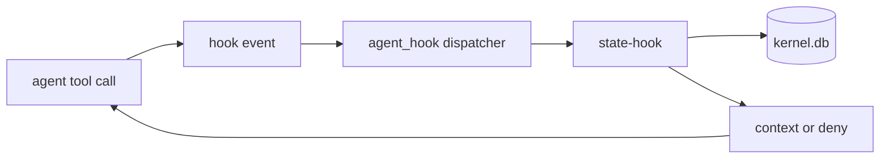

# Hooks drive the `state` record; PR state comes from GitHub

A run's record must not depend on the model remembering to write it. Hooks
write every event a program can derive from a tool call, and inject `state`
and `ctx` context where it is used. The lead records only what it decides.
What GitHub shows about the run's PR is read from GitHub, not from the
lead's shell commands.

## Evidence

Run 33c5fcbd (#333), an `/engineer` run with `state` and no hooks:

- No `state` call for the first 61 minutes, then back-filled.
- 37 calls, all from the lead: 4 overrides and 4 failures.
- 5 hand-backs retyped into `state handback`, one failing to parse.
- The last two steps ran with no `state` call at all.

The model forgets the record, and what it forgets is mechanical: a
hand-back's status and head, a spawn, a PR. A hook derives each from the
tool call.

## Decisions

- **Best effort, fail open and tell.** A hook that fails, or a `state`
  refusal, lets the call go on and adds `state hook <name>: <error>` and the
  refusal's `fix:` line to the agent's context. No skill assumes a hook
  fired: prose names the fallback (`state record <step>.spawned`,
  `state handback <role>`).
- **The state hooks** (`programs/agents/kernel/hooks.nix`, each runs
  `state-hook <name>`; `State.Protocol.Hook`). Each does nothing for an
  agent bound to no run, or for a run that is over.

  | Hook | When | Does |
  |---|---|---|
  | resume | session start | prints `state show` and `state next`; records `Restarted` when a fresh session lost the agents a run had at work |
  | spawn | before a delegate | at a choice, records the spawn (a researcher's `spawned`); adds `state next` and a warning when a role off the advice is spawned; never rewrites the prompt |
  | handback | before a hand-back | records it and adds what it recorded, or the refusal and `fix:` |
  | bind | after a shell that ran `state init`; after a spawn | binds the agent to the run init printed; binds a worker to its spawner's run |
  | route | before a shell, an edit, a write or a delegate | the one denying hook (below) |
  | begin | a subagent starts; a typed lead skill; a Skill call of one | tells a spawned lead its run starts at its prompt's `state init` line, a worker its `state brief`, a lead skill (`engineer`, `10x-engineer`, `architect`, `chief`) to begin with `state`, and marks it a lead |
  | stop | an agent stops; after a stop call | records that a child run's agent ended with no hand-back |

- **`route` is the one hook that denies.** Each deny prevents a wrong or
  missing record, and its fix is one command:
  - a `state` call aimed at another run than the agent's, `fix: cd
    <its worktree> && state ...`; a child's run is read by that child;
  - a subagent's `state init` with no parent run;
  - a lead's write before its `state init`: an edit, a write, a spawn,
    `git commit`, `git push`, `gh pr create` and `gh pr merge` (#378);
  - a code write, commit, push or PR in a read-only flow (the architect,
    or the chief in its discussion), outside the notes directory.

  Reads, research and `state` pass. A shell command the simple reader
  cannot follow passes: the guard is a nudge, not a sandbox.
- **What stays manual** is what only the model decides: the Fuel, a step's
  outcome that is a choice (confirm or adjust, which review rows, CI green
  or red), a question's kind and ruling. `state next` advises each.
- **Read GitHub, record into the log.** `state next`, `state show` and
  every state hook read `gh pr view` for the run's PR, then append only the
  event the run waits for: the draft PR at the draft step, the ready PR at
  the ready step (`due`, `State.Protocol.Advice`). Anything else appends
  nothing, so a sync twice is a sync once. The log stays the one replayable
  record (ADR 0014): a derive from GitHub would replay differently once the
  PR changes.
- **Which PR.** A run's own PR is its branch's. A round on an existing PR
  (`state init --pr <url>`) reads that PR by URL.
- **Offline is not a failure.** No `gh`, a 10 second timeout or an error:
  the log is used as it is, and the output says `PR sync skipped - <why>`.
- **A run is bound to its branch.** The hooks go silent, cheapest check
  first, when the run is over, HEAD is on another branch than its draft
  PR's, or the PR is merged or closed.
- **Hooks bind agents to runs.** A subagent's hook `cwd` is its spawner's
  folder, and no payload field names a subagent's spawner. So the hooks
  find a run through a binding, not the cwd:
  `$XDG_STATE_HOME/state/bindings/<session>/<agent id or main>` holds the
  line `state init` prints. An agent binds itself by its own `state init`;
  a worker, which never inits, is bound by its spawner's after-spawn hook.
  A hand-back seen before that binding is stashed and recorded once it
  exists. Only the main session falls back to its cwd. Every reply names
  its run: `run <id>: ...`.
- **Idempotent records.** A hook record is keyed on a content hash of the
  run, agent and message, so a hook that fires twice appends once
  (ADR 0014).
- **A vendor-free hook abstraction.** `programs/agents/hooks/` declares
  hooks with the Nix module system: `hooks.<name> = { on; tools; command;
  order; }`, events and tools from `vocabulary.json`, every option `uniq`,
  so a duplicate name, an unknown event, tool or field is an eval error. A
  profile lists hook module files in its `hooks` field.
- **A neutral contract.** A hook is a program reading one event as JSON and
  printing one result or nothing (`agent_hook.py`). A beforeTool hook
  prints a verdict (`decision, reason, context, updatedInput`); a
  sessionStart, afterTool, agentStart or promptExpansion hook only a note
  (`context`). An agentStop hook's output is dropped: the agent has stopped.
- **One dispatcher per event, in the frontend.** A backend registers one
  entry per event; its adapter hands the event to the dispatcher, which
  runs the matching hooks in `order` and folds their results as a monoid:
  deny wins, contexts join, a rewritten input reaches the next hook. Claude
  runs its own hooks in parallel with no defined winner for a rewrite;
  OpenCode runs them in order. The dispatcher makes both the same.
- **Claude Code is the first backend.** `codegen/hooks.nix` maps the events
  to `SessionStart`, `PreToolUse`, `PostToolUse`, `SubagentStart`,
  `UserPromptExpansion`, and `agentStop` to both `SubagentStop` and `Stop`,
  and the tools to a matcher through `codegen/tools.nix`; a tool with no
  Claude name throws. `hooks/adapter` (`agent-hook-claude`) translates
  Claude's JSON to the contract and back.

## Considered options

- **Keep prose only.** Rejected: run #333 above.
- **Read PR state from the lead's shell commands** (a `pr` hook lexing
  `gh pr create`). Rejected: it missed a PR made any other way and took a
  PR body that mentions `gh pr ready` for the command.
- **One settings entry per hook, no dispatcher.** Simplest codegen, but
  order and input rewrites would differ per vendor.
- **Claude-native hook commands.** Less code now, but an OpenCode backend
  would rewrite every hook.
- **More denying hooks** (a spawn out of order, a Stop hook refusing
  "done"). Out for now: a refusal that blocks work costs more than one that
  tells. The kernel refuses an event off its flow instead (ADR 0014).

## Consequences

- The skills teach what each hook adds and keep only the records the lead
  decides. `state help`, `show` and `next` still work by hand.
- The guards (`hooks/guards/`: secret, read, wait and context) run on the
  same contract, so every flavor gets them.
- An OpenCode backend reuses every hook through a generated plugin.

## History

- #335, #339: hooks drive the record.
- #341, #343: PR state from GitHub; runs bound to a branch.
- #350: the guards move onto the neutral contract.
- #376: the Haskell `state-hook` replaces the Python hooks.
- #378: the guard on a lead's writes before `state init`.
- #402, #403, #411: bindings reach subagents at any depth.
- #489, #502, #525: the asked hook goes; questions are plain text.
