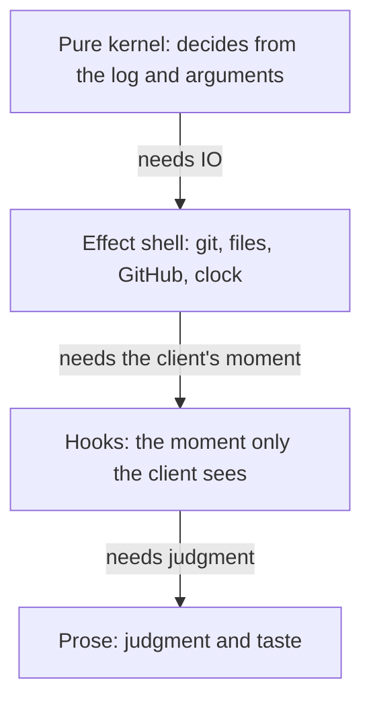
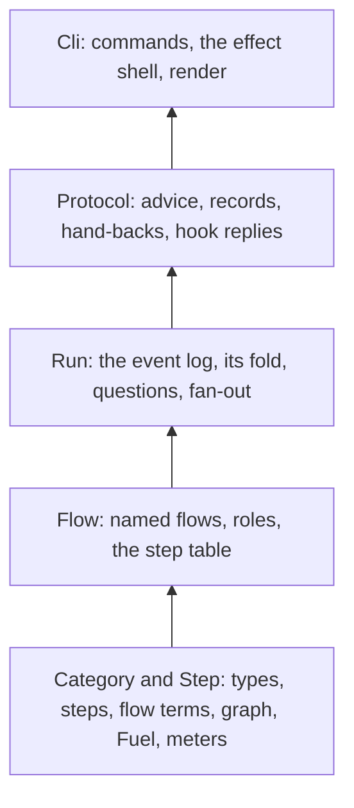
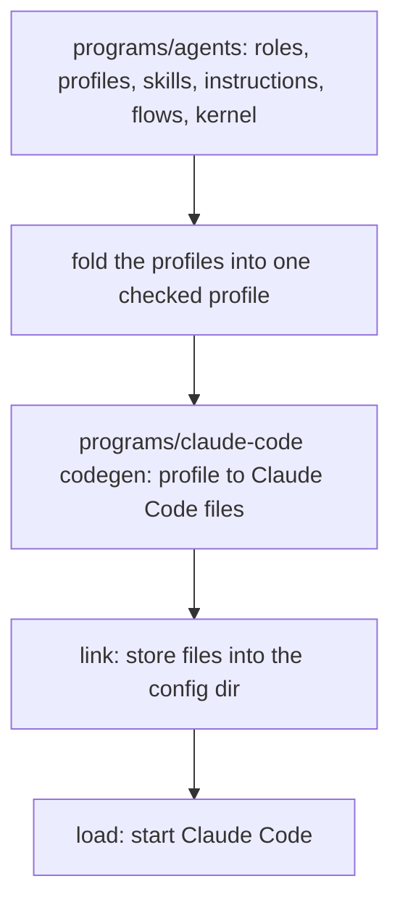
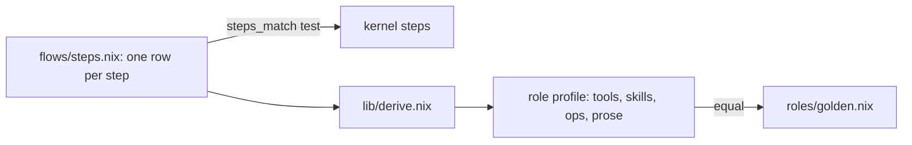

# Architecture

| Part | In one line |
|---|---|
| [The logic ladder](#the-logic-ladder) | each rule lives on the most testable rung that can hold it |
| [Kernel layers](#kernel-layers) | `state` in layers; only the shell does IO |
| [The agent compiler](#the-agent-compiler) | one vendor-free config compiles to Claude Code's files |
| [Roles derived from the step table](#roles-derived-from-the-step-table) | no role's tools are written by hand |
| [The ADRs](#the-adrs) | the decisions behind it; this page does not repeat them |

## The logic ladder

Each behaviour lives on the first rung that can hold it. Each rung down is
less deterministic and harder to test.

| Rung | Where | How it is tested | Example |
|---|---|---|---|
| Pure kernel | Haskell modules with no IO | property, law and golden tests | the next action, `state next` ([`advise`][advise]) |
| Effect shell | [`State/Cli/Shell.hs`][shell] and `Effects/` | the shell's tests on in-memory doubles | read the PR state from GitHub, append to the log |
| Hooks | [`kernel/hooks.nix`][kernelhooks], [guards][guardshooks] | hook and guard tests; works only when the client fires it | record a spawn before the subagent starts |
| Prose | skills, roles, instructions | only by a model reading and obeying it | how to split a plan into slices |

What follows from the ladder:

- The kernel is the source of truth. Prose may repeat a kernel rule as
  context, never contradict it.
- A rule never lives only in prose when it could be code.
- Hooks are thin adapters that call the kernel, and best effort: no skill
  assumes a hook fired ([GUARDRAILS](GUARDRAILS.md#hooks-fail-open-they-are-not-a-security-boundary)).

The rule: [`.claude/rules/agents-logic-ladder.md`](../../.claude/rules/agents-logic-ladder.md),
refining [ADR 0013](../adr/0013-deterministic-programs-over-instructions.md).

## Kernel layers

The kernel is `state` and its hook entry point `state-hook`
(`programs/agents/kernel`). A module imports only its own layer or one below;
a test holds it ([layers test][archlayers], [`layers`][layers]).

| Layer | Holds | Start reading |
|---|---|---|
| `Category` | the model: artifact types, typed steps, the `Flow` term, its graph, Fuel, meters | [`Flow.hs`][flowhs], [CATEGORY-THEORY](CATEGORY-THEORY.md) |
| `Step` | the concrete steps by layer: plan, build, review, ship, gather, fan-out | [`Catalog.hs`][catalog] |
| `Flow` | the named flows built from a small library: engineer, 10x, architect, chief | [`Library.hs`][library], [FLOWS](FLOWS.md) |
| `Run` | the log's events, its codec, the fold that turns a log into state, the authority table | [`Fold.hs`][fold], [RUN-LOOP](RUN-LOOP.md) |
| `Protocol` | what a run says to its agents: the next action, the record grammar, hand-backs, hooks | [`Advice.hs`][advice] |
| `Cli` | the command line, the effect shell, the Mermaid render | [`Command.hs`][command] |

Only the shell and `Effects/` (store, git, GitHub, clock, files) do IO;
the rest is pure, and a test holds that too ([IO test][archio]). The run
store is one SQLite file ([ADR 0022](../adr/0022-sqlite-run-store.md)).

## The agent compiler

The agent config is built like a compiler
([ADR 0011](../adr/0011-agent-compiler.md), refining
[ADR 0002](../adr/0002-agent-agnostic-configuration.md)). `programs/agents` is
the vendor-free frontend; each `programs/<vendor>` only translates and
installs.

- **Vendor-free frontend.** Nothing under `programs/agents` may reach a
  vendor backend, even through another program; Deslop enforces it
  ([`agents-name-no-vendor`][novendor]). The kernel knows nothing of Claude
  Code either.
- **Claude Code backend.** Today the only one. OpenCode and Codex are
  planned ([COMPARISON](COMPARISON.md#planned-not-built)).
- **Conflicts throw.** Two profiles that set one key to different values are
  an evaluation error, never last-writer-wins (ADR 0011).

### `~/.claude-kategory` isolation

claude-kategory is that backend packaged for anyone with Nix
([`kategory/default.nix`][katdefault]):

| Half | Does |
|---|---|
| Pure | builds the profile's skills, roles and `CLAUDE.md` in the Nix store, every `~/.claude` path rewritten to `~/.claude-kategory` |
| Effect | sets `CLAUDE_CONFIG_DIR` to `~/.claude-kategory`, links the skills and roles, writes `CLAUDE.md`, passes the harness settings with `--settings` ([`link.sh`][linksh]) |

The user's `~/.claude`, `~/.claude.json`, their `settings.json` and login are
never read or written. Install and update: [docs/KATEGORY.md](../KATEGORY.md).

## Roles derived from the step table

No role's tools are written by hand. [`flows/steps.nix`][steps] has one row
per kernel step: its types, outcomes, runner (the lead, or a subagent role)
and the tools, skills, operations and prose it needs.
[`lib/derive.nix`][derive] builds each role's profile from the rows it runs.

| Check | Holds |
|---|---|
| [`steps_match`][stepsmatch] | the table's types and outcomes equal the kernel's steps |
| [sufficient][derive106] | every role holds what each of its steps needs |
| [lean][derive109] | no role holds what none of its steps needs |
| golden | the derived roles equal [`roles/golden.nix`](../../programs/agents/roles/golden.nix), so a change shows in review |

`roles/<name>/role.nix` keeps only a role's identity.

## The ADRs

| ADR | Decides |
|---|---|
| [0011](../adr/0011-agent-compiler.md) | the agent config is a compiler: vendor-free frontend, thin backends |
| [0013](../adr/0013-deterministic-programs-over-instructions.md) | programs over prose for mechanical steps |
| [0014](../adr/0014-pure-core-event-sourced-flow.md) | a pure core over an event log |
| [0015](../adr/0015-state-program.md) | the `state` program |
| [0016](../adr/0016-hooks-drive-the-state-record.md) | hooks write the derivable records; the lead records only decisions |
| [0017](../adr/0017-pr-state-from-github.md) | PR facts are read from GitHub |
| [0018](../adr/0018-category-model-haskell-state.md) | the category model |
| [0019](../adr/0019-composable-flows.md) | flows composed from small flows |
| [0020](../adr/0020-flow-core-from-sums-and-elgot.md) | the flow core: sums, cases and loops |
| [0021](../adr/0021-flow-effects.md) | pick, ask and focus as typed flow effects |
| [0022](../adr/0022-sqlite-run-store.md) | one SQLite run store |

[advise]: https://github.com/ILIYANGERMANOV/nixos/blob/2c6ba6df6c2a9cc70bbd299cdbd8efd1b6df1edc/programs/agents/kernel/src/State/Protocol/Advice.hs#L263
[shell]: https://github.com/ILIYANGERMANOV/nixos/blob/2c6ba6df6c2a9cc70bbd299cdbd8efd1b6df1edc/programs/agents/kernel/src/State/Cli/Shell.hs#L1
[kernelhooks]: https://github.com/ILIYANGERMANOV/nixos/blob/2c6ba6df6c2a9cc70bbd299cdbd8efd1b6df1edc/programs/agents/kernel/hooks.nix#L1
[guardshooks]: https://github.com/ILIYANGERMANOV/nixos/blob/2c6ba6df6c2a9cc70bbd299cdbd8efd1b6df1edc/programs/agents/hooks/guards/hooks.nix#L1
[archlayers]: https://github.com/ILIYANGERMANOV/nixos/blob/2c6ba6df6c2a9cc70bbd299cdbd8efd1b6df1edc/programs/agents/kernel/test/State/ArchitectureSpec.hs#L23
[layers]: https://github.com/ILIYANGERMANOV/nixos/blob/2c6ba6df6c2a9cc70bbd299cdbd8efd1b6df1edc/programs/agents/kernel/test/State/ArchitectureSpec.hs#L75
[archio]: https://github.com/ILIYANGERMANOV/nixos/blob/2c6ba6df6c2a9cc70bbd299cdbd8efd1b6df1edc/programs/agents/kernel/test/State/ArchitectureSpec.hs#L39
[flowhs]: https://github.com/ILIYANGERMANOV/nixos/blob/2c6ba6df6c2a9cc70bbd299cdbd8efd1b6df1edc/programs/agents/kernel/src/State/Category/Flow.hs#L1
[catalog]: https://github.com/ILIYANGERMANOV/nixos/blob/2c6ba6df6c2a9cc70bbd299cdbd8efd1b6df1edc/programs/agents/kernel/src/State/Step/Catalog.hs#L1
[library]: https://github.com/ILIYANGERMANOV/nixos/blob/2c6ba6df6c2a9cc70bbd299cdbd8efd1b6df1edc/programs/agents/kernel/src/State/Flow/Library.hs#L1
[fold]: https://github.com/ILIYANGERMANOV/nixos/blob/2c6ba6df6c2a9cc70bbd299cdbd8efd1b6df1edc/programs/agents/kernel/src/State/Run/Fold.hs#L1
[advice]: https://github.com/ILIYANGERMANOV/nixos/blob/2c6ba6df6c2a9cc70bbd299cdbd8efd1b6df1edc/programs/agents/kernel/src/State/Protocol/Advice.hs#L1
[command]: https://github.com/ILIYANGERMANOV/nixos/blob/2c6ba6df6c2a9cc70bbd299cdbd8efd1b6df1edc/programs/agents/kernel/src/State/Cli/Command.hs#L1
[novendor]: https://github.com/ILIYANGERMANOV/nixos/blob/2c6ba6df6c2a9cc70bbd299cdbd8efd1b6df1edc/deslop/rules/architecture.yaml#L30
[katdefault]: https://github.com/ILIYANGERMANOV/nixos/blob/2c6ba6df6c2a9cc70bbd299cdbd8efd1b6df1edc/programs/claude-code/kategory/default.nix#L1
[linksh]: https://github.com/ILIYANGERMANOV/nixos/blob/2c6ba6df6c2a9cc70bbd299cdbd8efd1b6df1edc/programs/claude-code/kategory/link.sh#L1
[steps]: https://github.com/ILIYANGERMANOV/nixos/blob/2c6ba6df6c2a9cc70bbd299cdbd8efd1b6df1edc/programs/agents/flows/steps.nix#L1
[derive]: https://github.com/ILIYANGERMANOV/nixos/blob/2c6ba6df6c2a9cc70bbd299cdbd8efd1b6df1edc/programs/agents/lib/derive.nix#L1
[stepsmatch]: https://github.com/ILIYANGERMANOV/nixos/blob/2c6ba6df6c2a9cc70bbd299cdbd8efd1b6df1edc/programs/agents/kernel/test/State/TableSpec.hs#L27
[derive106]: https://github.com/ILIYANGERMANOV/nixos/blob/2c6ba6df6c2a9cc70bbd299cdbd8efd1b6df1edc/programs/agents/lib/derive.nix#L106
[derive109]: https://github.com/ILIYANGERMANOV/nixos/blob/2c6ba6df6c2a9cc70bbd299cdbd8efd1b6df1edc/programs/agents/lib/derive.nix#L109
