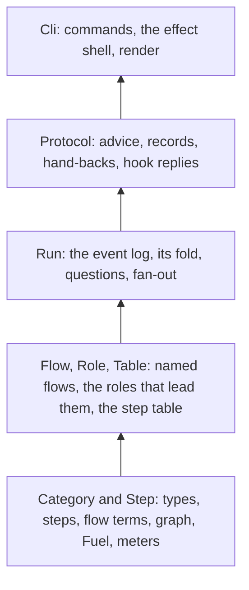
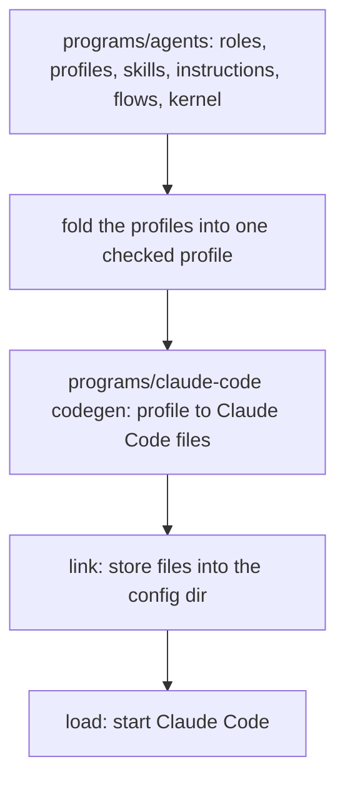
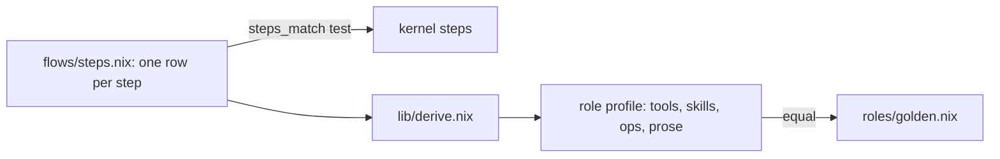

# Architecture

| Part | In one line |
|---|---|
| [The logic ladder](#the-logic-ladder) | each rule lives on the most testable rung that can hold it |
| [Kernel layers](#kernel-layers) | `state` in layers; only the shell does IO |
| [The agent compiler](#the-agent-compiler) | one vendor-free config compiles to Claude Code's and OpenCode's files |
| [Roles derived from the step table](#roles-derived-from-the-step-table) | no role's tools are written by hand |
| [The ADRs](#the-adrs) | the decisions behind it; this page does not repeat them |

## The logic ladder

The ladder is the lower four levels of the reliability pyramid, drawn in
the [README](README.md#the-reliability-pyramid). Above it sits each
project's own CI, outside the harness.

Each behaviour lives on the first rung that can hold it. Each rung down is
less deterministic and harder to test.

| Rung | Where | How it is tested | Example |
|---|---|---|---|
| Pure kernel | Haskell modules with no IO | property, law and golden tests | the next action, `state next` ([`advise`][advise]) |
| Effect shell | [`State/Cli/Shell.hs`][shell] and `Effects/` | the shell's tests on in-memory doubles | read the PR state from GitHub, append to the log |
| Hooks | [`kernel/hooks.nix`][kernelhooks], [guards][guardshooks] | hook and guard tests; works only when the client fires it | record a spawn before the subagent starts |
| Prose | skills, roles, instructions | only by a model reading and obeying it | how to split a plan into slices |

What follows from the ladder:

- The kernel is the source of truth. Prose may repeat a kernel rule as
  context, never contradict it.
- A rule never lives only in prose when it could be code.
- Hooks are thin adapters that call the kernel, and best effort: no skill
  assumes a hook fired ([GUARDRAILS](GUARDRAILS.md#hooks-fail-open-they-are-not-a-security-boundary)).

The rule: [`.claude/rules/agents-logic-ladder.md`](../../.claude/rules/agents-logic-ladder.md),
refining [ADR 0013](../adr/0013-deterministic-programs-over-instructions.md).

## Kernel layers



The kernel is `state` and its hook entry point `state-hook`
(`programs/agents/kernel`). A module imports only its own layer or a lower
one; a test holds it ([layers test][archlayers], [`layers`][layers]).
Paths below are under `programs/agents/kernel/src/`.

| Layer | Holds | Start reading |
|---|---|---|
| `State/Category/`, `State/Step/` | the model: artifact types, typed steps, the `Flow` term, its graph, Fuel, meters; the concrete steps by layer (plan, build, review, ship, gather, fan-out) | [`Flow.hs`][flowhs], [`Catalog.hs`][catalog], [CATEGORY-THEORY](CATEGORY-THEORY.md) |
| `State/Flow/`, `State/Role.hs`, `State/Table.hs` | the blocks every flow shares, the combinators that glue them, the named flows under `Role/` (engineer, 10x, architect, chief), the roles that lead them, the step table | [`Block.hs`][block], [`Combinator.hs`][combinator], [`Role/`][roles], [FLOWS](FLOWS.md) |
| `State/Run/` | the log's events, its codec, the fold that turns a log into state, the authority table | [`Fold.hs`][fold], [RUN-LOOP](RUN-LOOP.md) |
| `State/Protocol/` | what a run says to its agents: the next action, the record grammar, hand-backs, hooks | [`Advice.hs`][advice] |
| `State/Cli/` | the command line, the effect shell, the Mermaid render | [`Command.hs`][command] |

IO lives only in the effect shell, [`State/Cli/Shell.hs`][shell], and in
[`Effects/`][effects]. There are nine effects, each one file with its IO
interpreter, built on the [`effectful`](https://hackage.haskell.org/package/effectful)
library: `Clock`, `Console`, `Environment`, `FileSystem`, `Gh`, `Git`,
`Log`, `Random` and `Store` (`Effects.Store.*`, the only modules that
speak SQL). Tests run the shell on in-memory doubles in
[`test/Doubles/`][doubles]. The rest is pure, and a test holds that too
([IO test][archio]). The run store is one SQLite file, `kernel-v2.db`
([ADR 0014](../adr/0014-pure-core-event-sourced-flow.md),
[ADR 0023](../adr/0023-append-only-event-store-with-rebuilt-projections.md)).

The store has three layers of its own, and the layers test holds them too:

```text
Domain  <-  Data  <-  Effects/Store
 pure       pure       IO, SQL only
```

- `State/` is the domain: the events and states the fold decides on.
- `Data/` is the database's shape, pure: column codecs (`Field.hs`), one
  row type per table (`Entity/`), and the mapping between events and rows
  (`Payload/`).
- `Effects/Store/` runs SQL on rows: `Connection.hs`, `Migration.hs`,
  `Events.hs`. It holds no row type and no mapping.

## The agent compiler



The agent config is built like a compiler
([ADR 0011](../adr/0011-agent-compiler.md), refining
[ADR 0002](../adr/0002-agent-agnostic-configuration.md)). `programs/agents` is
the vendor-free frontend; each `programs/<vendor>` only translates and
installs.

- **Vendor-free frontend.** Nothing under `programs/agents` may reach a
  vendor backend, even through another program; Deslop enforces it
  ([`agents-name-no-vendor`][novendor]). The kernel knows nothing of Claude
  Code either.
- **Claude Code and OpenCode backends.** OpenCode runs without hooks yet.
  Codex is planned ([COMPARISON](COMPARISON.md#planned-not-built)).
- **Conflicts throw.** Two profiles that set one key to different values are
  an evaluation error, never last-writer-wins (ADR 0011).

### `~/.claude-kategory` isolation

claude-kategory is that backend packaged for anyone with Nix
([`kategory/default.nix`][katdefault]):

| Half | Does |
|---|---|
| Pure | builds the profile's skills, roles and `CLAUDE.md` in the Nix store, every `~/.claude` path rewritten to `~/.claude-kategory` |
| Effect | sets `CLAUDE_CONFIG_DIR` to `~/.claude-kategory`, links the skills and roles, writes `CLAUDE.md`, passes the harness settings with `--settings` ([`link.sh`][linksh]) |

The user's `~/.claude`, `~/.claude.json`, their `settings.json` and login are
never read or written. Install and update: [docs/KATEGORY.md](../KATEGORY.md).

## Roles derived from the step table



No role's tools are written by hand. [`flows/steps.nix`][steps] has one row
per kernel step: its types, outcomes, runner (the lead, or a subagent role)
and the tools, skills, operations and prose it needs.
[`lib/derive.nix`][derive] builds each role's profile from the rows it runs.

| Check | Holds |
|---|---|
| [`steps_match`][stepsmatch] | the table's types and outcomes equal the kernel's steps |
| [sufficient][derive106] | every role holds what each of its steps needs |
| [lean][derive109] | no role holds what none of its steps needs |
| golden | the derived roles equal [`roles/golden.nix`](../../programs/agents/roles/golden.nix), so a change shows in review |

`roles/<name>/role.nix` keeps only a role's identity.

## The ADRs

The one list of the harness's decisions. Some ADRs were merged into a
later one; each merged number keeps its row and links its old text at the
last commit that had it. Numbers are never reused: the next new ADR is
0024.

| ADR | Decides |
|---|---|
| [0011](../adr/0011-agent-compiler.md) | agent config is a compiler: one vendor-free frontend, thin vendor backends |
| [0012][adr0012] | merged into 0018 |
| [0013](../adr/0013-deterministic-programs-over-instructions.md) | prefer deterministic programs over agent instructions |
| [0014](../adr/0014-pure-core-event-sourced-flow.md) | a run is a pure fold over an event log in one SQLite store |
| [0015][adr0015] | merged into 0014 |
| [0016](../adr/0016-hooks-drive-the-state-record.md) | hooks drive the `state` record; PR state comes from GitHub |
| [0017][adr0017] | merged into 0016 |
| [0018](../adr/0018-category-model-haskell-state.md) | the agent flows follow a category model, checked by a Haskell `state` |
| [0019][adr0019] | merged into 0020 |
| [0020](../adr/0020-flow-core-from-sums-and-elgot.md) | the flow core: sums, cases, Elgot-shaped loops and step meters |
| [0021](../adr/0021-flow-effects.md) | flow effects: Pick, Ask, Focus and Await in a flow's type |
| [0022][adr0022] | merged into 0014 |
| [0023](../adr/0023-append-only-event-store-with-rebuilt-projections.md) | an append-only event store with rebuilt projections; total decode |

[adr0012]: https://github.com/ILIYANGERMANOV/nixos/blob/1d114af7f556b904900b6aea70b733cabfd3ab32/docs/adr/0012-engineer-state-machine.md
[adr0015]: https://github.com/ILIYANGERMANOV/nixos/blob/1d114af7f556b904900b6aea70b733cabfd3ab32/docs/adr/0015-state-program.md
[adr0017]: https://github.com/ILIYANGERMANOV/nixos/blob/1d114af7f556b904900b6aea70b733cabfd3ab32/docs/adr/0017-pr-state-from-github.md
[adr0019]: https://github.com/ILIYANGERMANOV/nixos/blob/1d114af7f556b904900b6aea70b733cabfd3ab32/docs/adr/0019-composable-flows.md
[adr0022]: https://github.com/ILIYANGERMANOV/nixos/blob/1d114af7f556b904900b6aea70b733cabfd3ab32/docs/adr/0022-sqlite-run-store.md
[advise]: https://github.com/ILIYANGERMANOV/nixos/blob/1d114af7f556b904900b6aea70b733cabfd3ab32/programs/agents/kernel/src/State/Protocol/Advice.hs#L455
[shell]: ../../programs/agents/kernel/src/State/Cli/Shell.hs
[effects]: ../../programs/agents/kernel/src/Effects
[doubles]: ../../programs/agents/kernel/test/Doubles
[kernelhooks]: ../../programs/agents/kernel/hooks.nix
[guardshooks]: ../../programs/agents/hooks/guards/hooks.nix
[archlayers]: https://github.com/ILIYANGERMANOV/nixos/blob/1d114af7f556b904900b6aea70b733cabfd3ab32/programs/agents/kernel/test/State/ArchitectureSpec.hs#L28
[layers]: https://github.com/ILIYANGERMANOV/nixos/blob/1d114af7f556b904900b6aea70b733cabfd3ab32/programs/agents/kernel/test/State/ArchitectureSpec.hs#L96
[archio]: https://github.com/ILIYANGERMANOV/nixos/blob/1d114af7f556b904900b6aea70b733cabfd3ab32/programs/agents/kernel/test/State/ArchitectureSpec.hs#L53
[flowhs]: ../../programs/agents/kernel/src/State/Category/Flow.hs
[catalog]: ../../programs/agents/kernel/src/State/Step/Catalog.hs
[block]: ../../programs/agents/kernel/src/State/Flow/Block.hs
[combinator]: ../../programs/agents/kernel/src/State/Flow/Combinator.hs
[roles]: ../../programs/agents/kernel/src/State/Flow/Role
[fold]: ../../programs/agents/kernel/src/State/Run/Fold.hs
[advice]: ../../programs/agents/kernel/src/State/Protocol/Advice.hs
[command]: ../../programs/agents/kernel/src/State/Cli/Command.hs
[novendor]: https://github.com/ILIYANGERMANOV/nixos/blob/1d114af7f556b904900b6aea70b733cabfd3ab32/deslop/rules/architecture.yaml#L30
[katdefault]: ../../programs/claude-code/kategory/default.nix
[linksh]: ../../programs/claude-code/kategory/link.sh
[steps]: ../../programs/agents/flows/steps.nix
[derive]: ../../programs/agents/lib/derive.nix
[stepsmatch]: https://github.com/ILIYANGERMANOV/nixos/blob/1d114af7f556b904900b6aea70b733cabfd3ab32/programs/agents/kernel/test/State/TableSpec.hs#L38
[derive106]: https://github.com/ILIYANGERMANOV/nixos/blob/1d114af7f556b904900b6aea70b733cabfd3ab32/programs/agents/lib/derive.nix#L125
[derive109]: https://github.com/ILIYANGERMANOV/nixos/blob/1d114af7f556b904900b6aea70b733cabfd3ab32/programs/agents/lib/derive.nix#L128
