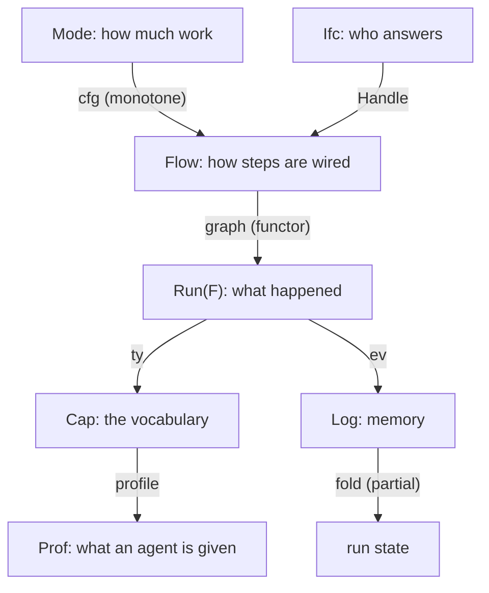
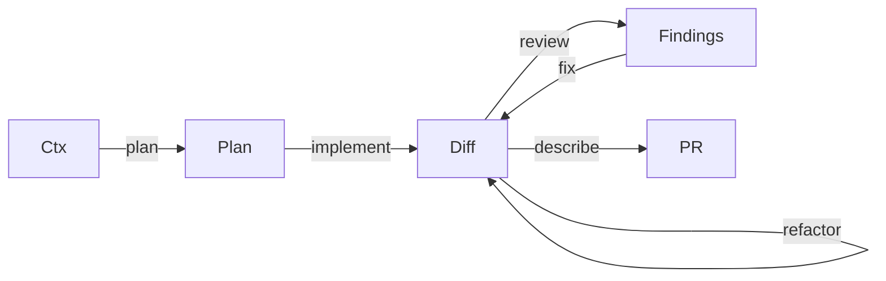
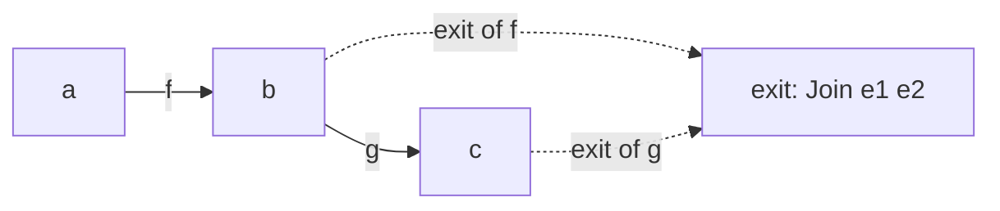
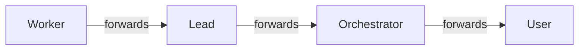
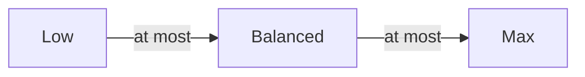
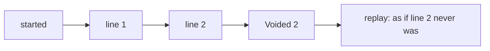
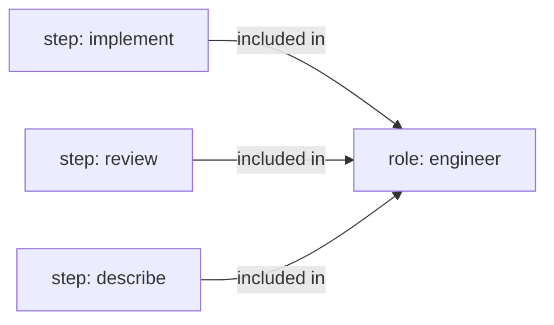
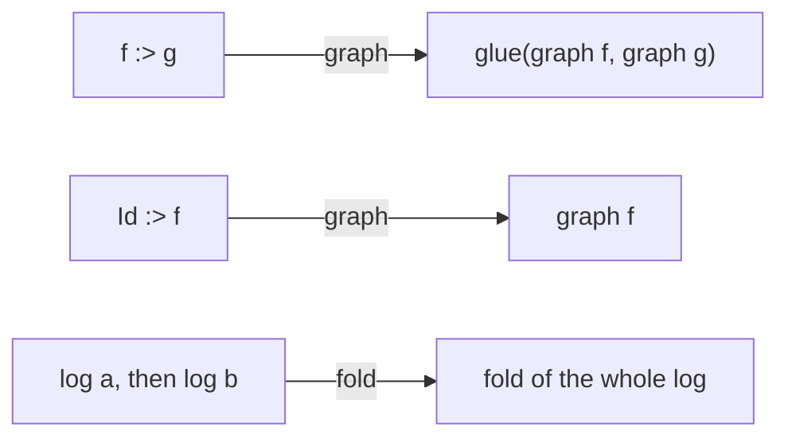
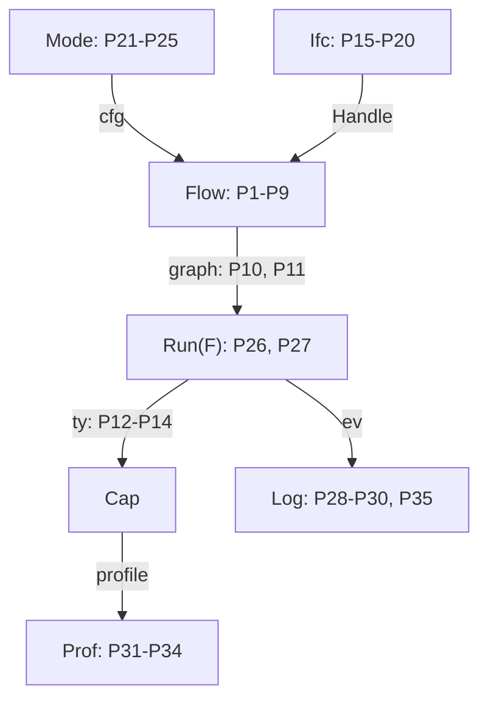

# The category model of claude-kategory

Seven categories, the maps between them, and the laws they give, each with
its test or an honest status. For readers who know basic category theory.
The same system as engineering: [README](README.md),
[ARCHITECTURE](ARCHITECTURE.md), [RUN-LOOP](RUN-LOOP.md), [FLOWS](FLOWS.md),
[GUARDRAILS](GUARDRAILS.md).

## 0 Model at a glance

| Category | Plain words | Objects | Arrows | Identity | Composition |
|---|---|---|---|---|---|
| `Cap` | the vocabulary of work | artifact types `Ctx`, `Plan`, `Diff`, `Findings`, `PR`, `Ticket`, `Result`, lists, labelled sums | paths of outcome edges `step.outcome : A -> B` | the empty path | concatenation |
| `Flow` | how steps are wired | the same types, as ports | flow terms `Flow s i e o` | `Id` | `:>` (series) |
| `Run(F)` | what happened in one run | states of the graph of flow `F` | paths, one edge per event | the empty path | concatenation |
| `Ifc` | who answers a question | one object: a question | handlers `Question -> Either Refusal Verdict` | `forwardAll` | `andThen` |
| `Mode` | how much work | `Low`, `Balanced`, `Max` | `m <= m'` | `m <= m` | transitivity |
| `Log` | memory | one object | lists of log lines | the empty list | concatenation |
| `Prof` | what an agent is given | profiles: sets of tools, skills, operations, prose | inclusion | `P` is included in `P` | transitivity |

The maps, in one line each:

- `graph`: a flow term to the state machine a run walks.
- `ty`: a run read back as a path of typed outcomes.
- `ev`: the run's events, which the log stores; `fold` replays a log into
  the run's state.
- `cfg`: each budget of a flow at one Fuel level.
- `profile`: what a role is given, from the steps it runs.
- `Handle`: an `Ifc` handler around a flow, with no change to its graph.

## 1 Cap: the vocabulary

Some of the engineer's edges. A step's type is its signature:
`implement : Plan -> Diff`, `review : Diff -> Findings`
([Build.hs][build21], [Review.hs][review23]).

- **Objects.** The artifact types of [`TyOf`][ty39]: `Ctx`, `Plan`, `Diff`,
  `Findings`, `PR`, `Ticket`, `Result`, `List t` and labelled sums
  `Sum [(label, t)]`.
- **Arrows.** Paths of outcome edges, [`OutcomeEdge`][step334]: one outcome
  of one step, `step.outcome : dom -> cod`, each edge's `cod` the next one's
  `dom` ([`composes`][flowgen233]).
- **Identity.** The empty path at `A`. A skipped step maps to it
  ([PathSpec.hs:24][path24]).
- **Composition.** Concatenation. `Cap` is the free category on the outcome
  edges.

## 2 Flow: how steps are wired

`f :> g` feeds `f`'s out into `g`; either side may exit early. A wrong wiring
does not compile, and a whole flow has no uncaught exit and no unhandled
effect ([FlowSpec.hs:42][flowspec42]).

| Constructor | Structure | Plain words |
|---|---|---|
| `Case` | copairing over a labelled sum | each summand runs the branch of its label |
| `Exit`, `Catch` | injection into the exit, and the codiagonal `b + b -> b` | leave early, and go on from the exit as if it were the out |
| `Loop` | Elgot iteration, `Loop n f = Catch (f :> Loop n f)` | a loop is its body, then the loop again, until the body exits |
| `Each` | map over a list | the body once per item, in order |
| `Fork`, `Await` | `parallel g f = Each (Fork g f) :> Await g`, a traverse | start child runs, then wait for all of them |
| `Capped` | a budget per Fuel level on one step | at most this many spends, then refuse, stop or ask |
| `Scope` | action of the free monoid of names | the same flow placed twice gets distinct state names |
| `Handle` | removes one effect from the term's effect set | says who answers a pick, a question or a focus wait |

Each has its law in [LawsSpec.hs][laws42].

- **Objects.** The types of `Cap`, as a flow's ports.
- **Arrows.** Terms of the GADT [`Flow s i e o`][flow130]: in port `i`, out
  port `o`, an optional exit `e :: Maybe Ty`, and the term's shape `s`. A step
  is [`Do`][flow134].
- **Identity.** [`Id :: Flow IdS a 'Nothing a`][flow136].
- **Composition.** Series, [`f :> g`][flow144]. The exit of the whole is
  [`Join e1 e2`][flow57]: either side's exit, the same type when both have
  one.

## 3 Run(F): what happened

An engineer run that reviews, fixes once and re-reviews: one edge per event
`state.outcome`, names from [engineer.mmd][golden-engineer]. A log names at
most one such path.

- **Objects.** The states of `graph(F)`: each step's place, plus the in port,
  the out port and the exit ([Graph.hs][graph100]).
- **Arrows.** Paths, one edge per event. The graph maps `(state, event)` to
  one edge, so from a state an event names at most one edge
  ([GraphSpec.hs:62][graph62]).
- **Identity.** The empty path.
- **Composition.** Concatenation. `Run(F)` is the free category on the graph
  of `F` ([Path.hs][path1]).

## 4 Ifc: who answers

A question climbs until a rung may answer it. Which rung may answer which
kind is the exhaustive table [`authority`][ask122].

- **Objects.** One object: a question, of kind `Fact`, `Pick`, `Design`,
  `Scope`, `Confirm`, `Security` or `Stuck` ([Ask.hs:82][ask82]).
- **Arrows.** Handlers, [`Question -> Either Refusal Verdict`][ask307]: a
  rung rules, forwards or refuses. Kleisli arrows of `Either Refusal`.
- **Identity.** [`forwardAll`][ask310]: pass every question on as it came.
- **Composition.** [`andThen`][ask314]: the first rung, then the next on
  what the first forwards.

With one object, `Ifc` is a monoid. In the flow term, a flow's effects are a
type-level set; [`Handle`][effect32] removes one, and a handler draws as the
flow it handles ([LawsSpec.hs:124][laws124]).

## 5 Mode: how much work

`Mode` is a chain: a total order seen as a category. ADR 0018 drew it as
Quality x Size; the code has this one chain (Note N7).

- **Objects.** The Fuel levels `Low`, `Balanced`, `Max`
  ([Fuel.hs:29][fuel29]).
- **Arrows.** One arrow `m -> m'` exactly when `m <= m'`, by the derived
  order `Low < Balanced < Max`.
- **Identity.** `m <= m`.
- **Composition.** Transitivity.

## 6 Log: memory

The log only grows. A line logged in error is cancelled by a later `Voided`
line; replay drops both ([Event.hs:203][event203]). Appending a line whose
id is already logged changes nothing, so a hook record that fires twice is
logged once ([FoldSpec.hs:310][fold310]).

- **Objects.** One object.
- **Arrows.** Finite lists of log lines, [`Envelope`][event89], each holding
  one [`Event`][event114].
- **Identity.** The empty list.
- **Composition.** Concatenation: the free monoid on log lines, up to the
  two facts above.

## 7 Prof: what an agent is given

A role's profile is built from the profiles of the steps it runs, read from
`flows/steps.nix` by [`lib/derive.nix`][derive1]. `Prof` is a preorder with
joins (union).

- **Objects.** Profiles: a set of tools, skills, operations and prose
  fragments.
- **Arrows.** Inclusion: `P -> Q` exactly when every part of `P` is in `Q`.
- **Identity.** `P` is included in `P`.
- **Composition.** Transitivity of inclusion.

## 8 Maps between the categories

| Map | Type | What it is | Evidence |
|---|---|---|---|
| `graph` | `Flow -> Either Clash OpenGraph` | a partial functor into graphs up to isomorphism | P2, P10 |
| `ty` | `[EventName] -> Maybe [OutcomeEdge]` | a partial map from `Run(F)` to `Cap` that keeps the empty walk and prefixes; not a functor | P12, P13, P14 |
| `ev` | a run to its log | not a function in the code | Open |
| `cfg` | `Fuel` to the flow's budgets | a monotone map | P21, P22, P23 |
| `profile` | steps to a role profile | a plain function, checked by Nix; monotone on tools, skills and operations, not prose | P31, P32, P33 |
| `fold` | `Log -> run state` | a partial monoid action | P27, P28, P30 |
| Mermaid render | `OpenGraph -> Text` | a plain function | golden tests |

**graph.** [`graph`][graph139] turns a term into an `OpenGraph`, or refuses it
with a `Clash`: two states of one name, a loop with no cap, a fork with no
await. It sends `Id` to the unit of gluing and `f :> g` to the glue of the
two graphs ([`glue`][graph260]):

- `graph(Id :> f) = graph(f) = graph(f :> Id)` ([LawsSpec.hs:42][laws42]).
- `graph(f :> g) = glue(graph f, graph g)` ([GraphSpec.hs:35][graph35]).

So `graph` is a functor from `Flow` into the Kleisli category of
`Either Clash` over graphs up to isomorphism, the only map here called a
functor.

**ty.** [`ty`][path53] walks the events from the in port and returns each
outcome's edge of `Cap`, or `Nothing` when an event has no edge where the run
is. The empty walk gives the empty path. Every log replay accepts is a
composable path of `Cap` (P13). On two glued graphs, `ty` of a joined walk is
the join of the two `ty`s ([GraphSpec.hs:40][graph40]). It is not a functor:
it always walks from the in port, so a walk that starts mid-flow has no `ty`,
and `ty (p ++ q) = ty p ; ty q` does not typecheck. What holds, for every
generated flow, is that the empty walk maps to the empty path
([PathSpec.hs:42][path42]) and a prefix of a walk to a prefix of its path
([PathSpec.hs:46][path46]).

**ev.** A run's path is a list of events; the log stores it with envelopes.
There is no `ev` function: the log is the path written down.

**cfg.** A flow carries its budgets in the term as [`PerFuel a`][fuel56]
values, one per level; `cfg(m)` reads each at level `m` with
[`atFuel`][fuel59]. It is monotone when each `PerFuel` is: a higher level
allows at least the spends, skips no more, and reviews at least the areas in
full ([`monotone`][fuel72], [`fullReview`][fuel101]). `PerFuel` is a Haskell
`Functor`, but that is the container, not `cfg`.

**profile.** `profile(r)` is the union of the tools, skills, operations and
prose of the steps role `r` runs; for a split role, the prose is the
intersection ([derive.nix:1][derive1]). Nix assertions check every role
(P31, P32). Tools, skills and operations are unions, so a step more never
gives fewer: the check removes each row of the table in turn and finds nothing
new ([derive.nix:134][derive134]), and union makes any smaller table follow
(P33). Prose is not monotone: a split role is given only the prose every step
needs, so a step more may give less.

**fold.** [`replay`][fold337] reads a non-empty log that starts with
`started`; [`fold`][fold378] reads more lines onto a state. Both may refuse
(`Either Refusal`), so `fold` is a partial monoid action of `Log` on run
states: `fold (a <> b) = fold a >=> fold b` ([FoldSpec.hs:458][fold458]).

**Mermaid render.** [`mermaid`][mermaid18] prints a graph as a Mermaid state
diagram, pinned by golden files ([MermaidSpec.hs:18][mermaidspec18]).

## 9 Properties

Laws between flow terms hold up to graph isomorphism, or up to bisimulation
where a law copies a subterm: a run walks the same names and events from the
start on either side. Terms are never compared as syntax
([LawsSpec.hs][laws-header]).

Status is one of: `Holds (<test>)`, `Holds if <condition>`,
`Needs <test> (#499)`, `Assumed`. Ids are stable.

| # | Property | Statement | Status |
|---|---|---|---|
| P1 | Typed gluing | `f :> g` compiles only when `f`'s out is `g`'s in; a whole flow has no uncaught exit and no unhandled effect | Holds ([FlowSpec.hs:42][flowspec42]) |
| P2 | Identity | `Id :> f = f = f :> Id`: adding a do-nothing step changes no graph | Holds ([LawsSpec.hs:42][laws42]) |
| P3 | Associativity | `(f :> g) :> h = f :> (g :> h)`: grouping a series changes no graph | Holds ([LawsSpec.hs:50][laws50]) |
| P4 | Case beta and fusion | a summand walks as its branch; `Case bs :> h = Case (each b :> h)` | Holds ([LawsSpec.hs:63][laws63], [LawsSpec.hs:70][laws70]) |
| P5 | Codiagonal | `Catch Exit = Id`; `Catch` moves past a side with no exit and into a case | Holds ([LawsSpec.hs:79][laws79], [LawsSpec.hs:87][laws87]) |
| P6 | Elgot fixpoint | `Loop n f = Catch (f :> Loop n f)`: a loop walks as its body unrolled once | Holds ([LawsSpec.hs:95][laws95]) |
| P7 | Parallel draws one graph | `parallel g Id`, `parallel g f` and `parallel g (f :> h)` draw the same parent graph | Holds ([LawsSpec.hs:119][laws119]) |
| P8 | Scope is an action | `Scope s (f :> g) = Scope s f :> Scope s g`; `Scope s (Scope t f) = Scope (s/t) f` | Holds ([LawsSpec.hs:134][laws134], [LawsSpec.hs:147][laws147]) |
| P9 | Handler is invisible to the graph | `Handle h f` draws as `f` | Holds ([LawsSpec.hs:124][laws124]) |
| P10 | graph preserves series | `graph(f :> g)` is the glue of `graph f` and `graph g` | Holds ([GraphSpec.hs:35][graph35]) |
| P11 | Deterministic | from a state, an event names at most one edge | Holds ([GraphSpec.hs:62][graph62]) |
| P12 | Skip is endo | a skipped step maps to the identity of `Cap` | Holds ([PathSpec.hs:24][path24]) |
| P13 | Trace soundness | every log replay accepts is a composable path of `Cap` | Holds if the flow is engineer ([FoldSpec.hs:203][fold203]); a walk through a fork may not compose (N12) |
| P14 | ty keeps unit and prefixes | `ty [] = Just []`, and `ty p` is a prefix of `ty (p ++ q)`, for every generated flow. Not a functor law: `ty` walks from the in port (N5) | Holds ([PathSpec.hs:42][path42], [PathSpec.hs:46][path46]) |
| P15 | Forward is identity | `forwardAll andThen h = h = h andThen forwardAll` | Holds ([AskSpec.hs:22][askspec22]) |
| P16 | Handlers associate | `(a andThen b) andThen c = a andThen (b andThen c)` | Holds ([AskSpec.hs:43][askspec43]) |
| P17 | Chain | the parent rules on what the child forwards, raised to the child's reading | Holds ([AskSpec.hs:32][askspec32]) |
| P18 | Ceiling | no event lowers a `Security` question; a `Security` ruling names its basis | Holds ([AskSpec.hs:49][askspec49], [AskSpec.hs:57][askspec57]) |
| P19 | Total asks | every question ends answered or stopped | Holds ([FoldSpec.hs:1059][fold1059]) |
| P20 | Principal-blind | the advice is the same whoever started the run, up to delivery | Holds ([AdviceSpec.hs:44][advice44]) |
| P21 | Monotone budgets | each Fuel level allows at least the spends and runs of the level below | Holds ([LawsSpec.hs:158][laws158]) |
| P22 | Monotone budgets, every flow | P21 for every flow in `State.Role.roles`: engineer, 10x, architect and chief, and any flow added there | Holds ([LawsSpec.hs:158][laws158]) |
| P23 | Monotone full review | each level reviews in full at least the areas of the level below | Holds ([FuelSpec.hs:52][fuel52]) |
| P24 | Keep | the engineer flow: no Fuel level skips `review` or `describe`. The 10x flow: no level skips `engineers` or `merge`, and each engineer runs the engineer flow | Holds ([EngineerSpec.hs:19][eng19], [TenXSpec.hs:22][tenx22], [TenXSpec.hs:28][tenx28]) |
| P25 | Keep, full | in every flow of `State.Role.roles`, no Fuel skip names `review` (where the security review runs), `re_review` (blockers), `research` (fact research), `describe` or `simplify_pr` (the final fixer). A flow without one of these steps holds it vacuously | Holds ([LawsSpec.hs:163][laws163]) |
| P26 | Bounded | no run spends past a cap; a loop whose body caps no step is refused | Holds ([FoldSpec.hs:228][fold228], [GraphSpec.hs:74][graph74]) |
| P27 | Stuck | the same problems in a loop's last two rounds in a row mark it stuck, and the run asks a `Stuck` question | Holds ([FoldSpec.hs:267][fold267]) |
| P28 | Log is a fold | replaying a prefix, then the rest, is replaying the whole | Holds ([FoldSpec.hs:458][fold458], [FoldSpec.hs:338][fold338]) |
| P29 | Append is idempotent | appending a line already logged changes nothing | Holds ([FoldSpec.hs:310][fold310]) |
| P30 | Void | a voided line replays as if it was never logged | Holds ([FoldSpec.hs:436][fold436]) |
| P31 | Sufficient | a role holds every tool, skill, operation and prose its steps need | Holds ([derive.nix:106][derive106]) |
| P32 | Lean | a role holds nothing its steps do not need | Holds ([derive.nix:109][derive109]) |
| P33 | profile is monotone | more steps never give a role fewer tools, skills or operations; prose is excluded, as a split role's prose is an intersection | Holds ([derive.nix:134][derive134]) |
| P34 | Budget | each role's preloaded prose stays under its ceiling | Holds ([config-check.nix:148][configcheck148], `budget-compare` from [budget/default.nix:16][budget16]) |
| P35 | One writer | only the kernel appends to a run's log | Assumed: only `Effects.Store` inserts events ([Store.hs:93][store93]), but nothing stops another writer, such as `sqlite3` on the database (N13) |

## 10 Notes

Each note is verified against the code.

| Note | On | Says |
|---|---|---|
| N1 | P2 to P10 | Laws compare graphs, not terms: up to isomorphism, or bisimulation where a law copies a subterm, as the header of [LawsSpec.hs][laws-header] says. |
| N2 | P3 | Associativity is tested on generated triples that `graph` accepts; a triple that clashes is filtered out ([LawsSpec.hs:50][laws50]). |
| N3 | P4 | Case eta is not expressible: the core has no injection, and a flow out of a sum is already a `Case` ([LawsSpec.hs:58][laws58]). |
| N4 | P7 | `parallel g (f :> h) = parallel g f :> parallel g' h` holds of the children's runs, not of a graph, and is not tested as such ([LawsSpec.hs:110][laws110]). |
| N5 | P10, P14 | `graph` is partial: it refuses terms with a `Clash` ([GraphSpec.hs:70][graph70]). `ty` is not a functor: it walks from the in port, so only walks from the start have a `ty`. Its tests pin the empty walk, prefixes, glued walks and accepted logs. |
| N6 | P21, P22 | The monotone test reads every flow in `State.Role.roles`, one per `FlowName`, so a new flow is covered with no edit ([LawsSpec.hs:159][laws159]). |
| N7 | P21 | ADR 0018 drew `Mode` as Quality x Size. The code has one order, `Low < Balanced < Max` ([Fuel.hs:29][fuel29]); ADR 0018's text said so until #499, which drew `Mode` as this chain. |
| N8 | P27 | Only two rounds in a row count: rounds that alternate A, B, A, B are not stuck, on purpose, and the loop's cap ends them ([Fold.hs:1424][fold1424]). |
| N9 | P28, P29, P30 | `fold` is partial, not total: replay needs a non-empty log whose first line is `started` ([FoldSpec.hs:465][fold465]), and an event with no edge where the run is is refused ([Fold.hs:520][fold520]). Since #499, ADR 0014 states the unit as the `started` line and totality as `applyEvent` returning a `Refusal` value, never a throw. |
| N10 | P29 | The log is a free monoid only up to ids. A line whose id is already logged is `AlreadyLogged`, so a hook record that fires twice is logged once ([FoldSpec.hs:317][fold317]). |
| N11 | P31, P32, P34 | Nix assertions over the real step table and roles, run as checks (`derived-roles` in [`programs/agents/default.nix`][agents248]), not property tests over generated input. |
| N12 | P13, P14 | The prefix property's walks can pass a fork: there `ty` returns the spawn edge typed by one child (`Ctx -> Ctx`) between the fan-out's `List` edges, so that path does not compose. P13 is tested on the engineer flow ([FoldSpec.hs:203][fold203]), and the prefix test does not assert composition. |
| N13 | P35 | The log is one SQLite database (ADR 0022). The kernel writes it through one insert ([Store.hs:93][store93]); no hook, permission or architecture rule stops an agent writing it another way. |

## 11 Open in the model

| Open | Tracked |
|---|---|
| One writer for the log is assumed, not enforced | P35, N13 |
| `ty` composes only on walks with no fork | P13, N12 |
| `profile`'s prose is not monotone for split roles | P33 |
| `ev` has no code: the log is the path written down. Naming it a map adds nothing until something consumes it | - |
| ADR 0018 names `Ifc` "the operations a role may call". The code splits it in two: a type-level effect set that `Handle` discharges, and the runtime handler monoid of section 4 | - |

## 12 About this document

Ground rules it keeps:

- The least structure that works. A thing is called a functor only if a test
  checks that it is one. Here only `graph` is.
- Every claim is a test, or it is labelled `Needs` or `Assumed`.
- Verified facts and assumptions are kept apart.
- Plain words first, symbols second. Each formula has a plain-English twin.

The design lives in [ADR 0018](../adr/0018-category-model-haskell-state.md),
[ADR 0019](../adr/0019-composable-flows.md),
[ADR 0020](../adr/0020-flow-core-from-sums-and-elgot.md) and
[ADR 0021](../adr/0021-flow-effects.md); the event log in
[ADR 0014](../adr/0014-pure-core-event-sourced-flow.md) and
[ADR 0022](../adr/0022-sqlite-run-store.md). This document does not repeat
them. Code paths are under `programs/agents/kernel` unless they say
otherwise, pinned to the commit this document was checked against.

[laws-header]: https://github.com/ILIYANGERMANOV/nixos/blob/2c6ba6df6c2a9cc70bbd299cdbd8efd1b6df1edc/programs/agents/kernel/test/State/Category/LawsSpec.hs#L1
[laws42]: https://github.com/ILIYANGERMANOV/nixos/blob/2c6ba6df6c2a9cc70bbd299cdbd8efd1b6df1edc/programs/agents/kernel/test/State/Category/LawsSpec.hs#L42
[laws50]: https://github.com/ILIYANGERMANOV/nixos/blob/2c6ba6df6c2a9cc70bbd299cdbd8efd1b6df1edc/programs/agents/kernel/test/State/Category/LawsSpec.hs#L50
[laws58]: https://github.com/ILIYANGERMANOV/nixos/blob/2c6ba6df6c2a9cc70bbd299cdbd8efd1b6df1edc/programs/agents/kernel/test/State/Category/LawsSpec.hs#L58
[laws63]: https://github.com/ILIYANGERMANOV/nixos/blob/2c6ba6df6c2a9cc70bbd299cdbd8efd1b6df1edc/programs/agents/kernel/test/State/Category/LawsSpec.hs#L63
[laws70]: https://github.com/ILIYANGERMANOV/nixos/blob/2c6ba6df6c2a9cc70bbd299cdbd8efd1b6df1edc/programs/agents/kernel/test/State/Category/LawsSpec.hs#L70
[laws79]: https://github.com/ILIYANGERMANOV/nixos/blob/2c6ba6df6c2a9cc70bbd299cdbd8efd1b6df1edc/programs/agents/kernel/test/State/Category/LawsSpec.hs#L79
[laws87]: https://github.com/ILIYANGERMANOV/nixos/blob/2c6ba6df6c2a9cc70bbd299cdbd8efd1b6df1edc/programs/agents/kernel/test/State/Category/LawsSpec.hs#L87
[laws95]: https://github.com/ILIYANGERMANOV/nixos/blob/2c6ba6df6c2a9cc70bbd299cdbd8efd1b6df1edc/programs/agents/kernel/test/State/Category/LawsSpec.hs#L95
[laws110]: https://github.com/ILIYANGERMANOV/nixos/blob/2c6ba6df6c2a9cc70bbd299cdbd8efd1b6df1edc/programs/agents/kernel/test/State/Category/LawsSpec.hs#L110
[laws119]: https://github.com/ILIYANGERMANOV/nixos/blob/2c6ba6df6c2a9cc70bbd299cdbd8efd1b6df1edc/programs/agents/kernel/test/State/Category/LawsSpec.hs#L119
[laws124]: https://github.com/ILIYANGERMANOV/nixos/blob/2c6ba6df6c2a9cc70bbd299cdbd8efd1b6df1edc/programs/agents/kernel/test/State/Category/LawsSpec.hs#L124
[laws134]: https://github.com/ILIYANGERMANOV/nixos/blob/2c6ba6df6c2a9cc70bbd299cdbd8efd1b6df1edc/programs/agents/kernel/test/State/Category/LawsSpec.hs#L134
[laws147]: https://github.com/ILIYANGERMANOV/nixos/blob/2c6ba6df6c2a9cc70bbd299cdbd8efd1b6df1edc/programs/agents/kernel/test/State/Category/LawsSpec.hs#L147
[laws158]: https://github.com/ILIYANGERMANOV/nixos/blob/badb822f39ce44fc0e3f654582a5bd4d3cf334ba/programs/agents/kernel/test/State/Category/LawsSpec.hs#L158
[laws159]: https://github.com/ILIYANGERMANOV/nixos/blob/badb822f39ce44fc0e3f654582a5bd4d3cf334ba/programs/agents/kernel/test/State/Category/LawsSpec.hs#L159
[laws163]: https://github.com/ILIYANGERMANOV/nixos/blob/badb822f39ce44fc0e3f654582a5bd4d3cf334ba/programs/agents/kernel/test/State/Category/LawsSpec.hs#L163
[graph35]: https://github.com/ILIYANGERMANOV/nixos/blob/2c6ba6df6c2a9cc70bbd299cdbd8efd1b6df1edc/programs/agents/kernel/test/State/Category/GraphSpec.hs#L35
[graph40]: https://github.com/ILIYANGERMANOV/nixos/blob/2c6ba6df6c2a9cc70bbd299cdbd8efd1b6df1edc/programs/agents/kernel/test/State/Category/GraphSpec.hs#L40
[graph62]: https://github.com/ILIYANGERMANOV/nixos/blob/2c6ba6df6c2a9cc70bbd299cdbd8efd1b6df1edc/programs/agents/kernel/test/State/Category/GraphSpec.hs#L62
[graph70]: https://github.com/ILIYANGERMANOV/nixos/blob/2c6ba6df6c2a9cc70bbd299cdbd8efd1b6df1edc/programs/agents/kernel/test/State/Category/GraphSpec.hs#L70
[graph74]: https://github.com/ILIYANGERMANOV/nixos/blob/2c6ba6df6c2a9cc70bbd299cdbd8efd1b6df1edc/programs/agents/kernel/test/State/Category/GraphSpec.hs#L74
[path42]: https://github.com/ILIYANGERMANOV/nixos/blob/badb822f39ce44fc0e3f654582a5bd4d3cf334ba/programs/agents/kernel/test/State/Category/PathSpec.hs#L42
[path46]: https://github.com/ILIYANGERMANOV/nixos/blob/badb822f39ce44fc0e3f654582a5bd4d3cf334ba/programs/agents/kernel/test/State/Category/PathSpec.hs#L46
[path24]: https://github.com/ILIYANGERMANOV/nixos/blob/2c6ba6df6c2a9cc70bbd299cdbd8efd1b6df1edc/programs/agents/kernel/test/State/Category/PathSpec.hs#L24
[flowspec42]: https://github.com/ILIYANGERMANOV/nixos/blob/2c6ba6df6c2a9cc70bbd299cdbd8efd1b6df1edc/programs/agents/kernel/test/State/Category/FlowSpec.hs#L42
[fuel52]: https://github.com/ILIYANGERMANOV/nixos/blob/2c6ba6df6c2a9cc70bbd299cdbd8efd1b6df1edc/programs/agents/kernel/test/State/Category/FuelSpec.hs#L52
[flowgen233]: https://github.com/ILIYANGERMANOV/nixos/blob/2c6ba6df6c2a9cc70bbd299cdbd8efd1b6df1edc/programs/agents/kernel/test/State/Category/FlowGen.hs#L233
[fold203]: https://github.com/ILIYANGERMANOV/nixos/blob/2c6ba6df6c2a9cc70bbd299cdbd8efd1b6df1edc/programs/agents/kernel/test/State/Run/FoldSpec.hs#L203
[fold228]: https://github.com/ILIYANGERMANOV/nixos/blob/2c6ba6df6c2a9cc70bbd299cdbd8efd1b6df1edc/programs/agents/kernel/test/State/Run/FoldSpec.hs#L228
[fold267]: https://github.com/ILIYANGERMANOV/nixos/blob/2c6ba6df6c2a9cc70bbd299cdbd8efd1b6df1edc/programs/agents/kernel/test/State/Run/FoldSpec.hs#L267
[fold310]: https://github.com/ILIYANGERMANOV/nixos/blob/2c6ba6df6c2a9cc70bbd299cdbd8efd1b6df1edc/programs/agents/kernel/test/State/Run/FoldSpec.hs#L310
[fold317]: https://github.com/ILIYANGERMANOV/nixos/blob/2c6ba6df6c2a9cc70bbd299cdbd8efd1b6df1edc/programs/agents/kernel/test/State/Run/FoldSpec.hs#L317
[fold338]: https://github.com/ILIYANGERMANOV/nixos/blob/2c6ba6df6c2a9cc70bbd299cdbd8efd1b6df1edc/programs/agents/kernel/test/State/Run/FoldSpec.hs#L338
[fold436]: https://github.com/ILIYANGERMANOV/nixos/blob/2c6ba6df6c2a9cc70bbd299cdbd8efd1b6df1edc/programs/agents/kernel/test/State/Run/FoldSpec.hs#L436
[fold458]: https://github.com/ILIYANGERMANOV/nixos/blob/2c6ba6df6c2a9cc70bbd299cdbd8efd1b6df1edc/programs/agents/kernel/test/State/Run/FoldSpec.hs#L458
[fold465]: https://github.com/ILIYANGERMANOV/nixos/blob/2c6ba6df6c2a9cc70bbd299cdbd8efd1b6df1edc/programs/agents/kernel/test/State/Run/FoldSpec.hs#L465
[fold1059]: https://github.com/ILIYANGERMANOV/nixos/blob/2c6ba6df6c2a9cc70bbd299cdbd8efd1b6df1edc/programs/agents/kernel/test/State/Run/FoldSpec.hs#L1059
[askspec22]: https://github.com/ILIYANGERMANOV/nixos/blob/2c6ba6df6c2a9cc70bbd299cdbd8efd1b6df1edc/programs/agents/kernel/test/State/Run/AskSpec.hs#L22
[askspec32]: https://github.com/ILIYANGERMANOV/nixos/blob/2c6ba6df6c2a9cc70bbd299cdbd8efd1b6df1edc/programs/agents/kernel/test/State/Run/AskSpec.hs#L32
[askspec43]: https://github.com/ILIYANGERMANOV/nixos/blob/2c6ba6df6c2a9cc70bbd299cdbd8efd1b6df1edc/programs/agents/kernel/test/State/Run/AskSpec.hs#L43
[askspec49]: https://github.com/ILIYANGERMANOV/nixos/blob/2c6ba6df6c2a9cc70bbd299cdbd8efd1b6df1edc/programs/agents/kernel/test/State/Run/AskSpec.hs#L49
[askspec57]: https://github.com/ILIYANGERMANOV/nixos/blob/2c6ba6df6c2a9cc70bbd299cdbd8efd1b6df1edc/programs/agents/kernel/test/State/Run/AskSpec.hs#L57
[advice44]: https://github.com/ILIYANGERMANOV/nixos/blob/2c6ba6df6c2a9cc70bbd299cdbd8efd1b6df1edc/programs/agents/kernel/test/State/Protocol/AdviceSpec.hs#L44
[eng19]: https://github.com/ILIYANGERMANOV/nixos/blob/2c6ba6df6c2a9cc70bbd299cdbd8efd1b6df1edc/programs/agents/kernel/test/State/Flow/EngineerSpec.hs#L19
[tenx22]: https://github.com/ILIYANGERMANOV/nixos/blob/2c6ba6df6c2a9cc70bbd299cdbd8efd1b6df1edc/programs/agents/kernel/test/State/Flow/TenXSpec.hs#L22
[tenx28]: https://github.com/ILIYANGERMANOV/nixos/blob/2c6ba6df6c2a9cc70bbd299cdbd8efd1b6df1edc/programs/agents/kernel/test/State/Flow/TenXSpec.hs#L28
[mermaidspec18]: https://github.com/ILIYANGERMANOV/nixos/blob/2c6ba6df6c2a9cc70bbd299cdbd8efd1b6df1edc/programs/agents/kernel/test/State/Cli/Render/MermaidSpec.hs#L18
[ty39]: https://github.com/ILIYANGERMANOV/nixos/blob/2c6ba6df6c2a9cc70bbd299cdbd8efd1b6df1edc/programs/agents/kernel/src/State/Category/Ty.hs#L39
[step334]: https://github.com/ILIYANGERMANOV/nixos/blob/2c6ba6df6c2a9cc70bbd299cdbd8efd1b6df1edc/programs/agents/kernel/src/State/Category/Step.hs#L334
[build21]: https://github.com/ILIYANGERMANOV/nixos/blob/2c6ba6df6c2a9cc70bbd299cdbd8efd1b6df1edc/programs/agents/kernel/src/State/Step/Build.hs#L21
[review23]: https://github.com/ILIYANGERMANOV/nixos/blob/2c6ba6df6c2a9cc70bbd299cdbd8efd1b6df1edc/programs/agents/kernel/src/State/Step/Review.hs#L23
[flow57]: https://github.com/ILIYANGERMANOV/nixos/blob/2c6ba6df6c2a9cc70bbd299cdbd8efd1b6df1edc/programs/agents/kernel/src/State/Category/Flow.hs#L57
[flow130]: https://github.com/ILIYANGERMANOV/nixos/blob/2c6ba6df6c2a9cc70bbd299cdbd8efd1b6df1edc/programs/agents/kernel/src/State/Category/Flow.hs#L130
[flow134]: https://github.com/ILIYANGERMANOV/nixos/blob/2c6ba6df6c2a9cc70bbd299cdbd8efd1b6df1edc/programs/agents/kernel/src/State/Category/Flow.hs#L134
[flow136]: https://github.com/ILIYANGERMANOV/nixos/blob/2c6ba6df6c2a9cc70bbd299cdbd8efd1b6df1edc/programs/agents/kernel/src/State/Category/Flow.hs#L136
[flow144]: https://github.com/ILIYANGERMANOV/nixos/blob/2c6ba6df6c2a9cc70bbd299cdbd8efd1b6df1edc/programs/agents/kernel/src/State/Category/Flow.hs#L144
[effect32]: https://github.com/ILIYANGERMANOV/nixos/blob/2c6ba6df6c2a9cc70bbd299cdbd8efd1b6df1edc/programs/agents/kernel/src/State/Category/Effect.hs#L32
[graph100]: https://github.com/ILIYANGERMANOV/nixos/blob/2c6ba6df6c2a9cc70bbd299cdbd8efd1b6df1edc/programs/agents/kernel/src/State/Category/Graph.hs#L100
[graph139]: https://github.com/ILIYANGERMANOV/nixos/blob/2c6ba6df6c2a9cc70bbd299cdbd8efd1b6df1edc/programs/agents/kernel/src/State/Category/Graph.hs#L139
[graph260]: https://github.com/ILIYANGERMANOV/nixos/blob/2c6ba6df6c2a9cc70bbd299cdbd8efd1b6df1edc/programs/agents/kernel/src/State/Category/Graph.hs#L260
[path1]: https://github.com/ILIYANGERMANOV/nixos/blob/2c6ba6df6c2a9cc70bbd299cdbd8efd1b6df1edc/programs/agents/kernel/src/State/Category/Path.hs#L1
[path53]: https://github.com/ILIYANGERMANOV/nixos/blob/2c6ba6df6c2a9cc70bbd299cdbd8efd1b6df1edc/programs/agents/kernel/src/State/Category/Path.hs#L53
[fuel29]: https://github.com/ILIYANGERMANOV/nixos/blob/2c6ba6df6c2a9cc70bbd299cdbd8efd1b6df1edc/programs/agents/kernel/src/State/Category/Fuel.hs#L29
[fuel56]: https://github.com/ILIYANGERMANOV/nixos/blob/2c6ba6df6c2a9cc70bbd299cdbd8efd1b6df1edc/programs/agents/kernel/src/State/Category/Fuel.hs#L56
[fuel59]: https://github.com/ILIYANGERMANOV/nixos/blob/2c6ba6df6c2a9cc70bbd299cdbd8efd1b6df1edc/programs/agents/kernel/src/State/Category/Fuel.hs#L59
[fuel72]: https://github.com/ILIYANGERMANOV/nixos/blob/2c6ba6df6c2a9cc70bbd299cdbd8efd1b6df1edc/programs/agents/kernel/src/State/Category/Fuel.hs#L72
[fuel101]: https://github.com/ILIYANGERMANOV/nixos/blob/2c6ba6df6c2a9cc70bbd299cdbd8efd1b6df1edc/programs/agents/kernel/src/State/Category/Fuel.hs#L101
[ask82]: https://github.com/ILIYANGERMANOV/nixos/blob/2c6ba6df6c2a9cc70bbd299cdbd8efd1b6df1edc/programs/agents/kernel/src/State/Run/Ask.hs#L82
[ask122]: https://github.com/ILIYANGERMANOV/nixos/blob/2c6ba6df6c2a9cc70bbd299cdbd8efd1b6df1edc/programs/agents/kernel/src/State/Run/Ask.hs#L122
[ask307]: https://github.com/ILIYANGERMANOV/nixos/blob/2c6ba6df6c2a9cc70bbd299cdbd8efd1b6df1edc/programs/agents/kernel/src/State/Run/Ask.hs#L307
[ask310]: https://github.com/ILIYANGERMANOV/nixos/blob/2c6ba6df6c2a9cc70bbd299cdbd8efd1b6df1edc/programs/agents/kernel/src/State/Run/Ask.hs#L310
[ask314]: https://github.com/ILIYANGERMANOV/nixos/blob/2c6ba6df6c2a9cc70bbd299cdbd8efd1b6df1edc/programs/agents/kernel/src/State/Run/Ask.hs#L314
[event89]: https://github.com/ILIYANGERMANOV/nixos/blob/2c6ba6df6c2a9cc70bbd299cdbd8efd1b6df1edc/programs/agents/kernel/src/State/Run/Event.hs#L89
[event114]: https://github.com/ILIYANGERMANOV/nixos/blob/2c6ba6df6c2a9cc70bbd299cdbd8efd1b6df1edc/programs/agents/kernel/src/State/Run/Event.hs#L114
[event203]: https://github.com/ILIYANGERMANOV/nixos/blob/2c6ba6df6c2a9cc70bbd299cdbd8efd1b6df1edc/programs/agents/kernel/src/State/Run/Event.hs#L203
[fold337]: https://github.com/ILIYANGERMANOV/nixos/blob/2c6ba6df6c2a9cc70bbd299cdbd8efd1b6df1edc/programs/agents/kernel/src/State/Run/Fold.hs#L337
[fold378]: https://github.com/ILIYANGERMANOV/nixos/blob/2c6ba6df6c2a9cc70bbd299cdbd8efd1b6df1edc/programs/agents/kernel/src/State/Run/Fold.hs#L378
[fold520]: https://github.com/ILIYANGERMANOV/nixos/blob/2c6ba6df6c2a9cc70bbd299cdbd8efd1b6df1edc/programs/agents/kernel/src/State/Run/Fold.hs#L520
[fold1424]: https://github.com/ILIYANGERMANOV/nixos/blob/2c6ba6df6c2a9cc70bbd299cdbd8efd1b6df1edc/programs/agents/kernel/src/State/Run/Fold.hs#L1424
[mermaid18]: https://github.com/ILIYANGERMANOV/nixos/blob/2c6ba6df6c2a9cc70bbd299cdbd8efd1b6df1edc/programs/agents/kernel/src/State/Cli/Render/Mermaid.hs#L18
[derive1]: https://github.com/ILIYANGERMANOV/nixos/blob/2c6ba6df6c2a9cc70bbd299cdbd8efd1b6df1edc/programs/agents/lib/derive.nix#L1
[derive106]: https://github.com/ILIYANGERMANOV/nixos/blob/2c6ba6df6c2a9cc70bbd299cdbd8efd1b6df1edc/programs/agents/lib/derive.nix#L106
[derive134]: https://github.com/ILIYANGERMANOV/nixos/blob/badb822f39ce44fc0e3f654582a5bd4d3cf334ba/programs/agents/lib/derive.nix#L134
[derive109]: https://github.com/ILIYANGERMANOV/nixos/blob/2c6ba6df6c2a9cc70bbd299cdbd8efd1b6df1edc/programs/agents/lib/derive.nix#L109
[agents248]: https://github.com/ILIYANGERMANOV/nixos/blob/2c6ba6df6c2a9cc70bbd299cdbd8efd1b6df1edc/programs/agents/default.nix#L248
[configcheck148]: https://github.com/ILIYANGERMANOV/nixos/blob/badb822f39ce44fc0e3f654582a5bd4d3cf334ba/programs/claude-code/config-check.nix#L148
[store93]: https://github.com/ILIYANGERMANOV/nixos/blob/badb822f39ce44fc0e3f654582a5bd4d3cf334ba/programs/agents/kernel/src/Effects/Store.hs#L93
[budget16]: https://github.com/ILIYANGERMANOV/nixos/blob/2c6ba6df6c2a9cc70bbd299cdbd8efd1b6df1edc/programs/claude-code/budget/default.nix#L16
[golden-engineer]: https://github.com/ILIYANGERMANOV/nixos/blob/2c6ba6df6c2a9cc70bbd299cdbd8efd1b6df1edc/programs/agents/kernel/test/golden/engineer.mmd
