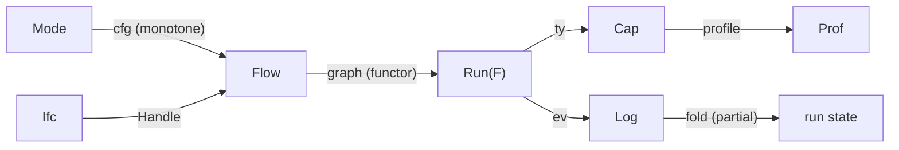
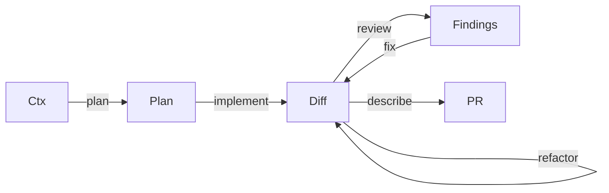
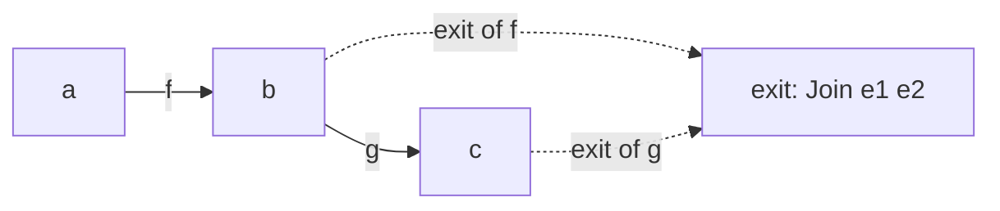
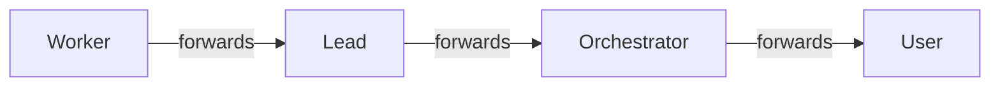
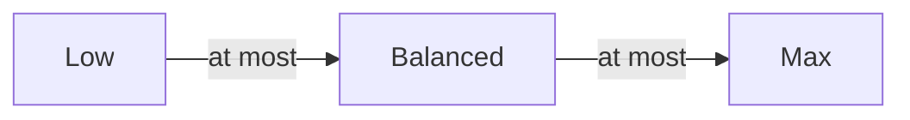
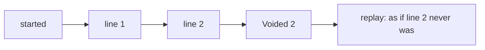
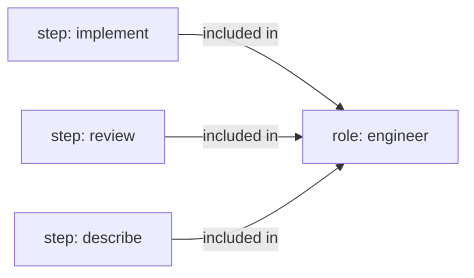

# The category model of claude-kategory

This document states the mathematics behind the harness: the seven categories
it uses, the maps between them, and the properties they give, each with its
test or an honest status. It is for readers who know basic category theory.
The other docs in this folder explain the same system as engineering:
[README](README.md), [ARCHITECTURE](ARCHITECTURE.md), [RUN-LOOP](RUN-LOOP.md),
[FLOWS](FLOWS.md), [GUARDRAILS](GUARDRAILS.md).

Ground rules this document keeps:

- The least structure that works. A thing is called a functor only if a test
  checks that it is one. Here only `graph` is.
- Every claim is a test, or it is labelled `Needs` or `Assumed`.
- Verified facts and assumptions are kept apart.
- Plain words first, symbols second. Each formula has a plain-English twin.

The design lives in [ADR 0018](../adr/0018-category-model-haskell-state.md),
[ADR 0019](../adr/0019-composable-flows.md),
[ADR 0020](../adr/0020-flow-core-from-sums-and-elgot.md) and
[ADR 0021](../adr/0021-flow-effects.md); the event log in
[ADR 0014](../adr/0014-pure-core-event-sourced-flow.md) and
[ADR 0022](../adr/0022-sqlite-run-store.md). This document does not repeat
them. Code paths below are under `programs/agents/kernel` unless they say
otherwise, pinned to the commit this document was checked against.

**Equality.** A law between two flow terms holds up to graph isomorphism
(where a state sits in the term does not count), or, where the law copies a
subterm, up to bisimulation: a run walks the same names and events from the
start on either side. Terms are never compared as syntax. This is stated at
the top of [LawsSpec.hs][laws-header].

## 0 Model at a glance

| Category | Objects | Arrows | Identity | Composition | Plain words |
|---|---|---|---|---|---|
| `Cap` | artifact types `Ctx`, `Plan`, `Diff`, `Findings`, `PR`, `Ticket`, `Result`, lists, labelled sums | paths of outcome edges `step.outcome : A -> B` | the empty path | concatenation | the vocabulary of work |
| `Flow` | the same types, as ports | flow terms `Flow s i e o` | `Id` | `:>` (series) | how steps are wired |
| `Run(F)` | states of the graph of flow `F` | paths, one edge per event | the empty path | concatenation | what happened in one run |
| `Ifc` | one object: a question | handlers `Question -> Either Refusal Verdict` | `forwardAll` | `andThen` | who answers a question |
| `Mode` | `Low`, `Balanced`, `Max` | `m <= m'` | `m <= m` | transitivity | how much work |
| `Log` | one object | lists of log lines | the empty list | concatenation | memory |
| `Prof` | profiles: sets of tools, skills, operations, prose | inclusion | `P` is included in `P` | transitivity | what an agent is given |

The maps between them:

In words: `graph` turns a flow term into the state machine a run walks. `ty`
reads a run back as a path of typed outcomes. `ev` is the run's list of
events, which the log stores; `fold` replays a log into the run's state.
`cfg` picks each budget of a flow at a Fuel level. `profile` derives what a
role is given from the steps it runs. `Handle` puts an `Ifc` handler around a
flow without changing its graph.

## 1 Cap: the vocabulary

- **Objects.** The artifact types of [`TyOf`][ty39]: `Ctx`, `Plan`, `Diff`,
  `Findings`, `PR`, `Ticket`, `Result`, `List t` and labelled sums
  `Sum [(label, t)]`.
- **Arrows.** Generated by outcome edges, [`OutcomeEdge`][step334]: one
  outcome of one step, `step.outcome : dom -> cod`. An arrow is a path of such
  edges where each edge's `cod` is the next one's `dom`
  ([`composes`][flowgen233]).
- **Identity.** The empty path at `A`. A skipped step maps to it
  ([PathSpec.hs:24][path24]).
- **Composition.** Concatenation of paths. `Cap` is the free category on the
  outcome edges.

A step's type is its signature, for example `implement : Plan -> Diff` and
`review : Diff -> Findings` ([Build.hs][build21], [Review.hs][review23]). The diagram shows some of the
engineer's edges, each labelled by its step.

## 2 Flow: how steps are wired

- **Objects.** The types of `Cap`, as a flow's ports.
- **Arrows.** Terms of the GADT [`Flow s i e o`][flow130]: in port `i`, out
  port `o`, an optional exit `e :: Maybe Ty`, and the term's shape `s`. A step
  is [`Do`][flow134].
- **Identity.** [`Id :: Flow IdS a 'Nothing a`][flow136].
- **Composition.** Series, [`f :> g`][flow144]: `g` takes `f`'s out. The
  exit of the whole is [`Join e1 e2`][flow57]: either side's exit, and both
  must agree in type when both have one.

The rest of the structure, each with its law in [LawsSpec.hs][laws42]:

| Constructor | Structure | Plain words |
|---|---|---|
| `Case` | copairing over a labelled sum | each summand runs the branch of its label |
| `Exit`, `Catch` | injection into the exit, and the codiagonal `b + b -> b` | leave early, and go on from the exit as if it were the out |
| `Loop` | Elgot iteration, `Loop n f = Catch (f :> Loop n f)` | a loop is its body, then the loop again, until the body exits |
| `Each` | map over a list | the body once per item, in order |
| `Fork`, `Await` | `parallel g f = Each (Fork g f) :> Await g`, a traverse | start child runs, then wait for all of them |
| `Capped` | a budget per Fuel level on one step | at most this many spends, then refuse, stop or ask |
| `Scope` | action of the free monoid of names | the same flow placed twice gets distinct state names |
| `Handle` | removes one effect from the term's effect set | says who answers a pick, a question or a focus wait |

The type checker enforces gluing: `f :> g` does not compile when `f`'s out is
not `g`'s in, and a whole flow must have no uncaught exit and no unhandled
effect ([FlowSpec.hs:42][flowspec42]).

## 3 Run(F): what happened

- **Objects.** The states of the graph `graph(F)`: each step's place, plus the
  in port, the out port and the exit ([Graph.hs][graph100]).
- **Arrows.** Paths: one edge per event. The graph is a map from
  `(state, event)` to one edge, so from a state an event names at most one
  edge ([GraphSpec.hs:62][graph62]).
- **Identity.** The empty path.
- **Composition.** Concatenation. `Run(F)` is the free category on the graph
  of `F` ([Path.hs][path1]).

A run of the engineer flow that reviews, fixes once and re-reviews walks the
path below, each edge named by its event `state.outcome`; a log names at most
one such path. The names are the engineer graph's
([engineer.mmd][golden-engineer]).

## 4 Ifc: who answers

- **Objects.** One object: a question, with its kind `Fact`, `Pick`,
  `Design`, `Scope`, `Confirm`, `Security` or `Stuck` ([Ask.hs:82][ask82]).
- **Arrows.** Handlers, [`Question -> Either Refusal Verdict`][ask307]: a
  rung rules on the question, forwards it, or refuses. These are Kleisli
  arrows of `Either Refusal`.
- **Identity.** [`forwardAll`][ask310]: pass every question on as it came.
- **Composition.** [`andThen`][ask314]: the first rung, then the next one on
  what the first forwards.

With one object, `Ifc` is a monoid. Which rung may answer which kind is the
exhaustive table [`authority`][ask122]. In the flow term, the effects a flow
raises are a type-level set, and [`Handle`][effect32] removes one; a handler
draws as the flow it handles ([LawsSpec.hs:124][laws124]).

## 5 Mode: how much work

- **Objects.** The Fuel levels `Low`, `Balanced`, `Max`
  ([Fuel.hs:29][fuel29]).
- **Arrows.** One arrow `m -> m'` exactly when `m <= m'`, by the derived
  order `Low < Balanced < Max`.
- **Identity.** `m <= m`.
- **Composition.** Transitivity: `m <= m'` and `m' <= m''` give `m <= m''`.

`Mode` is a chain, a total order seen as a category. ADR 0018 drew `Mode` as
Quality x Size; the code replaced that with this one chain (Note N7).

## 6 Log: memory

- **Objects.** One object.
- **Arrows.** Finite lists of log lines, [`Envelope`][event89], each holding
  one [`Event`][event114].
- **Identity.** The empty list.
- **Composition.** Concatenation: the free monoid on log lines.

Two facts make the stored log more than a free monoid:

- A line logged in error is cancelled by a later `Voided` line; replay drops
  both ([Event.hs:203][event203]). Lines are never edited out.
- Appending a line whose id is already logged changes nothing: append is
  idempotent by id ([FoldSpec.hs:310][fold310]). A hook record that fires
  twice is logged once.

## 7 Prof: what an agent is given

- **Objects.** Profiles: a set of tools, skills, operations and prose
  fragments.
- **Arrows.** Inclusion: `P -> Q` exactly when every part of `P` is in `Q`.
- **Identity.** `P` is included in `P`.
- **Composition.** Transitivity of inclusion.

`Prof` is a preorder with joins (union). A role's profile is built from the
profiles of the steps it runs, read from `flows/steps.nix` by
[`lib/derive.nix`][derive1].

## 8 Maps between the categories

| Map | Type | What it is | Evidence |
|---|---|---|---|
| `graph` | `Flow -> Either Clash OpenGraph` | a partial functor into graphs up to isomorphism | P2, P10 |
| `ty` | `[EventName] -> Maybe [OutcomeEdge]` | a partial map from `Run(F)` to `Cap` | P12, P13; functor law P14 open |
| `ev` | a run to its log | not a function in the code | Open |
| `cfg` | `Fuel` to the flow's budgets | a monotone map | P21, P23; all flows P22 open |
| `profile` | steps to a role profile | a plain function, checked by Nix | P31, P32; P33 open |
| `fold` | `Log -> run state` | a partial monoid action | P27, P28, P30 |
| Mermaid render | `OpenGraph -> Text` | a plain function | golden tests |

**graph.** [`graph`][graph139] turns a term into an `OpenGraph`, or refuses it
with a `Clash` (two states of one name, a loop with no cap, a fork with no
await). It sends `Id` to the unit of gluing and `f :> g` to the glue of the
two graphs ([`glue`][graph260]):

- `graph(Id :> f) = graph(f) = graph(f :> Id)`: identity draws nothing
  ([LawsSpec.hs:42][laws42]).
- `graph(f :> g) = glue(graph f, graph g)`: series draws as the two graphs
  joined at the middle port ([GraphSpec.hs:35][graph35]).

So `graph` is a functor from `Flow` into the Kleisli category of
`Either Clash` over graphs up to isomorphism. It is the only map here that
this document calls a functor.

**ty.** [`ty`][path53] walks the events from the in port and returns each
outcome's edge of `Cap`; `Nothing` when an event has no edge where the run is.
On the empty walk it returns the empty path. Every log that replay accepts is
a composable path of `Cap` (P13). A test also shows that on two glued graphs
`ty` of a joined walk is the join of the two `ty`s ([GraphSpec.hs:40][graph40]).
A functor-law test over all paths is not written yet (P14).

**ev.** A run's path is a list of events, and the log stores that list with
envelopes. There is no `ev` function; the log is the path written down.

**cfg.** A flow carries its budgets in the term, as [`PerFuel a`][fuel56]
values, one per level. `cfg(m)` reads every one at level `m` with
[`atFuel`][fuel59]. It is monotone when each `PerFuel` is: a higher level
allows at least the spends, skips no more, and reviews at least the areas in
full ([`monotone`][fuel72], [`fullReview`][fuel101]). `PerFuel` is a Haskell
`Functor`, but that is the container, not `cfg`.

**profile.** For a role `r`, `profile(r)` is the union of the tools, skills,
operations and prose of the steps `r` runs; for a split role, the prose is the
intersection ([derive.nix:1][derive1]). Nix assertions check the result
against every role (P31, P32).

**fold.** [`replay`][fold337] reads a non-empty log that starts with
`started`; [`fold`][fold378] reads more lines onto a state. Both may refuse
(`Either Refusal`), so `fold` is a partial monoid action of `Log` on run
states:

- `fold (a <> b) = fold a >=> fold b`: reading two pieces of a log one after
  the other is reading the whole ([FoldSpec.hs:458][fold458]).

**Mermaid render.** [`mermaid`][mermaid18] prints a graph as a Mermaid state
diagram. It is a plain function, pinned by golden files
([MermaidSpec.hs:18][mermaidspec18]).

## 9 Properties

Status is one of: `Holds (<test>)`, `Holds if <condition>`,
`Needs <test> (#499)`, `Assumed`. Ids are stable.

| # | Property | Statement | Status |
|---|---|---|---|
| P1 | Typed gluing | `f :> g` compiles only when `f`'s out is `g`'s in; a whole flow has no uncaught exit and no unhandled effect | Holds ([FlowSpec.hs:42][flowspec42]) |
| P2 | Identity | `Id :> f = f = f :> Id`: adding a do-nothing step changes no graph | Holds ([LawsSpec.hs:42][laws42]) |
| P3 | Associativity | `(f :> g) :> h = f :> (g :> h)`: grouping a series changes no graph | Holds ([LawsSpec.hs:50][laws50]) |
| P4 | Case beta and fusion | a summand walks as its branch; `Case bs :> h = Case (each b :> h)` | Holds ([LawsSpec.hs:63][laws63], [LawsSpec.hs:70][laws70]) |
| P5 | Codiagonal | `Catch Exit = Id`; `Catch` moves past a side with no exit and into a case | Holds ([LawsSpec.hs:79][laws79], [LawsSpec.hs:87][laws87]) |
| P6 | Elgot fixpoint | `Loop n f = Catch (f :> Loop n f)`: a loop walks as its body unrolled once | Holds ([LawsSpec.hs:95][laws95]) |
| P7 | Parallel draws one graph | `parallel g Id`, `parallel g f` and `parallel g (f :> h)` draw the same parent graph | Holds ([LawsSpec.hs:119][laws119]) |
| P8 | Scope is an action | `Scope s (f :> g) = Scope s f :> Scope s g`; `Scope s (Scope t f) = Scope (s/t) f` | Holds ([LawsSpec.hs:134][laws134], [LawsSpec.hs:147][laws147]) |
| P9 | Handler is invisible to the graph | `Handle h f` draws as `f` | Holds ([LawsSpec.hs:124][laws124]) |
| P10 | graph preserves series | `graph(f :> g)` is the glue of `graph f` and `graph g` | Holds ([GraphSpec.hs:35][graph35]) |
| P11 | Deterministic | from a state, an event names at most one edge | Holds ([GraphSpec.hs:62][graph62]) |
| P12 | Skip is endo | a skipped step maps to the identity of `Cap` | Holds ([PathSpec.hs:24][path24]) |
| P13 | Trace soundness | every log replay accepts is a composable path of `Cap` | Holds ([FoldSpec.hs:203][fold203]) |
| P14 | ty is a functor | `ty` sends the empty path to the identity and a joined path to the joined `Cap` path, for every flow | Needs a functor-law test (#499) |
| P15 | Forward is identity | `forwardAll andThen h = h = h andThen forwardAll` | Holds ([AskSpec.hs:22][askspec22]) |
| P16 | Handlers associate | `(a andThen b) andThen c = a andThen (b andThen c)` | Holds ([AskSpec.hs:43][askspec43]) |
| P17 | Chain | the parent rules on what the child forwards, raised to the child's reading | Holds ([AskSpec.hs:32][askspec32]) |
| P18 | Ceiling | no event lowers a `Security` question; a `Security` ruling names its basis | Holds ([AskSpec.hs:49][askspec49], [AskSpec.hs:57][askspec57]) |
| P19 | Total asks | every question ends answered or stopped | Holds ([FoldSpec.hs:1059][fold1059]) |
| P20 | Principal-blind | the advice is the same whoever started the run, up to delivery | Holds ([AdviceSpec.hs:44][advice44]) |
| P21 | Monotone budgets | each Fuel level allows at least the spends and runs of the level below | Holds if the flow is engineer or 10x ([LawsSpec.hs:156][laws156]) |
| P22 | Monotone budgets, every flow | P21 for chief and architect too | Needs a monotone test over every flow (#499) |
| P23 | Monotone full review | each level reviews in full at least the areas of the level below | Holds ([FuelSpec.hs:52][fuel52]) |
| P24 | Keep | no Fuel level skips `review` or `describe` | Holds if the flow is engineer or 10x ([EngineerSpec.hs:19][eng19], [TenXSpec.hs:22][tenx22]) |
| P25 | Keep, full | no level skips the security review, blockers, fact research or the final fixer, in every flow | Needs a Keep test over every flow (#499) |
| P26 | Bounded | no run spends past a cap; a loop whose body caps no step is refused | Holds ([FoldSpec.hs:228][fold228], [GraphSpec.hs:74][graph74]) |
| P27 | Stuck | the same problems in a loop's last two rounds in a row mark it stuck, and the run asks a `Stuck` question | Holds ([FoldSpec.hs:267][fold267]) |
| P28 | Log is a fold | replaying a prefix, then the rest, is replaying the whole | Holds ([FoldSpec.hs:458][fold458], [FoldSpec.hs:338][fold338]) |
| P29 | Append is idempotent | appending a line already logged changes nothing | Holds ([FoldSpec.hs:310][fold310]) |
| P30 | Void | a voided line replays as if it was never logged | Holds ([FoldSpec.hs:436][fold436]) |
| P31 | Sufficient | a role holds every tool, skill, operation and prose its steps need | Holds ([derive.nix:106][derive106]) |
| P32 | Lean | a role holds nothing its steps do not need | Holds ([derive.nix:109][derive109]) |
| P33 | profile is monotone | more steps never give a role less | Needs a monotone test of `profile` (#499) |
| P34 | Budget | each role's preloaded prose stays under its ceiling | Holds ([budget/default.nix:16][budget16]) |
| P35 | One writer | only the kernel appends to a run's log | Needs a one-writer test (#499) |

## 10 Notes

- **N1 (P2 to P10), (verified).** Laws compare graphs, not terms: up to
  isomorphism, or bisimulation where a law copies a subterm, as the header of
  [LawsSpec.hs][laws-header] says.
- **N2 (P3), (verified).** Associativity is tested on generated triples that
  `graph` accepts; a triple that clashes is filtered out
  ([LawsSpec.hs:50][laws50]).
- **N3 (P4), (verified).** Case eta is not expressible: the core has no
  injection, and a flow out of a sum is already a `Case`
  ([LawsSpec.hs:58][laws58]).
- **N4 (P7), (verified).** `parallel g (f :> h) = parallel g f :> parallel g' h`
  holds of the children's runs, not of a graph, and is not tested as such
  ([LawsSpec.hs:110][laws110]).
- **N5 (P10, P14), (verified).** `graph` is partial: it refuses terms with a
  `Clash` ([GraphSpec.hs:70][graph70]). The comment on `ty` calls it a
  functor ([Path.hs:47][path47]), but only its behaviour on glued walks and on
  accepted logs is tested.
- **N6 (P21, P22), (verified).** The monotone test lists the engineer and 10x
  flows only ([LawsSpec.hs:157][laws157]).
- **N7 (P21), (verified).** ADR 0018 drew `Mode` as Quality x Size. The code
  has one order, `Low < Balanced < Max` ([Fuel.hs:29][fuel29]); ADR 0018's text
  is stale and #499 fixes it.
- **N8 (P27), (verified).** Only two rounds in a row count: rounds that
  alternate A, B, A, B are not stuck, on purpose, and the loop's cap ends them
  ([Fold.hs:1424][fold1424]).
- **N9 (P28, P29, P30), (verified).** `fold` is partial, not total: replay
  needs a non-empty log whose first line is `started`
  ([FoldSpec.hs:465][fold465]), and an event with no edge where the run is is
  refused ([Fold.hs:520][fold520]). ADR 0014 states a unit
  `fold([]) = S0` and a total `apply`; the code does neither, and #499 fixes
  the ADR.
- **N10 (P29), (verified).** The idempotence caveat: the log is a free monoid
  only up to ids. A line whose id is already logged is `AlreadyLogged`, so a
  hook record that fires twice is logged once ([FoldSpec.hs:317][fold317]).
- **N11 (P31, P32, P34), (verified).** These are Nix assertions over the real
  step table and roles, run as checks (`derived-roles` in
  [`programs/agents/default.nix`][agents248]), not property tests over
  generated input.

## 11 Open in the model

- `ty` as a functor over every path of every flow (P14, #499).
- `cfg` monotone for every flow, chief and architect included (P22, #499).
- `profile` as a monotone map (P33, #499).
- Keep over the full list of #351, in every flow (P25, #499).
- One writer for the log (P35, #499).
- `ev` has no code: the log is the path written down. Naming it a map adds
  nothing until something consumes it.
- ADR 0018 names `Ifc` "the operations a role may call". The code splits it
  in two: a type-level effect set that `Handle` discharges, and the runtime
  handler monoid of section 4.
- ADR 0014 (fold unit and totality) and ADR 0018 (`Mode`, functor claims)
  need their text brought in line with the code (#499).

[laws-header]: https://github.com/ILIYANGERMANOV/nixos/blob/2c6ba6df6c2a9cc70bbd299cdbd8efd1b6df1edc/programs/agents/kernel/test/State/Category/LawsSpec.hs#L1
[laws42]: https://github.com/ILIYANGERMANOV/nixos/blob/2c6ba6df6c2a9cc70bbd299cdbd8efd1b6df1edc/programs/agents/kernel/test/State/Category/LawsSpec.hs#L42
[laws50]: https://github.com/ILIYANGERMANOV/nixos/blob/2c6ba6df6c2a9cc70bbd299cdbd8efd1b6df1edc/programs/agents/kernel/test/State/Category/LawsSpec.hs#L50
[laws58]: https://github.com/ILIYANGERMANOV/nixos/blob/2c6ba6df6c2a9cc70bbd299cdbd8efd1b6df1edc/programs/agents/kernel/test/State/Category/LawsSpec.hs#L58
[laws63]: https://github.com/ILIYANGERMANOV/nixos/blob/2c6ba6df6c2a9cc70bbd299cdbd8efd1b6df1edc/programs/agents/kernel/test/State/Category/LawsSpec.hs#L63
[laws70]: https://github.com/ILIYANGERMANOV/nixos/blob/2c6ba6df6c2a9cc70bbd299cdbd8efd1b6df1edc/programs/agents/kernel/test/State/Category/LawsSpec.hs#L70
[laws79]: https://github.com/ILIYANGERMANOV/nixos/blob/2c6ba6df6c2a9cc70bbd299cdbd8efd1b6df1edc/programs/agents/kernel/test/State/Category/LawsSpec.hs#L79
[laws87]: https://github.com/ILIYANGERMANOV/nixos/blob/2c6ba6df6c2a9cc70bbd299cdbd8efd1b6df1edc/programs/agents/kernel/test/State/Category/LawsSpec.hs#L87
[laws95]: https://github.com/ILIYANGERMANOV/nixos/blob/2c6ba6df6c2a9cc70bbd299cdbd8efd1b6df1edc/programs/agents/kernel/test/State/Category/LawsSpec.hs#L95
[laws110]: https://github.com/ILIYANGERMANOV/nixos/blob/2c6ba6df6c2a9cc70bbd299cdbd8efd1b6df1edc/programs/agents/kernel/test/State/Category/LawsSpec.hs#L110
[laws119]: https://github.com/ILIYANGERMANOV/nixos/blob/2c6ba6df6c2a9cc70bbd299cdbd8efd1b6df1edc/programs/agents/kernel/test/State/Category/LawsSpec.hs#L119
[laws124]: https://github.com/ILIYANGERMANOV/nixos/blob/2c6ba6df6c2a9cc70bbd299cdbd8efd1b6df1edc/programs/agents/kernel/test/State/Category/LawsSpec.hs#L124
[laws134]: https://github.com/ILIYANGERMANOV/nixos/blob/2c6ba6df6c2a9cc70bbd299cdbd8efd1b6df1edc/programs/agents/kernel/test/State/Category/LawsSpec.hs#L134
[laws147]: https://github.com/ILIYANGERMANOV/nixos/blob/2c6ba6df6c2a9cc70bbd299cdbd8efd1b6df1edc/programs/agents/kernel/test/State/Category/LawsSpec.hs#L147
[laws156]: https://github.com/ILIYANGERMANOV/nixos/blob/2c6ba6df6c2a9cc70bbd299cdbd8efd1b6df1edc/programs/agents/kernel/test/State/Category/LawsSpec.hs#L156
[laws157]: https://github.com/ILIYANGERMANOV/nixos/blob/2c6ba6df6c2a9cc70bbd299cdbd8efd1b6df1edc/programs/agents/kernel/test/State/Category/LawsSpec.hs#L157
[graph35]: https://github.com/ILIYANGERMANOV/nixos/blob/2c6ba6df6c2a9cc70bbd299cdbd8efd1b6df1edc/programs/agents/kernel/test/State/Category/GraphSpec.hs#L35
[graph40]: https://github.com/ILIYANGERMANOV/nixos/blob/2c6ba6df6c2a9cc70bbd299cdbd8efd1b6df1edc/programs/agents/kernel/test/State/Category/GraphSpec.hs#L40
[graph62]: https://github.com/ILIYANGERMANOV/nixos/blob/2c6ba6df6c2a9cc70bbd299cdbd8efd1b6df1edc/programs/agents/kernel/test/State/Category/GraphSpec.hs#L62
[graph70]: https://github.com/ILIYANGERMANOV/nixos/blob/2c6ba6df6c2a9cc70bbd299cdbd8efd1b6df1edc/programs/agents/kernel/test/State/Category/GraphSpec.hs#L70
[graph74]: https://github.com/ILIYANGERMANOV/nixos/blob/2c6ba6df6c2a9cc70bbd299cdbd8efd1b6df1edc/programs/agents/kernel/test/State/Category/GraphSpec.hs#L74
[path24]: https://github.com/ILIYANGERMANOV/nixos/blob/2c6ba6df6c2a9cc70bbd299cdbd8efd1b6df1edc/programs/agents/kernel/test/State/Category/PathSpec.hs#L24
[flowspec42]: https://github.com/ILIYANGERMANOV/nixos/blob/2c6ba6df6c2a9cc70bbd299cdbd8efd1b6df1edc/programs/agents/kernel/test/State/Category/FlowSpec.hs#L42
[fuel52]: https://github.com/ILIYANGERMANOV/nixos/blob/2c6ba6df6c2a9cc70bbd299cdbd8efd1b6df1edc/programs/agents/kernel/test/State/Category/FuelSpec.hs#L52
[flowgen233]: https://github.com/ILIYANGERMANOV/nixos/blob/2c6ba6df6c2a9cc70bbd299cdbd8efd1b6df1edc/programs/agents/kernel/test/State/Category/FlowGen.hs#L233
[fold203]: https://github.com/ILIYANGERMANOV/nixos/blob/2c6ba6df6c2a9cc70bbd299cdbd8efd1b6df1edc/programs/agents/kernel/test/State/Run/FoldSpec.hs#L203
[fold228]: https://github.com/ILIYANGERMANOV/nixos/blob/2c6ba6df6c2a9cc70bbd299cdbd8efd1b6df1edc/programs/agents/kernel/test/State/Run/FoldSpec.hs#L228
[fold267]: https://github.com/ILIYANGERMANOV/nixos/blob/2c6ba6df6c2a9cc70bbd299cdbd8efd1b6df1edc/programs/agents/kernel/test/State/Run/FoldSpec.hs#L267
[fold310]: https://github.com/ILIYANGERMANOV/nixos/blob/2c6ba6df6c2a9cc70bbd299cdbd8efd1b6df1edc/programs/agents/kernel/test/State/Run/FoldSpec.hs#L310
[fold317]: https://github.com/ILIYANGERMANOV/nixos/blob/2c6ba6df6c2a9cc70bbd299cdbd8efd1b6df1edc/programs/agents/kernel/test/State/Run/FoldSpec.hs#L317
[fold338]: https://github.com/ILIYANGERMANOV/nixos/blob/2c6ba6df6c2a9cc70bbd299cdbd8efd1b6df1edc/programs/agents/kernel/test/State/Run/FoldSpec.hs#L338
[fold436]: https://github.com/ILIYANGERMANOV/nixos/blob/2c6ba6df6c2a9cc70bbd299cdbd8efd1b6df1edc/programs/agents/kernel/test/State/Run/FoldSpec.hs#L436
[fold458]: https://github.com/ILIYANGERMANOV/nixos/blob/2c6ba6df6c2a9cc70bbd299cdbd8efd1b6df1edc/programs/agents/kernel/test/State/Run/FoldSpec.hs#L458
[fold465]: https://github.com/ILIYANGERMANOV/nixos/blob/2c6ba6df6c2a9cc70bbd299cdbd8efd1b6df1edc/programs/agents/kernel/test/State/Run/FoldSpec.hs#L465
[fold1059]: https://github.com/ILIYANGERMANOV/nixos/blob/2c6ba6df6c2a9cc70bbd299cdbd8efd1b6df1edc/programs/agents/kernel/test/State/Run/FoldSpec.hs#L1059
[askspec22]: https://github.com/ILIYANGERMANOV/nixos/blob/2c6ba6df6c2a9cc70bbd299cdbd8efd1b6df1edc/programs/agents/kernel/test/State/Run/AskSpec.hs#L22
[askspec32]: https://github.com/ILIYANGERMANOV/nixos/blob/2c6ba6df6c2a9cc70bbd299cdbd8efd1b6df1edc/programs/agents/kernel/test/State/Run/AskSpec.hs#L32
[askspec43]: https://github.com/ILIYANGERMANOV/nixos/blob/2c6ba6df6c2a9cc70bbd299cdbd8efd1b6df1edc/programs/agents/kernel/test/State/Run/AskSpec.hs#L43
[askspec49]: https://github.com/ILIYANGERMANOV/nixos/blob/2c6ba6df6c2a9cc70bbd299cdbd8efd1b6df1edc/programs/agents/kernel/test/State/Run/AskSpec.hs#L49
[askspec57]: https://github.com/ILIYANGERMANOV/nixos/blob/2c6ba6df6c2a9cc70bbd299cdbd8efd1b6df1edc/programs/agents/kernel/test/State/Run/AskSpec.hs#L57
[advice44]: https://github.com/ILIYANGERMANOV/nixos/blob/2c6ba6df6c2a9cc70bbd299cdbd8efd1b6df1edc/programs/agents/kernel/test/State/Protocol/AdviceSpec.hs#L44
[eng19]: https://github.com/ILIYANGERMANOV/nixos/blob/2c6ba6df6c2a9cc70bbd299cdbd8efd1b6df1edc/programs/agents/kernel/test/State/Flow/EngineerSpec.hs#L19
[tenx22]: https://github.com/ILIYANGERMANOV/nixos/blob/2c6ba6df6c2a9cc70bbd299cdbd8efd1b6df1edc/programs/agents/kernel/test/State/Flow/TenXSpec.hs#L22
[mermaidspec18]: https://github.com/ILIYANGERMANOV/nixos/blob/2c6ba6df6c2a9cc70bbd299cdbd8efd1b6df1edc/programs/agents/kernel/test/State/Cli/Render/MermaidSpec.hs#L18
[ty39]: https://github.com/ILIYANGERMANOV/nixos/blob/2c6ba6df6c2a9cc70bbd299cdbd8efd1b6df1edc/programs/agents/kernel/src/State/Category/Ty.hs#L39
[step334]: https://github.com/ILIYANGERMANOV/nixos/blob/2c6ba6df6c2a9cc70bbd299cdbd8efd1b6df1edc/programs/agents/kernel/src/State/Category/Step.hs#L334
[build21]: https://github.com/ILIYANGERMANOV/nixos/blob/2c6ba6df6c2a9cc70bbd299cdbd8efd1b6df1edc/programs/agents/kernel/src/State/Step/Build.hs#L21
[review23]: https://github.com/ILIYANGERMANOV/nixos/blob/2c6ba6df6c2a9cc70bbd299cdbd8efd1b6df1edc/programs/agents/kernel/src/State/Step/Review.hs#L23
[flow57]: https://github.com/ILIYANGERMANOV/nixos/blob/2c6ba6df6c2a9cc70bbd299cdbd8efd1b6df1edc/programs/agents/kernel/src/State/Category/Flow.hs#L57
[flow130]: https://github.com/ILIYANGERMANOV/nixos/blob/2c6ba6df6c2a9cc70bbd299cdbd8efd1b6df1edc/programs/agents/kernel/src/State/Category/Flow.hs#L130
[flow134]: https://github.com/ILIYANGERMANOV/nixos/blob/2c6ba6df6c2a9cc70bbd299cdbd8efd1b6df1edc/programs/agents/kernel/src/State/Category/Flow.hs#L134
[flow136]: https://github.com/ILIYANGERMANOV/nixos/blob/2c6ba6df6c2a9cc70bbd299cdbd8efd1b6df1edc/programs/agents/kernel/src/State/Category/Flow.hs#L136
[flow144]: https://github.com/ILIYANGERMANOV/nixos/blob/2c6ba6df6c2a9cc70bbd299cdbd8efd1b6df1edc/programs/agents/kernel/src/State/Category/Flow.hs#L144
[effect32]: https://github.com/ILIYANGERMANOV/nixos/blob/2c6ba6df6c2a9cc70bbd299cdbd8efd1b6df1edc/programs/agents/kernel/src/State/Category/Effect.hs#L32
[graph100]: https://github.com/ILIYANGERMANOV/nixos/blob/2c6ba6df6c2a9cc70bbd299cdbd8efd1b6df1edc/programs/agents/kernel/src/State/Category/Graph.hs#L100
[graph139]: https://github.com/ILIYANGERMANOV/nixos/blob/2c6ba6df6c2a9cc70bbd299cdbd8efd1b6df1edc/programs/agents/kernel/src/State/Category/Graph.hs#L139
[graph260]: https://github.com/ILIYANGERMANOV/nixos/blob/2c6ba6df6c2a9cc70bbd299cdbd8efd1b6df1edc/programs/agents/kernel/src/State/Category/Graph.hs#L260
[path1]: https://github.com/ILIYANGERMANOV/nixos/blob/2c6ba6df6c2a9cc70bbd299cdbd8efd1b6df1edc/programs/agents/kernel/src/State/Category/Path.hs#L1
[path47]: https://github.com/ILIYANGERMANOV/nixos/blob/2c6ba6df6c2a9cc70bbd299cdbd8efd1b6df1edc/programs/agents/kernel/src/State/Category/Path.hs#L47
[path53]: https://github.com/ILIYANGERMANOV/nixos/blob/2c6ba6df6c2a9cc70bbd299cdbd8efd1b6df1edc/programs/agents/kernel/src/State/Category/Path.hs#L53
[fuel29]: https://github.com/ILIYANGERMANOV/nixos/blob/2c6ba6df6c2a9cc70bbd299cdbd8efd1b6df1edc/programs/agents/kernel/src/State/Category/Fuel.hs#L29
[fuel56]: https://github.com/ILIYANGERMANOV/nixos/blob/2c6ba6df6c2a9cc70bbd299cdbd8efd1b6df1edc/programs/agents/kernel/src/State/Category/Fuel.hs#L56
[fuel59]: https://github.com/ILIYANGERMANOV/nixos/blob/2c6ba6df6c2a9cc70bbd299cdbd8efd1b6df1edc/programs/agents/kernel/src/State/Category/Fuel.hs#L59
[fuel72]: https://github.com/ILIYANGERMANOV/nixos/blob/2c6ba6df6c2a9cc70bbd299cdbd8efd1b6df1edc/programs/agents/kernel/src/State/Category/Fuel.hs#L72
[fuel101]: https://github.com/ILIYANGERMANOV/nixos/blob/2c6ba6df6c2a9cc70bbd299cdbd8efd1b6df1edc/programs/agents/kernel/src/State/Category/Fuel.hs#L101
[ask82]: https://github.com/ILIYANGERMANOV/nixos/blob/2c6ba6df6c2a9cc70bbd299cdbd8efd1b6df1edc/programs/agents/kernel/src/State/Run/Ask.hs#L82
[ask122]: https://github.com/ILIYANGERMANOV/nixos/blob/2c6ba6df6c2a9cc70bbd299cdbd8efd1b6df1edc/programs/agents/kernel/src/State/Run/Ask.hs#L122
[ask307]: https://github.com/ILIYANGERMANOV/nixos/blob/2c6ba6df6c2a9cc70bbd299cdbd8efd1b6df1edc/programs/agents/kernel/src/State/Run/Ask.hs#L307
[ask310]: https://github.com/ILIYANGERMANOV/nixos/blob/2c6ba6df6c2a9cc70bbd299cdbd8efd1b6df1edc/programs/agents/kernel/src/State/Run/Ask.hs#L310
[ask314]: https://github.com/ILIYANGERMANOV/nixos/blob/2c6ba6df6c2a9cc70bbd299cdbd8efd1b6df1edc/programs/agents/kernel/src/State/Run/Ask.hs#L314
[event89]: https://github.com/ILIYANGERMANOV/nixos/blob/2c6ba6df6c2a9cc70bbd299cdbd8efd1b6df1edc/programs/agents/kernel/src/State/Run/Event.hs#L89
[event114]: https://github.com/ILIYANGERMANOV/nixos/blob/2c6ba6df6c2a9cc70bbd299cdbd8efd1b6df1edc/programs/agents/kernel/src/State/Run/Event.hs#L114
[event203]: https://github.com/ILIYANGERMANOV/nixos/blob/2c6ba6df6c2a9cc70bbd299cdbd8efd1b6df1edc/programs/agents/kernel/src/State/Run/Event.hs#L203
[fold337]: https://github.com/ILIYANGERMANOV/nixos/blob/2c6ba6df6c2a9cc70bbd299cdbd8efd1b6df1edc/programs/agents/kernel/src/State/Run/Fold.hs#L337
[fold378]: https://github.com/ILIYANGERMANOV/nixos/blob/2c6ba6df6c2a9cc70bbd299cdbd8efd1b6df1edc/programs/agents/kernel/src/State/Run/Fold.hs#L378
[fold520]: https://github.com/ILIYANGERMANOV/nixos/blob/2c6ba6df6c2a9cc70bbd299cdbd8efd1b6df1edc/programs/agents/kernel/src/State/Run/Fold.hs#L520
[fold1424]: https://github.com/ILIYANGERMANOV/nixos/blob/2c6ba6df6c2a9cc70bbd299cdbd8efd1b6df1edc/programs/agents/kernel/src/State/Run/Fold.hs#L1424
[mermaid18]: https://github.com/ILIYANGERMANOV/nixos/blob/2c6ba6df6c2a9cc70bbd299cdbd8efd1b6df1edc/programs/agents/kernel/src/State/Cli/Render/Mermaid.hs#L18
[derive1]: https://github.com/ILIYANGERMANOV/nixos/blob/2c6ba6df6c2a9cc70bbd299cdbd8efd1b6df1edc/programs/agents/lib/derive.nix#L1
[derive106]: https://github.com/ILIYANGERMANOV/nixos/blob/2c6ba6df6c2a9cc70bbd299cdbd8efd1b6df1edc/programs/agents/lib/derive.nix#L106
[derive109]: https://github.com/ILIYANGERMANOV/nixos/blob/2c6ba6df6c2a9cc70bbd299cdbd8efd1b6df1edc/programs/agents/lib/derive.nix#L109
[agents248]: https://github.com/ILIYANGERMANOV/nixos/blob/2c6ba6df6c2a9cc70bbd299cdbd8efd1b6df1edc/programs/agents/default.nix#L248
[budget16]: https://github.com/ILIYANGERMANOV/nixos/blob/2c6ba6df6c2a9cc70bbd299cdbd8efd1b6df1edc/programs/claude-code/budget/default.nix#L16
[golden-engineer]: https://github.com/ILIYANGERMANOV/nixos/blob/2c6ba6df6c2a9cc70bbd299cdbd8efd1b6df1edc/programs/agents/kernel/test/golden/engineer.mmd
