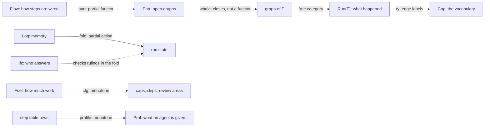
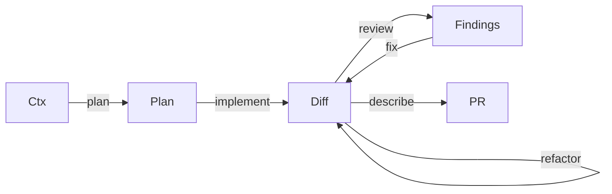
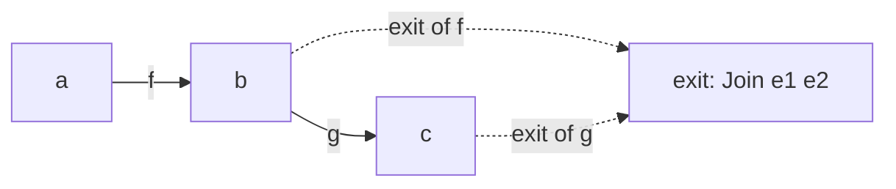
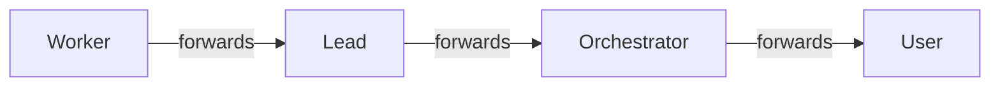
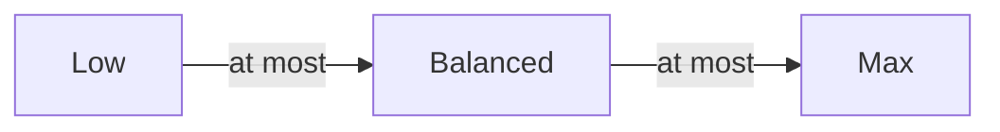
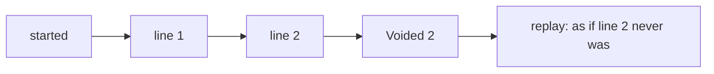

# The category model of kategory

Why category theory, for engineers:

- We design the harness by naming three things: objects (kinds of work),
  arrows (steps and flows) and laws (equations the arrows keep).
- Each law becomes a property test. The build checks the design, not a
  reviewer.
- Composition is how small flows build big ones: the review loop is glued
  after `implement`, and the 10x runs engineer flows side by side.
- A rule that holds for every flow replaces many checks for one flow.
- This file says which claims are theorems with tests, and which are
  readings or assumptions ([What we do not claim](#what-we-do-not-claim)).



Solid arrows are maps between categories. The dotted one is a runtime
use, not a map. Code paths below are under `programs/agents/kernel` unless
they say otherwise. The same system as engineering: [README](README.md),
[ARCHITECTURE](ARCHITECTURE.md), [FLOWS](FLOWS.md),
[GUARDRAILS](GUARDRAILS.md).

## The categories

A category has objects, arrows between them, an identity arrow on each
object, and an associative composition with that identity as its unit
(CWM I.1). A monoid is a category with one object. A preorder is a
category with at most one arrow between two objects (CWM I.2).

| Category | Think of it as | Objects | Arrows |
|---|---|---|---|
| `Cap` | the vocabulary of work | artifact types | paths of step outcomes |
| `Flow` | how steps are wired | the same types, as ports | flow terms, up to "draws the same" |
| `Run(F)` | what happened in one run | states of flow `F`'s graph | paths of edges |
| `Ifc` | who answers a question | one: a question | question handlers |
| `Fuel` | how much work | `Low`, `Balanced`, `Max` | `<=` |
| `Log` | memory | one | lists of log lines |
| `Prof` | what an agent is given | profiles | inclusion |

### Cap: the vocabulary

Think of it as the type signatures of all steps, and the chains they form.



- **Objects.** The artifact types of `TyOf` ([Ty.hs][ty]): `Ctx`, `Plan`,
  `Diff`, `Findings`, `PR`, `Ticket`, `Result`, `List t` and labelled sums
  `Sum [(label, t)]`.
- **Arrows.** Paths of outcome edges `step.outcome : dom -> cod`
  (`OutcomeEdge` in [Step.hs][step]). In a path, each edge's `cod` is the
  next edge's `dom` (`composes` in [FlowGen.hs][flowgen]).
- **Identity.** The empty path at a type.
- **Composition.** Concatenation of paths.
- **Structure.** `Cap` is the free category on the graph of outcome edges
  (CWM II.7). No code builds it as a value: it lives as lists of edges and
  the `composes` check.
- **A skip is not the identity.** A skipped step is a real edge
  `skip_x.skip : A -> A`, an endo arrow that is not the identity
  ([PathSpec.hs][pathspec]).

### Flow: how steps are wired

Think of it as a typed wiring diagram: steps in series, branches, loops
and parallel children.



- **Objects.** The types of `Cap`, as a flow's ports.
- **Arrows.** Terms of the GADT `Flow s i e o` ([Flow.hs][flow]): in port
  `i`, out port `o`, an optional exit `e :: Maybe Ty`, and the term's shape
  `s`. A step is `Do`. An arrow `a -> b` is a term with any shape, taken up
  to "draws the same": two terms are equal when their graphs are
  isomorphic up to place renumbering, or bisimilar where a law copies a
  subterm ([LawsSpec.hs][laws], its header). This is a quotient (CWM
  II.8). It needs "draws the same" to be a congruence under `:>`, which is
  assumed, not tested.
- **Identity.** `Id :: Flow IdS a 'Nothing a`.
- **Composition.** Series `f :> g`. The whole's exit is [`Join e1 e2`][join]:
  either side's exit. When both sides exit, the types must match, else the
  term does not compile. So composition is partial on exits.
- **Exits as exceptions (a reading).** Fix an exit type `E`. Terms with no
  exit or exit `E` behave like Kleisli arrows `a -> o + E` of the exception
  monad `- + E` (CWM VI.5). `Id` is its unit, `Exit` raises (`b -> c + b`),
  and an exit of either side exits the whole.

Extra structure, one constructor each:

| Constructor | Structure | Plain words |
|---|---|---|
| `Case` | copairing out of a labelled sum (CWM III.3). Beta and fusion are tested. Eta cannot be written: the core has no injections | each summand runs the branch of its label |
| `Exit`, `Catch` | raise into the exit; `Catch` post-composes the codiagonal `[id, id] : b + b -> b` | leave early; go on from the exit as if it were the out |
| `Loop` | Elgot-shaped: a body `a -> a + b` (out `a` goes round, exit `b` leaves) gives `a -> b`, like Elgot's `f†`. Fixpoint law tested: `Loop n f = Catch (f :> Loop n f)` | run the body until it exits |
| `Each` | map over a list, `a -> b` to `List a -> List b` | the body once per item, in order |
| `Fork`, `Await` | `parallel g f = Each (Fork g f) :> Await g`: a traverse over child runs ([Combinator.hs][combinator]) | start child runs, then wait for all, results in fork order |
| `Capped` | a meter: a limit per Fuel level, then `AtCap = Refuse \| Stop \| Extend` ([Meter.hs][meter]) | at most this many spends, then refuse, stop or ask the user |
| `Scope` | the scope path is the free monoid on names; `qualify` is its action on state names (CWM VII.4) | one flow placed twice gets distinct state names |
| `Handle` | removes one effect from the term's grade | says who answers a pick, a question, a focus wait or an await |
| `Into` | retype as `Result`; walks as `Id` | the chief's branches meet here |

**Effect grading.** Each term's type carries the set of effects it raises
(`EffectSet` in [Flow.hs][flow], `Effs` in [Effect.hs][effect]). `Id`
raises none, `:>` takes the union, and `Handle` removes one. So `Flow` is
graded by the monoid (effect sets, union, empty), in the sense of graded
(parametric) effects (Katsumata 2014, see Sources). This describes the types. It is not
a tested law. A whole flow must raise nothing: an unhandled effect does not
compile ([FlowSpec.hs][flowspec]).

### Run(F): what happened

Think of it as every walk a run of flow `F` can take through its state
machine.


An engineer run that reviews, fixes once and re-reviews. Names are from
[engineer.mmd][golden-engineer].

- **Objects.** The nodes of `graph F` ([Graph.hs][graph]): each state's
  place, the out port and the exit.
- **Arrows.** Paths of edges. An edge is keyed by `(place, event)`, so from
  a state an event names at most one edge. Two kinds of edge are taken with
  no event: an await's `done` and a parallel's fork ([Path.hs][path]).
- **Identity.** The empty path.
- **Composition.** Concatenation. `Run(F)` is the free category on the
  graph of `F` (CWM II.7).

A log names at most one such path. The log is the path written down: there
is no separate `ev` function.

### Ifc: who answers

Think of it as the chain of command a question climbs: worker, lead,
orchestrator, user.



- **Objects.** One object: a question, of kind `Fact`, `Pick`, `Design`,
  `Scope`, `Confirm`, `Security` or `Stuck` ([Ask.hs][ask]). The kind
  `Scope` is unrelated to the flow constructor `Scope`.
- **Arrows.** Handlers, [`Question -> Either Refusal Verdict`][handler],
  where `Verdict = Ruled Ruling | Forward Question`. A rung rules, forwards
  or refuses.
- **Identity.** `forwardAll`: pass every question on as it came.
- **Composition.** `andThen`: the first rung, then the next on what the
  first forwards. A ruling stops the chain.
- **Structure.** A handler is `Question -> Either Refusal (Either Ruling
  Question)`: a Kleisli endo arrow of `Question` for the monad
  `ExceptT Ruling (Either Refusal)` (CWM VI.5). `forwardAll` is its unit.
  So `Ifc` is the monoid of these endo arrows (CWM VII.3). Which rung may
  answer which kind is the total table `authority`.

In a run, the fold checks each ruling and forward against the run's row
of `authority` (`Ask.rule`, `Ask.pass`, reached from the `AskHandler` arm
of `handle` in [Fold.hs][fold-file]). A question that climbs through
several runs is the `andThen` chain of their rungs.

This runtime `Handler` is not the type-level `Handler eff` tag that
`Handle` takes ([Effect.hs][effect]). They only share a name.

### Fuel: how much work

Think of it as a dial with three settings. Turning it up never allows
less.



- **Objects.** `Low`, `Balanced`, `Max` ([Fuel.hs][fuel]).
- **Arrows.** One arrow `m -> m'` exactly when `m <= m'`, by the derived
  order `Low < Balanced < Max`.
- **Identity.** `m <= m`.
- **Composition.** Transitivity.
- **Structure.** A chain: a total order seen as a category (CWM I.2).

### Log: memory

Think of it as an append-only list of events. The run's state is what you
get by reading it from the top.



- **Objects.** One object.
- **Arrows.** Finite lists of log lines, `Envelope`, each holding one
  `Event` ([Event.hs][event]).
- **Identity.** The empty list.
- **Composition.** Concatenation. `Log` is the free monoid on log lines
  (CWM VII.3).
- **Dedup and voids are not part of the monoid.** A line whose id is
  already logged changes nothing: that is a property of `append`. A
  `Voided` line is a reversal event in Fowler's terms: `replay` drops it
  and the line it voids. Dropping voids does not respect `++` (a void in
  `b` cancels a line in `a`), so it is no quotient of the monoid. Both
  live in the fold ([Fold.hs][fold-file]).

### Prof: what an agent is given

Think of it as the tool belt of a role: what it may call and read.

- **Objects.** Profiles: sets of tools, skills, operations and prose
  fragments.
- **Arrows.** Inclusion: `P -> Q` exactly when every part of `P` is in `Q`.
- **Identity.** `P` is included in `P`.
- **Composition.** Transitivity.
- **Structure.** A partial order with joins (union) (CWM I.2). It lives in
  Nix, in [derive.nix][derive], not in the kernel.

## The maps

A functor sends objects to objects and arrows to arrows, and keeps
identity and composition (CWM I.3). A monotone map between preorders is a
functor between them.

| Map | Type | What it is |
|---|---|---|
| `part` | `Flow s i e o -> Either Clash (Part i o)` | a partial functor, up to place renumbering |
| `graph` | `whole . part`, whole flows only | not a functor: adds checks that do not compose |
| `ty` | events from the in port to `Cap` edges | the edge labels of a graph map into `Cap` |
| `fold` | `OpenGraph -> RunState -> [Envelope] -> Either Refusal RunState` | a partial action of `Log` on run states |
| `cfg` | `Fuel` to a flow's caps, skips and review areas | monotone: a functor between preorders |
| `profile` | step table rows to a role's profile | monotone on tools, skills and operations, not prose |
| `mermaid` | `OpenGraph -> Text` | a plain function, pinned by golden files |

### part: a partial functor

[`part`][part] turns a term into an open graph, `Part i o`, by structural
recursion. The target composes by [`glue`][glue]:
`Part a b -> Part b c -> Either Clash (Part a c)`.

- **Identity.** `part Id = passing Passes`, the part with no state.
- **Series.** `part (f :> g) = glue (part f) (part g)`, by definition.
- **Partial.** `glue` refuses only a loop-name clash. `part` alone can
  also refuse a term, such as a loop whose body caps no step.
- **Up to place renumbering.** `glue` puts each side under a fresh prefix
  (`within 0`, `within 1`). So the two groupings of `f :> g :> h` give the
  same graph with places named differently. `part` is a functor into the
  quotient by renumbering (CWM II.8), where gluing succeeds.
- **Handle is erased.** `part (Handle h f) = part f`.

### graph is not a functor

[`graph`][whole] is `whole =<< part`. `whole` closes a whole flow (one in
type, one out type, no sum). It keeps only reachable states and adds three
checks that look at the whole graph:

- `SameState`: two states of one name.
- `RefuseWithoutWayOut`: a `Refuse` cap with no edge out of its loop.
- `NotAwaited`: a fork with a way out that passes no await.

These do not compose. `Do Describe :> Do FixPR` and `Do FixPR` each draw,
but `Do Describe :> Do FixPR :> Do FixPR` is refused with `SameState`
([GraphSpec.hs][graphspec]). So `part` is the functor, and `graph` is
`part` plus whole-flow checks.

### ty: from a run back to the vocabulary

Each edge of `graph F` carries an `Arrow`: `Along e` for an outcome edge of
`Cap`, or `Stay` for a child spawned or handed back, which stands for the
identity.

- On edges this is a graph map into the underlying graph of `Cap`, with
  `Stay` going to an identity.
- If each state's edges agree on its type, it extends to a functor
  `Run(F) -> Cap` by the free category's universal property (CWM II.7,
  Theorem 1).
- The code's [`ty`][path] reads event names from the in port, not edge
  paths from any state. So the tests check what `ty` can say: the empty
  walk gives the empty path, a prefix gives a prefix, and every log the
  fold accepts gives a composable path.

### Monotone maps: cfg and profile

- **cfg.** A flow carries each budget as a `PerFuel a`, one value per
  level. `atFuel` reads it at one level. Each `PerFuel` the flows carry is
  `monotone`: a higher level allows at least the spends, skips no more and
  reviews at least the areas in full (`fullReview : Fuel -> (P(Area), ⊆)`).
  So `cfg` is a functor between preorders. `PerFuel` is also a Haskell
  `Functor`, but that is the container, not `cfg`.
- **profile.** `profile(r)` is the union of the tools, skills, operations
  and prose of the steps role `r` runs. For a split role, the prose is the
  intersection. Tools, skills and operations are monotone in the set of
  rows. Prose is not: a step more may give a split role less prose.

### fold: the log acts on run states

[`fold`][fold] reads lines onto a state. Each line may be refused, so the
action lives in `Either Refusal`. These equations hold:

```text
fold g s []       = Right s
fold g s (a ++ b) = fold g s a >>= \s' -> fold g s' b
```

This is a partial right action of the free monoid `Log` on run states
(CWM VII.4). `replay` starts from the first line, which must be
`started`, after it drops voided lines. Event sourcing in Fowler's terms:
the state is rebuilt by replaying the event log, and outside reads (such
as GitHub) count only once they are logged as events.

## The principles we build with

- **Laws over special cases.** State an equation for every flow, then test
  it on generated flows. A check for one flow is the fallback.
- **Sums and cases over flags.** `Verdict = Ruled | Forward`,
  `AtCap = Refuse | Stop | Extend`, a branch is a label of a `Sum`. No
  boolean that encodes a state.
- **Pure core, effect shell.** `fold` decides over plain values.
  `Effects.Store.*` and the CLI do the reads and writes.
- **Every law has a test.** Or this file says it is assumed.

## Laws and tests

Test paths are under `programs/agents/kernel/test/State/` unless they say
otherwise. Names are the current test names.

### Flow

| Law | Plain meaning | Test |
|---|---|---|
| Typed gluing | a wrong wiring, an uncaught exit or an unhandled effect does not compile | `Category/FlowSpec.hs`: should-not-typecheck cases, such as "a block whose out is not the next block's in", "a whole flow with an uncaught exit", "a pick no handler takes" |
| Identity | `Id :> f = f = f :> Id` | `Category/LawsSpec.hs` `identity_is_a_unit_of_series` |
| Into | `f :> Into` walks as `f` | `LawsSpec` `into_walks_as_identity` |
| Associativity | `(f :> g) :> h = f :> (g :> h)` | `LawsSpec` `series_is_associative` |
| Case beta | a step's edge `l` into a sum walks as branch `l` | `LawsSpec` `case_beta_each_summand_walks_as_its_branch` |
| Case fusion | `Case bs :> h = Case (each b :> h)` | `LawsSpec` `case_fusion_series_distributes_into_each_branch` |
| Case order | the order of a choice's branches changes no walk | `LawsSpec` `the_order_of_a_choice_s_branches_changes_nothing_a_run_walks` |
| Catch | `Catch Exit = Id`; `Catch (f :> g) = f :> Catch g` for `f` with no exit; `Catch` goes into a case | `LawsSpec` `catching_exit_is_identity`, `catch_moves_past_a_side_with_no_exit`, `catch_distributes_over_a_case` |
| Elgot fixpoint | a loop walks as its body unrolled once, up to bisimulation | `LawsSpec` `a_loop_walks_as_its_body_unrolled_once`, `a_choice_loop_walks_as_its_choice_unrolled_once` |
| choiceLoop order | the order of the actions changes no walk | `LawsSpec` `the_order_of_the_actions_changes_nothing_a_run_walks` |
| Parallel | `parallel g Id`, `parallel g f` and `parallel g (f :> h)` draw one parent graph; the merge gets results in fork order | `LawsSpec` `par_identity_and_composition_draw_one_parent_graph`; `Protocol/AdviceSpec.hs` `parallel_identity_gives_the_merge_the_prs_in_fork_order_whatever_order_the_engineers_hand_back_in` |
| Handle | `Handle h f` draws as `f` | `LawsSpec` `a_handler_draws_as_the_flow_it_handles` |
| Scope | keeps the graph but its names; `Scope s (f :> g) = Scope s f :> Scope s g`; `Scope s (Scope t f) = Scope (s/t) f` | `LawsSpec` `scope_preserves_the_graph_but_its_names`, `scope_distributes_over_series`, `nested_scopes_are_one_scope_of_both_names` |
| Scope action | `qualify` is an action of the scope monoid; `unqualify` inverts it | `LawsSpec` `qualify_is_an_action_of_the_scope_monoid`, `unqualify_inverts_qualify_on_a_slash_free_name` |
| Effects of each flow | each registered flow raises exactly its listed effects | `RoleSpec.hs` "Effects" (type equalities, checked as the module compiles) |

### part, graph and Run(F)

| Law | Plain meaning | Test |
|---|---|---|
| Series is glue | the graph of `f :> g` holds both sides' edges and loops; a walk goes through `f`, then `g`; either exit is the whole's | `Category/GraphSpec.hs` "graph_of_seq_is_glue_of_graphs" (4 cases) |
| Deterministic | from a state, an event names at most one edge | `GraphSpec` `graph_has_one_target_per_state_event` |
| Reachable | every state is reached from the start and reaches the end | `GraphSpec` `every_state_is_reached_from_the_start_and_reaches_the_end` |
| Bounded | a loop whose body caps no step is refused; no run spends past a cap | `GraphSpec` "refuses a loop whose body caps no step: nothing bounds it"; `Run/FoldSpec.hs` `never_spends_past_a_cap` |
| Structured concurrency | a fork with a way out that passes no await is refused | `GraphSpec` "refuses a fork no await follows: its children would outlive the flow" |
| Fixed targets | an event's target is a function of the graph, except an override | by construction in the fold |
| Prose guard | the blocks the skills paste equal `state render` | `checks.agents` (`kernel/rendered.nix`) |

### Cap and ty

| Law | Plain meaning | Test |
|---|---|---|
| Skip is endo | a skip is a real edge `A -> A`, never the identity; it goes where running the step goes | `Category/PathSpec.hs` `skipped_maps_to_identity` (despite its name, it fails unless the skip is a real edge), "takes a skip to where running the skipped step goes" |
| ty unit | the empty walk gives the empty path | `PathSpec` `ty_maps_the_empty_walk_to_the_empty_path` |
| ty prefixes | a prefix of a walk gives a prefix of its path | `PathSpec` `ty_maps_a_prefix_of_a_walk_to_a_prefix_of_its_path` |
| Trace soundness | every log the fold accepts is a composable path of `Cap` | `FoldSpec` `every_accepted_log_is_a_path` (engineer), `every_accepted_log_of_a_scoped_flow_is_a_path` (generated flows) |

### Ifc

| Law | Plain meaning | Test |
|---|---|---|
| Identity | `forwardAll` changes no handler | `Run/AskSpec.hs` `forward_all_handler_changes_nothing` |
| Associativity | `(a andThen b) andThen c = a andThen (b andThen c)` | `AskSpec` `andThen_is_associative` |
| Chain | the parent rules on what the child forwards | `AskSpec` `handlers_compose`, "lets the parent rule on what the child forwards" |
| Ceiling | no event lowers a `Security` question; a `Security` ruling names its basis | `AskSpec` `no_event_retags_security`, `security_ruling_needs_basis`; `FoldSpec` `no_event_retags_security` |
| Total authority | every rung and kind has a rule | `AskSpec` `authority_table_is_total`; `-Wall -Werror` refuses a missed case |
| Total asks | every question ends answered or stopped | `FoldSpec` `every_ask_ends_answered_or_stopped` |
| Principal-blind | the advice is the same whoever started the run, up to delivery | `ArchitectureSpec.hs` keeps the principal out of every flow module; `AdviceSpec` `advice_is_equal_under_any_principal_of_one_task_shape_up_to_delivery` |
| Stopgap-blind | the advice is the same with or without stopgap events: the kernel never reads one | `AdviceSpec` `advice_is_equal_with_or_without_stopgaps` |

### Fuel

| Law | Plain meaning | Test |
|---|---|---|
| Monotone budgets | each level allows at least the spends and runs of the level below, in every role's flow | `LawsSpec` "allows each level at least the spends and runs of the level below, in every role's flow" |
| Monotone full review | each level reviews in full at least the areas of the level below | `Category/FuelSpec.hs` "full_review_is_monotone: ..." |
| Keep | in every role's flow, no Fuel skip names `review`, `re_review`, `research`, `describe`, `visual` or `simplify_pr`; the engineer keeps `review` and `describe`, the 10x `engineers` and `merge` | `LawsSpec` "never lets a Fuel level skip a kept step, in every role's flow"; `Flow/Role/EngineerSpec.hs`, `Flow/Role/TenXSpec.hs` `no_mode_skips_kept_steps` |
| Stuck | the same problems in two rounds in a row mark a loop stuck; alternating rounds do not | `FoldSpec` `stuck_after_two_same_rounds`, "is not stuck on rows alternating A, B, A, B: only rounds in a row count" |

### Log

| Law | Plain meaning | Test |
|---|---|---|
| Log is a fold | replaying a prefix, then folding the rest, is replaying the whole | `FoldSpec` `state_is_a_fold`, `replaying_a_prefix_then_appending_the_rest_is_replaying_the_whole`, `live_appends_reach_the_run_the_log_replays` |
| Idempotent append | a line whose id is already logged changes nothing | `FoldSpec` `append_is_idempotent_by_id`, "logs a hook record fired twice once" |
| Void | a voided line replays as if never logged | `FoldSpec` `a_void_replays_as_the_line_never_logged` |
| Total fold | an event with no edge where the run is gets a `Refusal`, never a throw | `FoldSpec` "refuses an event with no edge where the run is"; `-Wall -Werror` refuses a missed case |
| Dense seq | a run's seqs run densely from 1 | the store throws on a gap or duplicate ([Events.hs][store]) |
| Round trip | an event's row decodes to what was encoded, for every event type | `Data/Payload/EventSpec.hs` `envelope_row_round_trips`, `dump_line_round_trips` (through `state dump`'s line), each labelled by event type |
| No duplicate key | no object of a payload repeats a key, at any depth (RFC 7493 s2.3) | `EventSpec` `writes_no_duplicate_key`, over aeson's token stream, since a decoded value hides a repeat |
| Total decode | any row decodes to `Known`, `Retired` or `Unknown`, never a throw; any object under a known type reads as that type's event or `Unknown`; a key more, at any depth, is ignored (RFC 7493 s4.2); an `Unknown` refuses the append, naming its seq and type | `EventSpec` "decode_is_total: any row decodes, its type and data kept when not known", `decodes_any_object_under_its_type`, `ignores_an_extra_key`; `Effects/LogSpec.hs` "refuses an append to a run holding a row it cannot read, naming its seq and type" |
| Append-only | no stored row is changed or deleted | `Effects/Store/MigrationSpec.hs` "aborts every change to a row with its table's trigger" (UPDATE, DELETE, `INSERT OR REPLACE` and an upsert on each table) |
| The log only grows | each read of a run's log holds the one before it as a prefix | `LogSpec` "only grows: each decision's log holds the one before it, its seqs dense from 1", over the store and the double |
| One writer | only the kernel appends to a run's log | Assumed: only `Effects.Store.*` inserts events ([Events.hs][store]) |
| Blob key | a blob's key is the SHA-256 of its content, so one content is one blob | `State/ArtifactSpec.hs` "keys a blob by the digest of its content"; `LogSpec` "keeps one blob per content, however often a decision carries it", over the store and the double, and "throws on a stored blob whose content does not hash to its key" |
| Snapshot | every snapshotted file artifact has its blob, and no other does | `ArtifactSpec` "keeps the blob of every file it calls snapshotted, and of no other"; `LogSpec` "stores a decision's blobs with its events, read back by their keys" |
| Re-snapshot idempotent | re-snapshotting over the newest artifacts, the disk unchanged, adds nothing | `ArtifactSpec` "adds nothing when run again over the newest artifacts, the disk unchanged" |

### Prof

These are Nix assertions over the real step table, run as the
`derived-roles` check in `programs/agents/default.nix`.

| Law | Plain meaning | Test |
|---|---|---|
| Sufficient | a role holds every tool, skill, operation and prose its steps need | [derive.nix][derive] `derived_role_holds_every_step_need` |
| Lean | a role holds nothing its steps do not need | `derive.nix` `derived_role_holds_nothing_else` |
| profile is monotone | a step more never gives fewer tools, skills or operations | `derive.nix` `derived_role_grows_with_its_steps` |
| Budget | each role's preloaded prose stays under its ceiling | `budget-compare`, which fails `checks.claude-config` ([config-check.nix][configcheck]) |

## What we do not claim

- **Congruence.** `Flow` is a quotient by "draws the same". A quotient
  category needs that relation to survive `:>` on both sides (CWM II.8).
  We assume it. No test checks it.
- **Elgot axioms.** `Loop` has the shape of Elgot iteration, and its
  fixpoint law is tested. Naturality, codiagonal and uniformity are not
  claimed. We do not call `Flow` an Elgot or iteration category.
- **Copairing eta.** `Case` has no injections, so eta cannot be written.
  We do not call a `Sum` a coproduct in `Flow`.
- **The exception reading.** Reading exits as the monad `- + E` explains
  `Exit`, `Catch` and `Join`. It is not a separate test.
- **part on its own.** Its identity and series laws are tested through
  `graph`, on terms that `graph` accepts.
- **ty as a functor.** That each state's edges agree on its type is not
  checked for every edge. The tests cover accepted logs. They do not report
  whether a generated log walks through a fork.
- **Each and parallel composition.** No functor law for `Each` is tested.
  `parallel g (f :> h) = parallel g f :> parallel g' h` holds of child
  runs only, and is not tested.
- **Effect grading.** It describes the types. It is not a tested law.
- **One writer.** Nothing stops another process, such as `sqlite3`,
  inserting into the database. Its triggers stop an UPDATE or a DELETE.
- **profile prose.** It is not monotone for split roles, by design.

## Design records

The design lives in
[ADR 0018](../adr/0018-category-model-haskell-state.md) (the model, Fuel,
the law table), [ADR 0020](../adr/0020-flow-core-from-sums-and-elgot.md)
(the flow core), [ADR 0021](../adr/0021-flow-effects.md) (effects) and
[ADR 0014](../adr/0014-pure-core-event-sourced-flow.md) (the event log and
the fold).

## Sources

- CWM: Saunders Mac Lane, *Categories for the Working Mathematician*, 2nd
  ed., Springer 1998. Sections used: I.1 categories, I.2 monoids and
  preorders as categories, I.3 functors, II.7 free categories on a graph,
  II.8 quotient categories, III.3 coproducts, VI.5 the Kleisli category,
  VII.3 monoids, VII.4 actions.
- Elgot iteration: Jiří Adámek, Stefan Milius, Jiří Velebil, "Elgot
  algebras", LMCS 2006, <https://arxiv.org/abs/cs/0609040>. The four axioms:
  Sergey Goncharov, "Shades of iteration", Def. 8,
  <https://arxiv.org/abs/2301.06202>.
- Effect grading: Shin-ya Katsumata, "Parametric effect monads and
  semantics of effect systems", POPL 2014,
  <https://doi.org/10.1145/2535838.2535846>.
- Event sourcing: Martin Fowler, "Event Sourcing",
  <https://martinfowler.com/eaaDev/EventSourcing.html>.

[ty]: ../../programs/agents/kernel/src/State/Category/Ty.hs
[step]: ../../programs/agents/kernel/src/State/Category/Step.hs
[flowgen]: ../../programs/agents/kernel/test/State/Category/FlowGen.hs
[pathspec]: ../../programs/agents/kernel/test/State/Category/PathSpec.hs
[flow]: ../../programs/agents/kernel/src/State/Category/Flow.hs
[join]: https://github.com/ILIYANGERMANOV/nixos/blob/1d114af7f556b904900b6aea70b733cabfd3ab32/programs/agents/kernel/src/State/Category/Flow.hs#L72
[laws]: ../../programs/agents/kernel/test/State/Category/LawsSpec.hs
[combinator]: ../../programs/agents/kernel/src/State/Flow/Combinator.hs
[meter]: ../../programs/agents/kernel/src/State/Category/Meter.hs
[effect]: ../../programs/agents/kernel/src/State/Category/Effect.hs
[flowspec]: ../../programs/agents/kernel/test/State/Category/FlowSpec.hs
[golden-engineer]: ../../programs/agents/kernel/test/golden/engineer.mmd
[graph]: ../../programs/agents/kernel/src/State/Category/Graph.hs
[path]: ../../programs/agents/kernel/src/State/Category/Path.hs
[ask]: ../../programs/agents/kernel/src/State/Run/Ask.hs
[handler]: https://github.com/ILIYANGERMANOV/nixos/blob/1d114af7f556b904900b6aea70b733cabfd3ab32/programs/agents/kernel/src/State/Run/Ask.hs#L319
[fuel]: ../../programs/agents/kernel/src/State/Category/Fuel.hs
[event]: ../../programs/agents/kernel/src/State/Run/Event.hs
[fold-file]: ../../programs/agents/kernel/src/State/Run/Fold.hs
[fold]: https://github.com/ILIYANGERMANOV/nixos/blob/1d114af7f556b904900b6aea70b733cabfd3ab32/programs/agents/kernel/src/State/Run/Fold.hs#L486
[derive]: ../../programs/agents/lib/derive.nix
[part]: https://github.com/ILIYANGERMANOV/nixos/blob/1d114af7f556b904900b6aea70b733cabfd3ab32/programs/agents/kernel/src/State/Category/Graph.hs#L311
[glue]: https://github.com/ILIYANGERMANOV/nixos/blob/1d114af7f556b904900b6aea70b733cabfd3ab32/programs/agents/kernel/src/State/Category/Graph.hs#L337
[whole]: https://github.com/ILIYANGERMANOV/nixos/blob/1d114af7f556b904900b6aea70b733cabfd3ab32/programs/agents/kernel/src/State/Category/Graph.hs#L193
[graphspec]: ../../programs/agents/kernel/test/State/Category/GraphSpec.hs
[store]: ../../programs/agents/kernel/src/Effects/Store/Events.hs
[configcheck]: ../../programs/claude-code/config-check.nix
