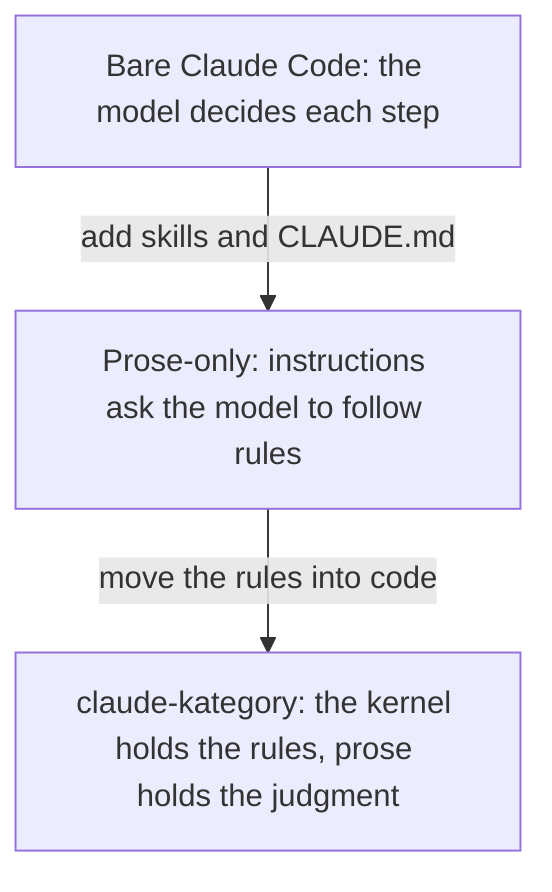

# claude-kategory compared

| Setup | What it is |
|---|---|
| **claude-kategory** | kategory's Claude Code build: skills, roles, hooks, guards and the `state` kernel that holds each run |
| **Prose-only Claude** | Claude Code with good skills, a shared `CLAUDE.md` and subagents, but no program that holds the rules |
| **Bare Claude Code** | Claude Code as installed |

Why moving rules from prose into programs matters:
[README](README.md#why-it-is-different). This page is the detail, row by
row.

## Side by side

Every claude-kategory cell links the code or the test behind it.

| Property | claude-kategory | Prose-only Claude | Bare Claude Code |
|---|---|---|---|
| Follows the predefined flow | Agents follow the flow more often: `state` and hooks push them to it. The `state-route` hook denies a lead's write (edit, commit, push, PR, spawn) before `state init` ([hook][routehook], [`gate`][gate]), so every lead talks to `state` at least once. `state next` then prints the next action, and the agent treats it as the authority ([`advise`][advise], [`deliver`][deliverline]). Hooks are best effort: a skipped hook pushes nothing. | A skill lists the steps. The model may skip or reorder them; nothing notices. | No flow. The model picks each step. |
| Context for the agent | On a fresh, resumed or compacted session, the `state-resume` hook prints `state show` and `state next` as context ([hook][resumehook], [`ResumeHook`][resumehookhs], [output][resumeanswer]). Each command's output says what to do next: an action line, or a refusal as `what - why` then `fix:` ([`failureText`][failuretext]). The resume hook is best effort too. | Context is what the model wrote down and the next one finds. | The conversation, or its compacted summary. |
| Resume after context loss | The run is its log. A fresh agent reads `state show` and `state next` and goes on; a session that lost its agents records `Restarted` and sends them again ([`restartOf`][restartOf], [test][hookspec231]). The context guard asks for a commit and hand-back before the limit ([limits][ctxlimits]). | A skill can ask the agent to keep a progress file. Recovery works if the model wrote it and the next one reads it. | `--resume` and `--continue` restore the conversation; auto-compaction summarises it. What the summary drops is lost. |
| Bounded loops | Each loop holds a capped step, with a limit per Fuel level; past it the kernel refuses, stops or asks ([`Limit`][limit], [`AtCap`][atcap]). A loop with no cap is refused when the flow is built ([test][graph74]); no run spends past a cap ([test][fold228]). | "At most 3 review rounds" in a skill. The model counts; nothing checks. | No loop budget. The user interrupts, or a headless run's turn limit ends it. |
| Named waits | Every wait is a line: `AWAIT` on CI, a merge, a worker or children, or `HANDBACK` to the run above ([`deliver`][deliver], [test][advice439]). The wait guard denies blind sleeps and polling ([guard][waitguard], [tests][waittest]). | "Do not poll; wait for the notification." Usually obeyed. | The model may sleep, poll or end its turn with no reason given. Background tasks can notify it. |
| Who answers which question | A question has a kind (Fact, Pick, Design, Scope, Confirm, Security, Stuck); a kernel table says which rung may answer it ([`authority`][authority]). A parent rules on what a child forwards ([test][askspec32]); nothing lowers a Security question ([test][askspec49]). | `CLAUDE.md` says "ask before design changes". The model judges what counts. | The model decides when to ask. Tool permission prompts are the fixed check. |
| Replay from a log | What a run knows is a pure fold over its log. Replaying a prefix, then the rest, equals replaying the whole ([test][fold458]); a voided line replays as if never logged ([test][fold436]). | Transcripts exist, but the state is in the model's context; reading them back is a new judgment. | Sessions are saved as transcripts and can be resumed, not folded into a state. |
| Typed flow composition | Flows are typed terms; `f :> g` compiles only when `f`'s output is `g`'s input ([`:>`][series], [test][flowspec42]). The algebra's laws each have a test ([LawsSpec][laws42]). | One skill names the next in prose. The order holds while the model follows it. | None. The user sequences the work. |
| Guards (secret, read, wait, context) | Four guards before or after tool calls ([hooks.nix][guardshooks]), each with tests ([secret][secrettest], [read][readtest], [wait][waittest], [context][ctxtest]). Best effort and fail open, not a security boundary ([GUARDRAILS](GUARDRAILS.md#hooks-fail-open-they-are-not-a-security-boundary)). | Rules in `CLAUDE.md`: "never print secrets", "read in ranges". | Permission rules and a hook system; you write your own guards. |
| Parallel engineers (10x) | The 10x flow breaks a plan into tasks and runs one engineer child run per task in parallel, each with its own log, then merges the PRs; rounds are capped at 9 ([`tenX`][tenx], [test][tenxspec15]). Factory only: it needs the headless server setup. | A skill can spawn several subagents. Who tracks which one finished lives in the lead's context. | Subagents can run in parallel; the user tracks worktrees and merges. |
| Reproducible install | One Nix package, pinned by the flake lock, in its own `~/.claude-kategory` config dir ([package][flakepkg], [isolation][linksh]). A check holds that its settings deny reading the login in both config dirs ([check][katcheck]). | A copy of someone's dotfiles. Versions drift unless pinned by hand. | The official installer; config shared in `~/.claude`. |
| Least-privilege roles | Each subagent role gets the union of what its steps need, derived from one step table, and nothing else ([sufficient][derive106], [lean][derive109]). | Each role file lists its tools by hand. | Subagent tools are whatever you configure. |

## Planned, not built

From the vision's [Direction](../../programs/agents/VISION.md#direction) and
[Providers](../../programs/agents/VISION.md#providers). None of these hold
today.

| Planned | Today |
|---|---|
| Agents choose from a library of flows and compose them for any task | Flows are fixed: chief, engineer, 10x, architect and the blocks ([FLOWS](FLOWS.md)) |
| A cheap, fast model reaches a top model's quality, because each flow hands it small jobs | Claude is the main model |
| Harder enforcement of `state` | Hooks gate a lead's work until `state init`, not every action after ([`Route.hs`][route]) |
| OpenCode and Codex backends | Claude Code is the only backend ([ADR 0011](../adr/0011-agent-compiler.md)) |

## What it costs

Fair to the other columns:

- **Nix is required.** Bare Claude Code installs anywhere.
- **Fixed flows.** A task that fits no flow goes to the chief's direct path,
  with fewer guarantees ([FLOWS](FLOWS.md#the-chief-routes-requests)).
- **More steps for small work.** Plan, review and CI rounds take time and
  tokens; Fuel `low` skips the optional ones, never review.
- **Hooks are best effort.** A rule on a hook holds only when the client
  fires it; only the kernel's rules always hold ([ARCHITECTURE](ARCHITECTURE.md#the-logic-ladder)).
- **Built for this repo first.** It serves this repository and the
  author's headless server first; anyone with Nix can use it
  ([Non-goals](../../programs/agents/VISION.md#non-goals-draft)).
- **No benchmarks yet.** No measured comparison is committed. The
  `self-improve` analyzer could produce one.

[restartOf]: https://github.com/ILIYANGERMANOV/nixos/blob/1d114af7f556b904900b6aea70b733cabfd3ab32/programs/agents/kernel/src/State/Protocol/Hook.hs#L676
[hookspec231]: https://github.com/ILIYANGERMANOV/nixos/blob/1d114af7f556b904900b6aea70b733cabfd3ab32/programs/agents/kernel/test/State/Protocol/HookSpec.hs#L496
[ctxlimits]: https://github.com/ILIYANGERMANOV/nixos/blob/1d114af7f556b904900b6aea70b733cabfd3ab32/programs/agents/hooks/guards/context-guard/context-guard.py#L57
[limit]: https://github.com/ILIYANGERMANOV/nixos/blob/1d114af7f556b904900b6aea70b733cabfd3ab32/programs/agents/kernel/src/State/Category/Meter.hs#L54
[atcap]: https://github.com/ILIYANGERMANOV/nixos/blob/1d114af7f556b904900b6aea70b733cabfd3ab32/programs/agents/kernel/src/State/Category/Meter.hs#L72
[graph74]: https://github.com/ILIYANGERMANOV/nixos/blob/1d114af7f556b904900b6aea70b733cabfd3ab32/programs/agents/kernel/test/State/Category/GraphSpec.hs#L133
[fold228]: https://github.com/ILIYANGERMANOV/nixos/blob/1d114af7f556b904900b6aea70b733cabfd3ab32/programs/agents/kernel/test/State/Run/FoldSpec.hs#L461
[deliver]: https://github.com/ILIYANGERMANOV/nixos/blob/1d114af7f556b904900b6aea70b733cabfd3ab32/programs/agents/kernel/src/State/Protocol/Advice.hs#L1239
[advice439]: https://github.com/ILIYANGERMANOV/nixos/blob/1d114af7f556b904900b6aea70b733cabfd3ab32/programs/agents/kernel/test/State/Protocol/AdviceSpec.hs#L878
[waitguard]: ../../programs/agents/hooks/guards/wait-guard/wait-guard.py
[waittest]: ../../programs/agents/hooks/guards/wait-guard/test_wait-guard.py
[authority]: https://github.com/ILIYANGERMANOV/nixos/blob/1d114af7f556b904900b6aea70b733cabfd3ab32/programs/agents/kernel/src/State/Run/Ask.hs#L131
[askspec32]: https://github.com/ILIYANGERMANOV/nixos/blob/1d114af7f556b904900b6aea70b733cabfd3ab32/programs/agents/kernel/test/State/Run/AskSpec.hs#L42
[askspec49]: https://github.com/ILIYANGERMANOV/nixos/blob/1d114af7f556b904900b6aea70b733cabfd3ab32/programs/agents/kernel/test/State/Run/AskSpec.hs#L62
[fold458]: https://github.com/ILIYANGERMANOV/nixos/blob/1d114af7f556b904900b6aea70b733cabfd3ab32/programs/agents/kernel/test/State/Run/FoldSpec.hs#L908
[fold436]: https://github.com/ILIYANGERMANOV/nixos/blob/1d114af7f556b904900b6aea70b733cabfd3ab32/programs/agents/kernel/test/State/Run/FoldSpec.hs#L876
[series]: https://github.com/ILIYANGERMANOV/nixos/blob/1d114af7f556b904900b6aea70b733cabfd3ab32/programs/agents/kernel/src/State/Category/Flow.hs#L162
[flowspec42]: https://github.com/ILIYANGERMANOV/nixos/blob/1d114af7f556b904900b6aea70b733cabfd3ab32/programs/agents/kernel/test/State/Category/FlowSpec.hs#L49
[laws42]: https://github.com/ILIYANGERMANOV/nixos/blob/1d114af7f556b904900b6aea70b733cabfd3ab32/programs/agents/kernel/test/State/Category/LawsSpec.hs#L94
[guardshooks]: ../../programs/agents/hooks/guards/hooks.nix
[secrettest]: ../../programs/agents/hooks/guards/secret-guard/test_secret-guard.py
[readtest]: ../../programs/agents/hooks/guards/read-guard/test_read-guard.py
[ctxtest]: ../../programs/agents/hooks/guards/context-guard/test_context-guard.py
[tenx]: https://github.com/ILIYANGERMANOV/nixos/blob/1d114af7f556b904900b6aea70b733cabfd3ab32/programs/agents/kernel/src/State/Flow/Role/TenX.hs#L39
[tenxspec15]: https://github.com/ILIYANGERMANOV/nixos/blob/1d114af7f556b904900b6aea70b733cabfd3ab32/programs/agents/kernel/test/State/Flow/Role/TenXSpec.hs#L15
[flakepkg]: https://github.com/ILIYANGERMANOV/nixos/blob/1d114af7f556b904900b6aea70b733cabfd3ab32/flake.nix#L272
[linksh]: https://github.com/ILIYANGERMANOV/nixos/blob/1d114af7f556b904900b6aea70b733cabfd3ab32/programs/claude-code/kategory/link.sh#L9
[katcheck]: ../../programs/claude-code/kategory/check.nix
[derive106]: https://github.com/ILIYANGERMANOV/nixos/blob/1d114af7f556b904900b6aea70b733cabfd3ab32/programs/agents/lib/derive.nix#L125
[derive109]: https://github.com/ILIYANGERMANOV/nixos/blob/1d114af7f556b904900b6aea70b733cabfd3ab32/programs/agents/lib/derive.nix#L128
[route]: ../../programs/agents/kernel/src/State/Cli/Route.hs
[routehook]: https://github.com/ILIYANGERMANOV/nixos/blob/1d114af7f556b904900b6aea70b733cabfd3ab32/programs/agents/kernel/hooks.nix#L37-L49
[gate]: https://github.com/ILIYANGERMANOV/nixos/blob/1d114af7f556b904900b6aea70b733cabfd3ab32/programs/agents/kernel/src/State/Cli/Route.hs#L241-L261
[advise]: https://github.com/ILIYANGERMANOV/nixos/blob/1d114af7f556b904900b6aea70b733cabfd3ab32/programs/agents/kernel/src/State/Protocol/Advice.hs#L454-L455
[deliverline]: https://github.com/ILIYANGERMANOV/nixos/blob/1d114af7f556b904900b6aea70b733cabfd3ab32/programs/agents/kernel/src/State/Protocol/Advice.hs#L1183-L1186
[resumehook]: https://github.com/ILIYANGERMANOV/nixos/blob/1d114af7f556b904900b6aea70b733cabfd3ab32/programs/agents/kernel/hooks.nix#L13-L16
[resumehookhs]: https://github.com/ILIYANGERMANOV/nixos/blob/1d114af7f556b904900b6aea70b733cabfd3ab32/programs/agents/kernel/src/State/Protocol/Hook.hs#L6
[resumeanswer]: https://github.com/ILIYANGERMANOV/nixos/blob/1d114af7f556b904900b6aea70b733cabfd3ab32/programs/agents/kernel/src/State/Cli/Shell.hs#L848-L866
[failuretext]: https://github.com/ILIYANGERMANOV/nixos/blob/1d114af7f556b904900b6aea70b733cabfd3ab32/programs/agents/kernel/src/State/Cli/Command.hs#L220-L240
