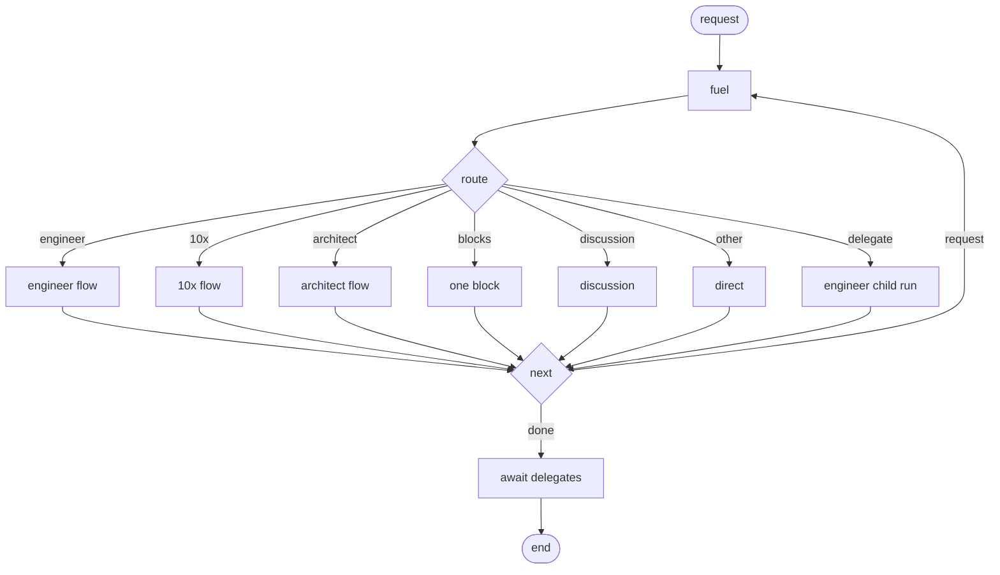
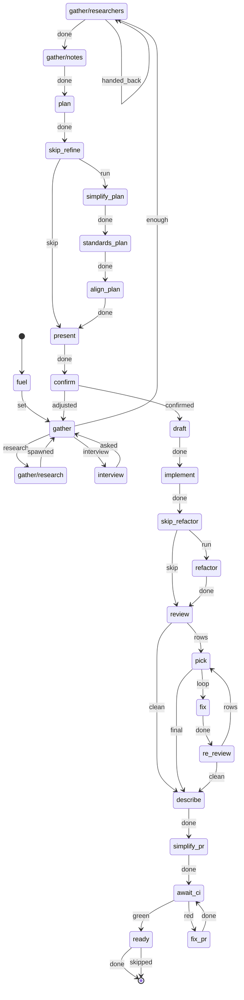
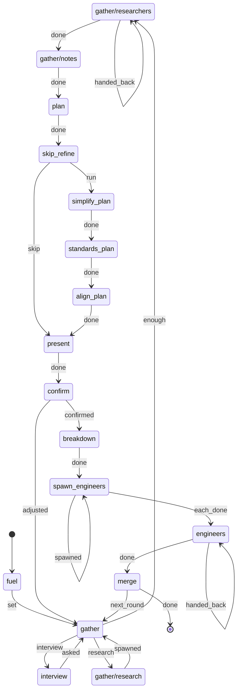
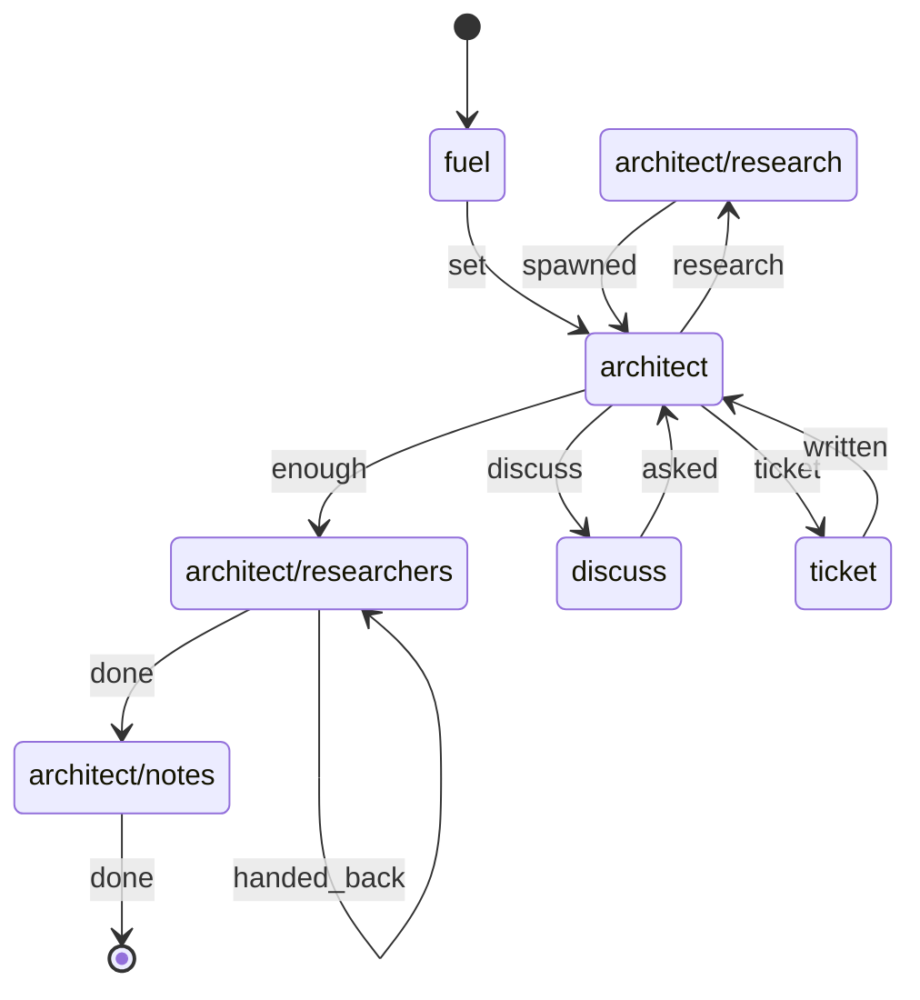

# Flows

| Flow | From | To | Diagram |
|---|---|---|---|
| **engineer** | a task | a ready pull request | [Engineer](#engineer) |
| **10x** | a plan | many engineers in parallel, their PRs merged | [10x](#10x) |
| **architect** | an idea | a design, no code changed | [Architect](#architect) |
| **chief** | a stream of requests | each request routed once | [The chief routes requests](#the-chief-routes-requests), [Chief](#chief) |

A flow is the path one run walks: a state machine. Its states are steps
(plan, implement, review, ...); its arrows are the outcomes a step can end
in.

The diagrams are not drawn by hand. Each is the output of
`state render mermaid --flow <flow>`, and a Nix check fails when the page and
the kernel disagree ([Keeping this page true](#keeping-this-page-true)).

## The chief routes requests

Most sessions start in the chief. It takes requests one at a time, sets each
one's Fuel, and routes it once. The sketch above is drawn by hand; the full
render is [at the end](#chief).

| Route | What runs | Where |
|---|---|---|
| `engineer`, `10x`, `architect` | the whole flow, inline in the chief's run | below |
| `blocks` | one part of the engineer flow, alone | [Blocks](#blocks) |
| `discussion` | a read-only talk with researchers, no code | the architect's loop, without the ticket |
| `other` | a request no flow fits (`direct`) | - |
| `delegate` | an engineer as a child run beside the chief | the chief waits for it at the end |

A request's states sit under its route's name (`engineer/plan`,
`10x/merge`), so two requests never share a state. The chief can park the
request in focus and turn to another (`state focus`). The routes are in
[`Chief.hs`](https://github.com/ILIYANGERMANOV/nixos/blob/2c6ba6df6c2a9cc70bbd299cdbd8efd1b6df1edc/programs/agents/kernel/src/State/Flow/Chief.hs#L38).

## Who runs each state

| Runner | States | What it does |
|---|---|---|
| lead (`you` in `state render states`) | `fuel`, `gather`, `interview`, `plan`, `present`, `confirm`, `draft`, `pick`, `await_ci`, `ready`, `breakdown`, `merge`, `route`, `next`, ... | decides, asks the user, records outcomes |
| `researcher` | `research`, `simplify_plan`, `standards_plan` | finds facts; reports where a plan could be simpler or follow a standard |
| `reviewer` | `align_plan` | reports where a plan breaks the engineering instructions |
| `implementer` | `implement` | builds one slice of the plan |
| `refactorer` | `refactor` | one refactor pass |
| `review-lead` | `review`, `re_review` | one review pass (a re-review reads only the fix) |
| `fixer` | `fix`, `describe`, `simplify_pr`, `fix_pr` | fixes rows, writes the PR text, fixes red CI |
| await | `*/researchers`, `engineers`, `delegates` | waits for every worker or child to hand back |
| fan-out | `spawn_engineers`, `spawn_delegates` | starts one child run per task |

The lead is the agent that ran the flow's skill (`/engineer`,
`/10x-engineer`, `/architect`, `/chief`); every other runner is a subagent
with a narrow role. Each step's runner is one row of
[`flows/steps.nix`](https://github.com/ILIYANGERMANOV/nixos/blob/2c6ba6df6c2a9cc70bbd299cdbd8efd1b6df1edc/programs/agents/flows/steps.nix#L1),
and each role's tools are derived from the rows it runs
([`lib/derive.nix`](https://github.com/ILIYANGERMANOV/nixos/blob/2c6ba6df6c2a9cc70bbd299cdbd8efd1b6df1edc/programs/agents/lib/derive.nix#L1);
see [ARCHITECTURE](ARCHITECTURE.md)).

## Engineer

From a task to a ready pull request:

1. Set the Fuel.
2. **Agree** on a plan: gather facts, interview the user, plan, refine,
   present, confirm.
3. **Build**: draft PR, implement, refactor.
4. **Review**: pick, fix, re-review, in a loop.
5. **Describe** the PR.
6. **Ship**: wait for CI, fix it, mark the PR ready.

Source: [`Engineer.hs`](https://github.com/ILIYANGERMANOV/nixos/blob/2c6ba6df6c2a9cc70bbd299cdbd8efd1b6df1edc/programs/agents/kernel/src/State/Flow/Engineer.hs#L11),
built from the blocks in [`Library.hs`](https://github.com/ILIYANGERMANOV/nixos/blob/2c6ba6df6c2a9cc70bbd299cdbd8efd1b6df1edc/programs/agents/kernel/src/State/Flow/Library.hs#L217).

Read it as: each box is a state, each arrow is labelled with the outcome
the run records to take it (`state record review.rows`). `skip_refine`
and `skip_refactor` are where Fuel decides (see [Fuel skips](#where-fuel-skips-a-step)).

## 10x

Many engineers in parallel:

1. Agree on a plan, like the engineer.
2. Break it into tasks; start one engineer child run per task.
3. Wait for all of them; merge their PRs.
4. `merge.next_round` loops back to plan the next round in the same run.

Source: [`TenX.hs`](https://github.com/ILIYANGERMANOV/nixos/blob/2c6ba6df6c2a9cc70bbd299cdbd8efd1b6df1edc/programs/agents/kernel/src/State/Flow/TenX.hs#L19).

Each child is a full engineer run of its own, with its own log, linked to the
10x run as its parent (see [RUN-LOOP](RUN-LOOP.md#the-run-store)).

## Architect

From an idea to a design, changing no code. Each round the agent picks one:

- spawn a researcher on a fact gap;
- ask the user design questions;
- write or edit the ticket.

`enough` waits for every researcher, merges their notes and ends the run.
Source: [`Architect.hs`](https://github.com/ILIYANGERMANOV/nixos/blob/2c6ba6df6c2a9cc70bbd299cdbd8efd1b6df1edc/programs/agents/kernel/src/State/Flow/Architect.hs#L20).

## Blocks

| Block | Runs | Starts from |
|---|---|---|
| `researching` | researchers on fact gaps, then notes | context |
| `gathering` | gather (research, interview) | context |
| `agreeing` | gather, plan, refine, present, confirm | context |
| `proposing` | plan, refine, present, confirm | context |
| `building` | draft, implement, refactor | a plan (`open_plan`) |
| `reviewing` | review, pick, fix, re-review | a branch (`open_branch`) |
| `describing` | describe, simplify the PR | a branch (`open_branch`) |
| `shipping` | await CI, fix CI, ready | a PR (`open_pr`) |

A block is one part of the engineer flow that the chief runs alone, when a
request needs only that part. A block that starts past the task's context
first opens its input from the issue, branch or PR the request names.

Source: [`blocks` in `Library.hs`](https://github.com/ILIYANGERMANOV/nixos/blob/2c6ba6df6c2a9cc70bbd299cdbd8efd1b6df1edc/programs/agents/kernel/src/State/Flow/Library.hs#L272).

## Where Fuel skips a step

| Step | Low | Balanced | Max | Also skipped when |
|---|---|---|---|---|
| `refine` (`simplify_plan`, `standards_plan`, `align_plan`) | agent's call, on a trivial task | runs | runs | the plan is settled without the user (`present` is skipped too): a parent run decided it, or it is feedback with no Design or Scope question open |
| `refactor` | agent's call, on a trivial task | skipped at 100 changed lines or fewer | runs | - |
| `describe`, `simplify_pr`, `ready` | never skipped | never skipped | never skipped | - |

Fuel, the run's effort level ([GUARDRAILS](GUARDRAILS.md#fuel-and-caps)),
sizes every cap (next section) and decides two skips. At a `skip_*` state
the kernel records `run` or `skip` itself when the Fuel or the facts decide;
the agent decides only where the table says "agent's call".

Sources: [`propose`](https://github.com/ILIYANGERMANOV/nixos/blob/2c6ba6df6c2a9cc70bbd299cdbd8efd1b6df1edc/programs/agents/kernel/src/State/Flow/Library.hs#L217) and
[`skippableAtLow`](https://github.com/ILIYANGERMANOV/nixos/blob/2c6ba6df6c2a9cc70bbd299cdbd8efd1b6df1edc/programs/agents/kernel/src/State/Flow/Library.hs#L320) for
the `refine` block; [`build`](https://github.com/ILIYANGERMANOV/nixos/blob/2c6ba6df6c2a9cc70bbd299cdbd8efd1b6df1edc/programs/agents/kernel/src/State/Flow/Library.hs#L228)
for `refactor`; [`settledSkips`](https://github.com/ILIYANGERMANOV/nixos/blob/2c6ba6df6c2a9cc70bbd299cdbd8efd1b6df1edc/programs/agents/kernel/src/State/Run/Fold.hs#L921)
for the settled plan; the kernel takes the skip in
[`due`](https://github.com/ILIYANGERMANOV/nixos/blob/2c6ba6df6c2a9cc70bbd299cdbd8efd1b6df1edc/programs/agents/kernel/src/State/Protocol/Advice.hs#L198).
A run that never set its Fuel counts as Balanced.

## The caps

| Meter | Step that spends it | Flow | Low | Balanced | Max | At the cap |
|---|---|---|---|---|---|---|
| Plan rounds | `confirm.adjusted` | engineer, 10x | 3 | 3 | 3 | [Stop](https://github.com/ILIYANGERMANOV/nixos/blob/2c6ba6df6c2a9cc70bbd299cdbd8efd1b6df1edc/programs/agents/kernel/src/State/Flow/Library.hs#L221) |
| Re-reviews | `pick.loop` | engineer | 1 | 3 | 5 | [Refuse](https://github.com/ILIYANGERMANOV/nixos/blob/2c6ba6df6c2a9cc70bbd299cdbd8efd1b6df1edc/programs/agents/kernel/src/State/Flow/Library.hs#L249): only `pick.final` is left |
| CI fixes | `fix_pr.done` | engineer | 5 | 5 | 5 | [Stop](https://github.com/ILIYANGERMANOV/nixos/blob/2c6ba6df6c2a9cc70bbd299cdbd8efd1b6df1edc/programs/agents/kernel/src/State/Flow/Library.hs#L263) |
| Rounds | `merge.next_round` | 10x | 9 | 9 | 9 | [Stop](https://github.com/ILIYANGERMANOV/nixos/blob/2c6ba6df6c2a9cc70bbd299cdbd8efd1b6df1edc/programs/agents/kernel/src/State/Flow/TenX.hs#L19): 10 rounds in all |
| Requests | `next.request` | chief | 50 | 100 | 200 | [Extend](https://github.com/ILIYANGERMANOV/nixos/blob/2c6ba6df6c2a9cc70bbd299cdbd8efd1b6df1edc/programs/agents/kernel/src/State/Flow/Chief.hs#L38) |
| Researchers | `research` (gather) | engineer, 10x | 1 | 5 | one per fact group | [Extend](https://github.com/ILIYANGERMANOV/nixos/blob/2c6ba6df6c2a9cc70bbd299cdbd8efd1b6df1edc/programs/agents/kernel/src/State/Flow/Library.hs#L180) |
| Interview questions | `interview` | engineer, 10x | 15 | 30 | 50 | [Extend](https://github.com/ILIYANGERMANOV/nixos/blob/2c6ba6df6c2a9cc70bbd299cdbd8efd1b6df1edc/programs/agents/kernel/src/State/Flow/Library.hs#L138) |
| Researchers | `research` (design) | architect, chief discussion | 10 | 30 | 60 | [Extend](https://github.com/ILIYANGERMANOV/nixos/blob/2c6ba6df6c2a9cc70bbd299cdbd8efd1b6df1edc/programs/agents/kernel/src/State/Flow/Library.hs#L180) |
| Discussion questions | `discuss` | architect, chief discussion | 50 | 100 | 200 | [Extend](https://github.com/ILIYANGERMANOV/nixos/blob/2c6ba6df6c2a9cc70bbd299cdbd8efd1b6df1edc/programs/agents/kernel/src/State/Flow/Library.hs#L156) |

Every loop in a flow holds a capped step, so no run loops forever. Each cap
counts one thing (a meter); used up, it refuses the spend, stops the run or
asks the user to extend it ([GUARDRAILS](GUARDRAILS.md#fuel-and-caps)
explains the three). The chief's request cap guards against a runaway loop;
it is not a budget.
Each request keeps the caps of its own path.

## Chief

The whole chief flow, as the kernel renders it: every route above, with each
whole flow and block inlined under its route's name.

```mermaid

stateDiagram-v2
  direction TB
  state "architect/fuel" as architect__fuel
  state "architect/architect" as architect__architect
  state "architect/architect/researchers" as architect__architect__researchers
  state "architect/architect/notes" as architect__architect__notes
  state "architect/architect/research" as architect__architect__research
  state "architect/discuss" as architect__discuss
  state "architect/ticket" as architect__ticket
  state "engineer/fuel" as engineer__fuel
  state "engineer/gather" as engineer__gather
  state "engineer/gather/researchers" as engineer__gather__researchers
  state "engineer/gather/notes" as engineer__gather__notes
  state "engineer/gather/research" as engineer__gather__research
  state "engineer/interview" as engineer__interview
  state "engineer/plan" as engineer__plan
  state "engineer/skip_refine" as engineer__skip_refine
  state "engineer/simplify_plan" as engineer__simplify_plan
  state "engineer/standards_plan" as engineer__standards_plan
  state "engineer/align_plan" as engineer__align_plan
  state "engineer/present" as engineer__present
  state "engineer/confirm" as engineer__confirm
  state "engineer/draft" as engineer__draft
  state "engineer/implement" as engineer__implement
  state "engineer/skip_refactor" as engineer__skip_refactor
  state "engineer/refactor" as engineer__refactor
  state "engineer/review" as engineer__review
  state "engineer/pick" as engineer__pick
  state "engineer/fix" as engineer__fix
  state "engineer/re_review" as engineer__re_review
  state "engineer/describe" as engineer__describe
  state "engineer/simplify_pr" as engineer__simplify_pr
  state "engineer/await_ci" as engineer__await_ci
  state "engineer/fix_pr" as engineer__fix_pr
  state "engineer/ready" as engineer__ready
  state "10x/fuel" as 10x__fuel
  state "10x/gather" as 10x__gather
  state "10x/gather/researchers" as 10x__gather__researchers
  state "10x/gather/notes" as 10x__gather__notes
  state "10x/gather/research" as 10x__gather__research
  state "10x/interview" as 10x__interview
  state "10x/plan" as 10x__plan
  state "10x/skip_refine" as 10x__skip_refine
  state "10x/simplify_plan" as 10x__simplify_plan
  state "10x/standards_plan" as 10x__standards_plan
  state "10x/align_plan" as 10x__align_plan
  state "10x/present" as 10x__present
  state "10x/confirm" as 10x__confirm
  state "10x/breakdown" as 10x__breakdown
  state "10x/spawn_engineers" as 10x__spawn_engineers
  state "10x/engineers" as 10x__engineers
  state "10x/merge" as 10x__merge
  state "researching/exploring" as researching__exploring
  state "researching/exploring/researchers" as researching__exploring__researchers
  state "researching/exploring/notes" as researching__exploring__notes
  state "researching/exploring/research" as researching__exploring__research
  state "gathering/gather" as gathering__gather
  state "gathering/gather/researchers" as gathering__gather__researchers
  state "gathering/gather/notes" as gathering__gather__notes
  state "gathering/gather/research" as gathering__gather__research
  state "gathering/interview" as gathering__interview
  state "agreeing/gather" as agreeing__gather
  state "agreeing/gather/researchers" as agreeing__gather__researchers
  state "agreeing/gather/notes" as agreeing__gather__notes
  state "agreeing/gather/research" as agreeing__gather__research
  state "agreeing/interview" as agreeing__interview
  state "agreeing/plan" as agreeing__plan
  state "agreeing/skip_refine" as agreeing__skip_refine
  state "agreeing/simplify_plan" as agreeing__simplify_plan
  state "agreeing/standards_plan" as agreeing__standards_plan
  state "agreeing/align_plan" as agreeing__align_plan
  state "agreeing/present" as agreeing__present
  state "agreeing/confirm" as agreeing__confirm
  state "proposing/plan" as proposing__plan
  state "proposing/skip_refine" as proposing__skip_refine
  state "proposing/simplify_plan" as proposing__simplify_plan
  state "proposing/standards_plan" as proposing__standards_plan
  state "proposing/align_plan" as proposing__align_plan
  state "proposing/present" as proposing__present
  state "proposing/confirm" as proposing__confirm
  state "building/open_plan" as building__open_plan
  state "building/draft" as building__draft
  state "building/implement" as building__implement
  state "building/skip_refactor" as building__skip_refactor
  state "building/refactor" as building__refactor
  state "reviewing/open_branch" as reviewing__open_branch
  state "reviewing/review" as reviewing__review
  state "reviewing/pick" as reviewing__pick
  state "reviewing/fix" as reviewing__fix
  state "reviewing/re_review" as reviewing__re_review
  state "describing/open_branch" as describing__open_branch
  state "describing/describe" as describing__describe
  state "describing/simplify_pr" as describing__simplify_pr
  state "shipping/open_pr" as shipping__open_pr
  state "shipping/await_ci" as shipping__await_ci
  state "shipping/fix_pr" as shipping__fix_pr
  state "shipping/ready" as shipping__ready
  state "discussion/discussing" as discussion__discussing
  state "discussion/discussing/researchers" as discussion__discussing__researchers
  state "discussion/discussing/notes" as discussion__discussing__notes
  state "discussion/discussing/research" as discussion__discussing__research
  state "discussion/discuss" as discussion__discuss
  [*] --> fuel
  fuel --> route: set
  route --> 10x__fuel: 10x
  route --> architect__fuel: architect
  route --> block: blocks
  route --> spawn_delegates: delegate
  route --> discussion__discussing: discussion
  route --> engineer__fuel: engineer
  route --> direct: other
  architect__fuel --> architect__architect: set
  architect__architect --> architect__discuss: discuss
  architect__architect --> architect__architect__researchers: enough
  architect__architect --> architect__architect__research: research
  architect__architect --> architect__ticket: ticket
  architect__architect__researchers --> architect__architect__notes: done
  architect__architect__researchers --> architect__architect__researchers: handed_back
  architect__architect__notes --> next: done
  architect__architect__research --> architect__architect: spawned
  architect__discuss --> architect__architect: asked
  architect__ticket --> architect__architect: written
  engineer__fuel --> engineer__gather: set
  engineer__gather --> engineer__gather__researchers: enough
  engineer__gather --> engineer__interview: interview
  engineer__gather --> engineer__gather__research: research
  engineer__gather__researchers --> engineer__gather__notes: done
  engineer__gather__researchers --> engineer__gather__researchers: handed_back
  engineer__gather__notes --> engineer__plan: done
  engineer__gather__research --> engineer__gather: spawned
  engineer__interview --> engineer__gather: asked
  engineer__plan --> engineer__skip_refine: done
  engineer__skip_refine --> engineer__simplify_plan: run
  engineer__skip_refine --> engineer__present: skip
  engineer__simplify_plan --> engineer__standards_plan: done
  engineer__standards_plan --> engineer__align_plan: done
  engineer__align_plan --> engineer__present: done
  engineer__present --> engineer__confirm: done
  engineer__confirm --> engineer__gather: adjusted
  engineer__confirm --> engineer__draft: confirmed
  engineer__draft --> engineer__implement: done
  engineer__implement --> engineer__skip_refactor: done
  engineer__skip_refactor --> engineer__refactor: run
  engineer__skip_refactor --> engineer__review: skip
  engineer__refactor --> engineer__review: done
  engineer__review --> engineer__describe: clean
  engineer__review --> engineer__pick: rows
  engineer__pick --> engineer__describe: final
  engineer__pick --> engineer__fix: loop
  engineer__fix --> engineer__re_review: done
  engineer__re_review --> engineer__describe: clean
  engineer__re_review --> engineer__pick: rows
  engineer__describe --> engineer__simplify_pr: done
  engineer__simplify_pr --> engineer__await_ci: done
  engineer__await_ci --> engineer__ready: green
  engineer__await_ci --> engineer__fix_pr: red
  engineer__fix_pr --> engineer__await_ci: done
  engineer__ready --> next: done
  engineer__ready --> next: skipped
  10x__fuel --> 10x__gather: set
  10x__gather --> 10x__gather__researchers: enough
  10x__gather --> 10x__interview: interview
  10x__gather --> 10x__gather__research: research
  10x__gather__researchers --> 10x__gather__notes: done
  10x__gather__researchers --> 10x__gather__researchers: handed_back
  10x__gather__notes --> 10x__plan: done
  10x__gather__research --> 10x__gather: spawned
  10x__interview --> 10x__gather: asked
  10x__plan --> 10x__skip_refine: done
  10x__skip_refine --> 10x__simplify_plan: run
  10x__skip_refine --> 10x__present: skip
  10x__simplify_plan --> 10x__standards_plan: done
  10x__standards_plan --> 10x__align_plan: done
  10x__align_plan --> 10x__present: done
  10x__present --> 10x__confirm: done
  10x__confirm --> 10x__gather: adjusted
  10x__confirm --> 10x__breakdown: confirmed
  10x__breakdown --> 10x__spawn_engineers: done
  10x__spawn_engineers --> 10x__engineers: each_done
  10x__spawn_engineers --> 10x__spawn_engineers: spawned
  10x__engineers --> 10x__merge: done
  10x__engineers --> 10x__engineers: handed_back
  10x__merge --> next: done
  10x__merge --> 10x__gather: next_round
  block --> agreeing__gather: agreeing
  block --> building__open_plan: building
  block --> describing__open_branch: describing
  block --> gathering__gather: gathering
  block --> proposing__plan: proposing
  block --> researching__exploring: researching
  block --> reviewing__open_branch: reviewing
  block --> shipping__open_pr: shipping
  researching__exploring --> researching__exploring__researchers: enough
  researching__exploring --> researching__exploring__research: research
  researching__exploring__researchers --> researching__exploring__notes: done
  researching__exploring__researchers --> researching__exploring__researchers: handed_back
  researching__exploring__notes --> next: done
  researching__exploring__research --> researching__exploring: spawned
  gathering__gather --> gathering__gather__researchers: enough
  gathering__gather --> gathering__interview: interview
  gathering__gather --> gathering__gather__research: research
  gathering__gather__researchers --> gathering__gather__notes: done
  gathering__gather__researchers --> gathering__gather__researchers: handed_back
  gathering__gather__notes --> next: done
  gathering__gather__research --> gathering__gather: spawned
  gathering__interview --> gathering__gather: asked
  agreeing__gather --> agreeing__gather__researchers: enough
  agreeing__gather --> agreeing__interview: interview
  agreeing__gather --> agreeing__gather__research: research
  agreeing__gather__researchers --> agreeing__gather__notes: done
  agreeing__gather__researchers --> agreeing__gather__researchers: handed_back
  agreeing__gather__notes --> agreeing__plan: done
  agreeing__gather__research --> agreeing__gather: spawned
  agreeing__interview --> agreeing__gather: asked
  agreeing__plan --> agreeing__skip_refine: done
  agreeing__skip_refine --> agreeing__simplify_plan: run
  agreeing__skip_refine --> agreeing__present: skip
  agreeing__simplify_plan --> agreeing__standards_plan: done
  agreeing__standards_plan --> agreeing__align_plan: done
  agreeing__align_plan --> agreeing__present: done
  agreeing__present --> agreeing__confirm: done
  agreeing__confirm --> agreeing__gather: adjusted
  agreeing__confirm --> next: confirmed
  proposing__plan --> proposing__skip_refine: done
  proposing__skip_refine --> proposing__simplify_plan: run
  proposing__skip_refine --> proposing__present: skip
  proposing__simplify_plan --> proposing__standards_plan: done
  proposing__standards_plan --> proposing__align_plan: done
  proposing__align_plan --> proposing__present: done
  proposing__present --> proposing__confirm: done
  proposing__confirm --> proposing__plan: adjusted
  proposing__confirm --> next: confirmed
  building__open_plan --> building__draft: done
  building__draft --> building__implement: done
  building__implement --> building__skip_refactor: done
  building__skip_refactor --> building__refactor: run
  building__skip_refactor --> next: skip
  building__refactor --> next: done
  reviewing__open_branch --> reviewing__review: done
  reviewing__review --> next: clean
  reviewing__review --> reviewing__pick: rows
  reviewing__pick --> next: final
  reviewing__pick --> reviewing__fix: loop
  reviewing__fix --> reviewing__re_review: done
  reviewing__re_review --> next: clean
  reviewing__re_review --> reviewing__pick: rows
  describing__open_branch --> describing__describe: done
  describing__describe --> describing__simplify_pr: done
  describing__simplify_pr --> next: done
  shipping__open_pr --> shipping__await_ci: done
  shipping__await_ci --> shipping__ready: green
  shipping__await_ci --> shipping__fix_pr: red
  shipping__fix_pr --> shipping__await_ci: done
  shipping__ready --> next: done
  shipping__ready --> next: skipped
  discussion__discussing --> discussion__discuss: discuss
  discussion__discussing --> discussion__discussing__researchers: enough
  discussion__discussing --> discussion__discussing__research: research
  discussion__discussing__researchers --> discussion__discussing__notes: done
  discussion__discussing__researchers --> discussion__discussing__researchers: handed_back
  discussion__discussing__notes --> next: done
  discussion__discussing__research --> discussion__discussing: spawned
  discussion__discuss --> discussion__discussing: asked
  direct --> next: done
  spawn_delegates --> next: spawned
  next --> delegates: done
  next --> fuel: request
  delegates --> [*]: done
  delegates --> delegates: handed_back

```

Full chief render (245 lines)

## Keeping this page true

The four state diagrams above are checked, not trusted. The Nix check
`rendered` ([`kernel/rendered.nix`](https://github.com/ILIYANGERMANOV/nixos/blob/2c6ba6df6c2a9cc70bbd299cdbd8efd1b6df1edc/programs/agents/kernel/rendered.nix#L1), part of
`checks.<system>.agents`) runs `state render mermaid --flow <flow>` for each
flow and fails when this page does not hold the output exactly, as a whole
block between blank lines. To update the page after a flow change, paste
what the check prints.

## Decisions

The design of flows is in [ADR 0019](../adr/0019-composable-flows.md) and
[ADR 0020](../adr/0020-flow-core-from-sums-and-elgot.md); how a run moves
through one is in [RUN-LOOP](RUN-LOOP.md); the caps and who answers what are
in [GUARDRAILS](GUARDRAILS.md).
