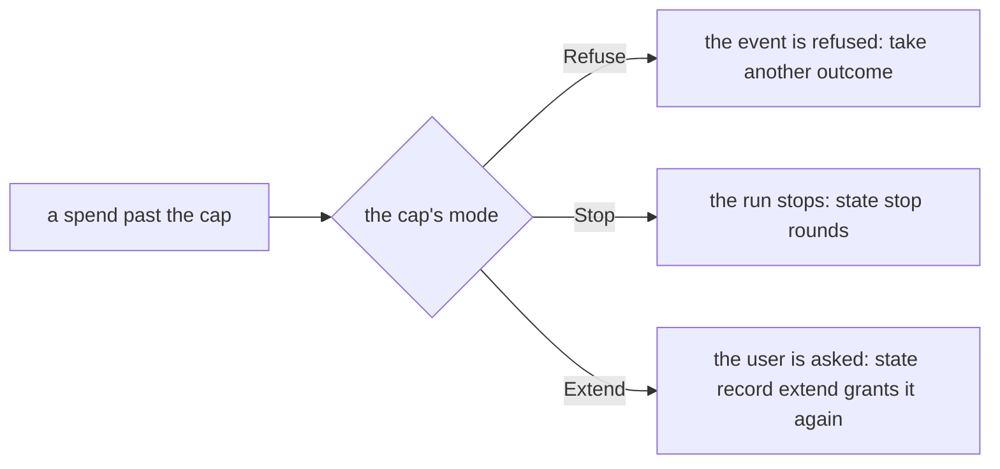
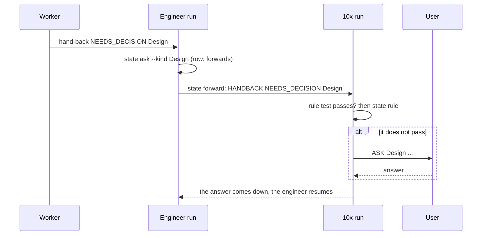

# Guardrails

What keeps a run from looping forever, from deciding what it should not,
and from wasting its context. Three layers, from strongest to weakest:

| Layer | What | Can it be skipped? |
|---|---|---|
| Kernel code | Fuel and caps, the stuck rule, who answers which question | no: `state` refuses the event |
| Hooks | the run's records, the route gate | best effort: they fail open |
| Guards | secret, read, wait and context guards | best effort: they fail open |

The rule that puts a behaviour on the strongest layer that can hold it is
the logic ladder ([ADR 0013](../adr/0013-deterministic-programs-over-instructions.md),
[ARCHITECTURE](ARCHITECTURE.md)). The flows these rules act on are in
[FLOWS](FLOWS.md); the loop that applies them is in [RUN-LOOP](RUN-LOOP.md).

## Fuel and caps

Fuel is a run's effort level: `low`, `balanced` (the default) or `max`,
set by `state record fuel.set <level>` at the run's first step. It decides
two things:

- **Skips**: which optional steps run (`simplify_plan`, `refactor`).
- **Caps**: how far each loop may go.

A cap is a **meter** on one step: a count of what that step's outcomes spend
(each `pick.loop` spends one re-review, each `confirm.adjusted` one plan
round). Its **limit** is `up to n` or `one per group` of the plan
([`Limit`](https://github.com/ILIYANGERMANOV/nixos/blob/2c6ba6df6c2a9cc70bbd299cdbd8efd1b6df1edc/programs/agents/kernel/src/State/Category/Meter.hs#L48)). At the limit, the cap does one
of three things ([`AtCap`](https://github.com/ILIYANGERMANOV/nixos/blob/2c6ba6df6c2a9cc70bbd299cdbd8efd1b6df1edc/programs/agents/kernel/src/State/Category/Meter.hs#L66)):



| Mode | Used where | Why |
|---|---|---|
| Refuse | re-reviews | a review loop has a safe exit: `pick.final` |
| Stop | plan rounds, CI fixes, 10x rounds | going on without a person would waste work |
| Extend | researchers, questions, chief requests | more may be fine, but the user decides |

Every number, per flow and per Fuel, is in [FLOWS: The caps](FLOWS.md#the-caps).
`state render fuel --flow <flow>` prints the table a run uses. A higher Fuel
never allows less than a lower one
([`limitAtMost`](https://github.com/ILIYANGERMANOV/nixos/blob/2c6ba6df6c2a9cc70bbd299cdbd8efd1b6df1edc/programs/agents/kernel/src/State/Category/Meter.hs#L52),
[`skipsAtMost`](https://github.com/ILIYANGERMANOV/nixos/blob/2c6ba6df6c2a9cc70bbd299cdbd8efd1b6df1edc/programs/agents/kernel/src/State/Category/Fuel.hs#L84); the law is in
[CATEGORY-THEORY](CATEGORY-THEORY.md)).

## The stuck rule

A cap ends a loop late. The stuck rule ends it early, when the loop is not
making progress. It is kernel code, not a hook
([`stuck`](https://github.com/ILIYANGERMANOV/nixos/blob/2c6ba6df6c2a9cc70bbd299cdbd8efd1b6df1edc/programs/agents/kernel/src/State/Run/Fold.hs#L1428)).

- Each round of a loop (review, CI) finds **problems**: review rows, unmet
  requirements, failing checks ([`Problem`](https://github.com/ILIYANGERMANOV/nixos/blob/2c6ba6df6c2a9cc70bbd299cdbd8efd1b6df1edc/programs/agents/kernel/src/State/Run/Fold.hs#L267)).
- A loop is **stuck** when its last two rounds, in a row, share a problem.
- The advice then is to ask a `Stuck` question. Once it is asked, the
  loop's exits open from where the run is: a stuck review loop may end with
  `pick.final` at `fix` ([`stuckExits`](https://github.com/ILIYANGERMANOV/nixos/blob/2c6ba6df6c2a9cc70bbd299cdbd8efd1b6df1edc/programs/agents/kernel/src/State/Run/Fold.hs#L1403)). A
  CI loop never claims CI is green.

```text
rounds {A, B} then {B, C}   B is in both: stuck
rounds {A, B} then {C, D}   nothing shared: not stuck
```

The rule looks only at the last two rounds on purpose. A loop that
alternates (A, B, A, B) is not caught; its cap ends it.

## Who answers which question

A question has a **kind**. Its kind, and where the asking run sits, decide who
may answer it. Each run's role sits on a rung: workers (subagents), leads
(engineer, architect, chief), the orchestrator (10x), and the user
([`Role.hs`](https://github.com/ILIYANGERMANOV/nixos/blob/2c6ba6df6c2a9cc70bbd299cdbd8efd1b6df1edc/programs/agents/kernel/src/State/Role.hs#L66)). The table is
[`authority`](https://github.com/ILIYANGERMANOV/nixos/blob/2c6ba6df6c2a9cc70bbd299cdbd8efd1b6df1edc/programs/agents/kernel/src/State/Run/Ask.hs#L122):

| Kind | Worker | Lead | Orchestrator | User |
|---|---|---|---|---|
| Fact | forwards | answers | answers | never asked |
| Pick | forwards | answers | answers | answers |
| Design | forwards | forwards | answers if it passes the rule test | answers |
| Scope | forwards | forwards | answers if it passes the rule test | answers |
| Confirm | forwards | forwards | answers if the task plan fits the confirmed breakdown | answers |
| Security | forwards | forwards | answers if the user already answered it, or it is obvious | answers |
| Stuck | forwards | forwards | answers if no retry was spent on it yet | answers |

The rule test: the answer is lower-impact, mostly obvious and reversible
([`Cond`](https://github.com/ILIYANGERMANOV/nixos/blob/2c6ba6df6c2a9cc70bbd299cdbd8efd1b6df1edc/programs/agents/kernel/src/State/Run/Ask.hs#L100)).

A question climbs until a rung may answer it:



The model judges the conditions ("is this obvious?"); no code can. The
kernel checks the structure ([`Ask.hs`](https://github.com/ILIYANGERMANOV/nixos/blob/2c6ba6df6c2a9cc70bbd299cdbd8efd1b6df1edc/programs/agents/kernel/src/State/Run/Ask.hs#L1)):

- a ruling where the row says forward is refused, and a forward where the
  row says answer;
- a `Security` ruling needs a basis: an earlier event or `obvious:<why>`;
- a question is never re-tagged away from `Security`
  ([`raise`](https://github.com/ILIYANGERMANOV/nixos/blob/2c6ba6df6c2a9cc70bbd299cdbd8efd1b6df1edc/programs/agents/kernel/src/State/Run/Ask.hs#L152)).

A forwarded question goes to whoever started the run: the user, the parent
run, or the agent that spawned this one
([`deliver`](https://github.com/ILIYANGERMANOV/nixos/blob/2c6ba6df6c2a9cc70bbd299cdbd8efd1b6df1edc/programs/agents/kernel/src/State/Run/Ask.hs#L415)). The model of these handlers is in
[ADR 0021](../adr/0021-flow-effects.md) and [CATEGORY-THEORY](CATEGORY-THEORY.md).

## Hooks

Hooks let the run's record keep up with what the agents do, without the
model remembering to record it
([ADR 0016](../adr/0016-hooks-drive-the-state-record.md)). Each runs
`state-hook <name>` ([`kernel/hooks.nix`](https://github.com/ILIYANGERMANOV/nixos/blob/2c6ba6df6c2a9cc70bbd299cdbd8efd1b6df1edc/programs/agents/kernel/hooks.nix#L12)).

| Hook | When | Does |
|---|---|---|
| `state-resume` | session start | records `Restarted` if agents were lost; prints `state show` and `state next` |
| `state-spawn` | before a spawn | prints `state next` and a warning if the spawn is off the advice |
| `state-handback` | before a hand-back | records the worker's hand-back |
| `state-asked` | after the ask tool | prints the answers to questions awaiting the user |
| `state-bind` | after a shell or a spawn | binds the agent to its run |
| `state-route` | before a shell, edit, write or spawn | **denies** a `state` call aimed at another run, and a lead's edit, commit, push, PR or spawn before its `state init` |
| `state-begin-*` | an agent, a typed skill or a skill call starts | tells the agent how its work begins |
| `state-stop`, `state-stop-call` | an agent stops | records a child run whose agent ended with no hand-back |

`state-route` is the only state hook that denies
([`gate`](https://github.com/ILIYANGERMANOV/nixos/blob/2c6ba6df6c2a9cc70bbd299cdbd8efd1b6df1edc/programs/agents/kernel/src/State/Cli/Route.hs#L203)). Every record a hook writes is
idempotent: a hook that fires twice records once (see
[RUN-LOOP](RUN-LOOP.md#the-run-store)).

## Guards

Guards stop common accidents before a tool runs
([`guards/hooks.nix`](https://github.com/ILIYANGERMANOV/nixos/blob/2c6ba6df6c2a9cc70bbd299cdbd8efd1b6df1edc/programs/agents/hooks/guards/hooks.nix#L1)). When several deny, each reason is
told, in this order.

| Guard | When | Denies |
|---|---|---|
| [secret](https://github.com/ILIYANGERMANOV/nixos/blob/2c6ba6df6c2a9cc70bbd299cdbd8efd1b6df1edc/programs/agents/hooks/guards/secret-guard/secret-guard.py#L1) | before a shell call | a command that names a secret file or its directory, expands a secret variable, or runs `printenv`/`env` inside a substitution |
| [read](https://github.com/ILIYANGERMANOV/nixos/blob/2c6ba6df6c2a9cc70bbd299cdbd8efd1b6df1edc/programs/agents/hooks/guards/read-guard/read-guard.py#L1) | before a shell call or a read | `cat` or `git show` of over 16 KiB to the screen, or an unlimited read of a text file over 16 KiB; skills and instruction files are exempt |
| [wait](https://github.com/ILIYANGERMANOV/nixos/blob/2c6ba6df6c2a9cc70bbd299cdbd8efd1b6df1edc/programs/agents/hooks/guards/wait-guard/wait-guard.py#L1) | before a shell call | a foreground sleep of 10 s or more, a sleep loop, `tail -f`; in a subagent also CI watches and repeated status reads |
| [context](https://github.com/ILIYANGERMANOV/nixos/blob/2c6ba6df6c2a9cc70bbd299cdbd8efd1b6df1edc/programs/agents/hooks/guards/context-guard/context-guard.py#L1) | after every tool | nothing: it only tells the agent its context size |

The context guard speaks at the warn limit, at the stop limit, then every
10k tokens past it. Past the stop it tells the agent to commit, push and hand
back a short note, so a fresh agent continues from the log
([RUN-LOOP](RUN-LOOP.md#resume-after-a-crash-or-a-lost-context)).

| Who | Warn | Stop |
|---|---|---|
| top-level session | 300k | 400k |
| engineer | 260k | 350k |
| any other role | 220k | 300k |

## Hooks fail open; they are not a security boundary

- **Fail open.** A guard that cannot read its input prints nothing and allows
  the call. A hook that crashes or prints something invalid never blocks: the
  dispatcher turns its error into context for the agent
  ([`run_hook`](https://github.com/ILIYANGERMANOV/nixos/blob/2c6ba6df6c2a9cc70bbd299cdbd8efd1b6df1edc/programs/agents/hooks/agent_hook.py#L328)). When several hooks answer, a
  deny wins and their contexts join
  ([`combine_verdicts`](https://github.com/ILIYANGERMANOV/nixos/blob/2c6ba6df6c2a9cc70bbd299cdbd8efd1b6df1edc/programs/agents/hooks/agent_hook.py#L266)).
- **Best effort.** A hook works only when the client fires it. So no skill
  assumes a hook fired: the prose names the fallback (`state record
  <step>.spawned`, `state handback <role>`).
- **Not a security boundary.** The guards read command text, and a
  determined command can always get past text matching (a script can read a
  file a `cat` could not). They catch careless commands and tell the model
  why. The boundaries are elsewhere: the client's permission deny rules, and
  secrets that reach a session only as file paths.

What is enforced for certain lives in the kernel: an event off the flow's
graph, past a cap, or a ruling the authority table forbids is refused no
matter what the model or a hook did.
