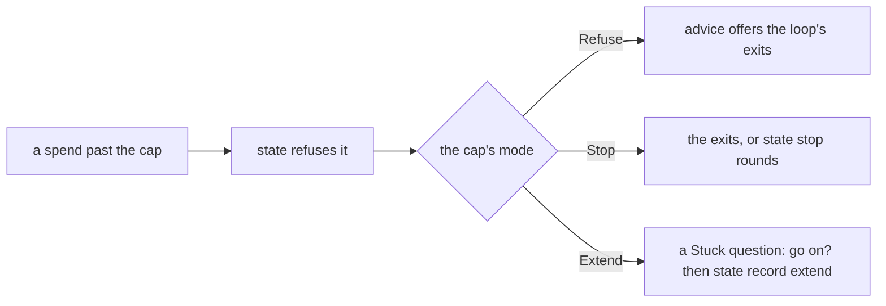
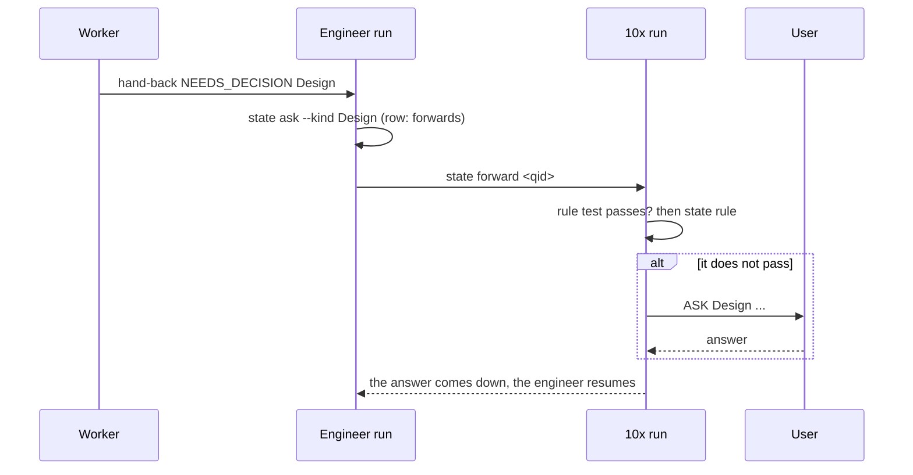

# Guardrails

| Layer, strongest first | What | Can it be skipped? |
|---|---|---|
| CI (per project) | the project's own checks on every PR | no: the engineer flow marks a PR ready only after green CI |
| Kernel code | Fuel and caps, the stuck rule, who answers which question | no: `state` refuses the event; `state override` is the one recorded way round |
| Hooks | the run's records, the route gate | best effort: they fail open |
| Guards | secret, read, wait and context guards | best effort: they fail open |

What keeps a run from looping forever, deciding what it should not, or
wasting its context. Each behaviour sits on the strongest layer that can
hold it: the logic ladder
([ADR 0013](../adr/0013-deterministic-programs-over-instructions.md),
[the reliability pyramid](README.md#the-reliability-pyramid)). The flows:
[FLOWS](FLOWS.md); the loop that applies the rules: [RUN-LOOP](RUN-LOOP.md).

## Fuel and caps



Fuel is a run's effort level: `low`, `balanced` (the default) or `max`, set
by `state record fuel.set <level>` at the run's first step. It decides:

- **Skips**: which optional steps run (the `refine` block, `refactor`).
  See [FLOWS: where Fuel skips a step](FLOWS.md#where-fuel-skips-a-step).
- **Caps**: how far each loop may go (below).
- **Full review**: which areas a fix gets a full review on: data model and
  auth, plus interface at Max
  ([`fullReview`](https://github.com/ILIYANGERMANOV/nixos/blob/1d114af7f556b904900b6aea70b733cabfd3ab32/programs/agents/kernel/src/State/Category/Fuel.hs#L101)).

A cap is a **meter** on one step: what that step's outcomes spend (each
`pick.loop` one re-review, each `confirm.adjusted` one plan round). Its
**limit** is `up to n` or `one per group` of the plan
([`Limit`](https://github.com/ILIYANGERMANOV/nixos/blob/1d114af7f556b904900b6aea70b733cabfd3ab32/programs/agents/kernel/src/State/Category/Meter.hs#L54)).
The kernel only counts a `one per group` limit; it refuses nothing there.

The nine meters:

| Meter | Step that spends it | Flow | Low | Balanced | Max | At the cap |
|---|---|---|---|---|---|---|
| Researchers | `research` (gather) | engineer, 10x | 1 | 5 | one per fact group | Extend |
| Researchers | `research` (design) | architect, chief discussion | 10 | 30 | 60 | Extend |
| Interview questions | `interview` | engineer, 10x | 15 | 30 | 50 | Extend |
| Discussion questions | `discuss` | architect, chief discussion | 50 | 100 | 200 | Extend |
| Plan rounds | `confirm.adjusted` | engineer, 10x | 3 | 3 | 3 | Stop |
| Re-reviews | `pick.loop` | engineer | 1 | 3 | 5 | Refuse: only `pick.final` is left |
| CI fixes | `fix_pr.done` | engineer | 5 | 5 | 5 | Stop |
| Rounds | `merge.next_round` | 10x | 9 | 9 | 9 | Stop: 10 rounds in all |
| Requests | `next.request` | chief | 50 | 100 | 200 | Extend |

The limits sit in the flow terms: [`Block.hs`](../../programs/agents/kernel/src/State/Flow/Block.hs),
[`TenX.hs`](../../programs/agents/kernel/src/State/Flow/Role/TenX.hs) and
[`Chief.hs`](../../programs/agents/kernel/src/State/Flow/Role/Chief.hs).
A chief request runs the caps of its own path; the request cap guards
against a runaway loop, it is not a budget.

Every cap refuses the spend past it, whatever its mode
([`spend`](https://github.com/ILIYANGERMANOV/nixos/blob/1d114af7f556b904900b6aea70b733cabfd3ab32/programs/agents/kernel/src/State/Run/Fold.hs#L1285)).
The mode ([`AtCap`](https://github.com/ILIYANGERMANOV/nixos/blob/1d114af7f556b904900b6aea70b733cabfd3ab32/programs/agents/kernel/src/State/Category/Meter.hs#L72))
only picks what the advice offers at the used-up step
([`capRecords`](https://github.com/ILIYANGERMANOV/nixos/blob/1d114af7f556b904900b6aea70b733cabfd3ab32/programs/agents/kernel/src/State/Protocol/Record.hs#L157)):

| Mode | Offers | Used where | Why |
|---|---|---|---|
| Refuse | the loop's exits | re-reviews | a review loop has a safe exit: `pick.final` |
| Stop | the exits, or `state stop rounds <why>` | plan rounds, CI fixes, 10x rounds | going on without a person would waste work |
| Extend | `state record extend <why>`, after a `Stuck` question "go on?" | researchers, questions, chief requests | more may be fine, but the user decides |

An `extend` grants again every extendable meter that holds the run
([`extended`](https://github.com/ILIYANGERMANOV/nixos/blob/1d114af7f556b904900b6aea70b733cabfd3ab32/programs/agents/kernel/src/State/Run/Fold.hs#L1266)).

A higher Fuel never allows less than a lower one
([`limitAtMost`](https://github.com/ILIYANGERMANOV/nixos/blob/1d114af7f556b904900b6aea70b733cabfd3ab32/programs/agents/kernel/src/State/Category/Meter.hs#L58),
[`skipsAtMost`](https://github.com/ILIYANGERMANOV/nixos/blob/1d114af7f556b904900b6aea70b733cabfd3ab32/programs/agents/kernel/src/State/Category/Fuel.hs#L84); the law is in
[CATEGORY-THEORY](CATEGORY-THEORY.md#laws-and-tests)).

### One source for Fuel

- The kernel is the one source: each cap and skip is a `PerFuel` value in
  the flow term
  ([`Fuel.hs`](../../programs/agents/kernel/src/State/Category/Fuel.hs)).
- `state render fuel --flow <flow>` prints the rows that vary by Fuel. Caps
  equal at every Fuel (plan rounds, CI fixes, 10x rounds) are not in it.
- The agents read the table in
  [`fuel.md`](../../programs/agents/instructions/topics/fuel.md). A Nix
  check fails when a rendered row is not a whole line of it
  ([`rendered.nix`](https://github.com/ILIYANGERMANOV/nixos/blob/1d114af7f556b904900b6aea70b733cabfd3ab32/programs/agents/kernel/rendered.nix#L54)).
- Four rows of `fuel.md` are prose only, not kernel: Skill dry run, Review
  agents, Large fix widens on, DEEP security.
- No skill, role or instruction may repeat a Fuel row: the
  [`modes`](../../programs/agents/lib/passes/modes.nix) pass fails the build.

## The stuck rule

```text
rounds {A, B} then {B, C}   B is in both: stuck
rounds {A, B} then {C, D}   nothing shared: not stuck
```

A cap ends a loop late. The stuck rule ends it early, when the loop makes no
progress. It is kernel code, not a hook
([`stuck`](https://github.com/ILIYANGERMANOV/nixos/blob/1d114af7f556b904900b6aea70b733cabfd3ab32/programs/agents/kernel/src/State/Run/Fold.hs#L1797)).

- Each round of a loop (review, CI) finds **problems**: review rows, unmet
  requirements, failing checks ([`Problem`](https://github.com/ILIYANGERMANOV/nixos/blob/1d114af7f556b904900b6aea70b733cabfd3ab32/programs/agents/kernel/src/State/Run/Fold.hs#L366)).
- A loop is **stuck** when its last two rounds, in a row, share a problem.
- The advice then is to ask a `Stuck` question. Once it is asked, the
  loop's exits open from where the run is: a stuck review loop may end with
  `pick.final` at `fix` ([`stuckExits`](https://github.com/ILIYANGERMANOV/nixos/blob/1d114af7f556b904900b6aea70b733cabfd3ab32/programs/agents/kernel/src/State/Run/Fold.hs#L1773)). A
  CI loop never claims CI is green.
- Only the last two rounds count, on purpose: a loop that alternates
  (A, B, A, B) is not caught; its cap ends it.

## Who answers which question

| Kind | Worker | Lead | Orchestrator | User |
|---|---|---|---|---|
| Fact | forwards | answers | answers | never asked |
| Pick | forwards | answers | answers | answers |
| Design | forwards | forwards | answers if it passes the rule test | answers |
| Scope | forwards | forwards | answers if it passes the rule test | answers |
| Confirm | forwards | forwards | answers if the task plan fits the confirmed breakdown | answers |
| Security | forwards | forwards | answers if the user already answered it, or it is obvious | answers |
| Stuck | forwards | forwards | answers if no retry was spent on it yet | answers |

A question's **kind**, and the rung of the asking run, decide who may answer
it. The rungs: workers (subagents), leads (engineer, architect, chief), the
orchestrator (10x), the user
([`Rung`](https://github.com/ILIYANGERMANOV/nixos/blob/1d114af7f556b904900b6aea70b733cabfd3ab32/programs/agents/kernel/src/State/Role.hs#L85)).
The rung is per state: a chief asks as the orchestrator inside its `10x`
route, and as the architect inside its `discussion`
([`rungAt`](https://github.com/ILIYANGERMANOV/nixos/blob/1d114af7f556b904900b6aea70b733cabfd3ab32/programs/agents/kernel/src/State/Role.hs#L157)).
The table is
[`authority`](https://github.com/ILIYANGERMANOV/nixos/blob/1d114af7f556b904900b6aea70b733cabfd3ab32/programs/agents/kernel/src/State/Run/Ask.hs#L131).
The rule test: the answer is lower-impact, mostly obvious and reversible
([`Cond`](https://github.com/ILIYANGERMANOV/nixos/blob/1d114af7f556b904900b6aea70b733cabfd3ab32/programs/agents/kernel/src/State/Run/Ask.hs#L109)).

A question climbs until a rung may answer it:



The model judges the conditions ("is this obvious?"); no code can. The
kernel checks the structure ([`Ask.hs`](../../programs/agents/kernel/src/State/Run/Ask.hs)):

- A ruling where the row says forward, or never asked, is refused.
- A forward is refused only for a `Fact` below the user, or for any
  question at the user, who has no one to forward to
  ([`forwardAnswered`](https://github.com/ILIYANGERMANOV/nixos/blob/1d114af7f556b904900b6aea70b733cabfd3ab32/programs/agents/kernel/src/State/Run/Ask.hs#L290)).
  So a lead may forward a `Pick` that needs the user.
- A `Security` ruling needs a basis: an earlier event or `obvious:<why>`.
- A question is never re-tagged away from `Security`
  ([`raise`](https://github.com/ILIYANGERMANOV/nixos/blob/1d114af7f556b904900b6aea70b733cabfd3ab32/programs/agents/kernel/src/State/Run/Ask.hs#L161)).

A forwarded question goes to whoever started the run: the user, the parent
run, or the agent that spawned this one
([`deliver`](https://github.com/ILIYANGERMANOV/nixos/blob/1d114af7f556b904900b6aea70b733cabfd3ab32/programs/agents/kernel/src/State/Run/Ask.hs#L427)). The model of these handlers is in
[ADR 0021](../adr/0021-flow-effects.md) and [CATEGORY-THEORY](CATEGORY-THEORY.md).

## Hooks

Seven state hooks, each `state-hook <name>`
([`kernel/hooks.nix`](../../programs/agents/kernel/hooks.nix),
[`Hook.hs`](../../programs/agents/kernel/src/State/Protocol/Hook.hs)):

| Hook | Event | Does | Kernel function | Kind |
|---|---|---|---|---|
| `state-resume` | session start | records `session_started` (harness, transcript, source, model), and `Restarted` if agents were lost; prints `state show` and `state next` | `sessionOf`, `restartOf` | best effort |
| `state-spawn` | before a spawn | at a choice, records the spawn, which opens a child (a researcher's `spawned`); prints `state next` and a warning if the spawn is off the advice | `spawnedAt`, `offAdvice` | best effort |
| `state-handback` | before a hand-back | records the worker's hand-back | `handbackPlan` | best effort |
| `state-bind` | after a shell or a spawn | binds the agent to its run after `state init`, and a spawned worker | `bindOf` | best effort |
| `state-route` | before a shell, edit, write or spawn | **denies** the calls listed below | `parentlessInit`, `route`, `gate`, `readOnly` | deny |
| `state-begin-*` | an agent starts, a skill is typed or called | tells the agent how its work begins | `beginText` | best effort |
| `state-stop`, `state-stop-call` | an agent stops, or a lead stops one | records a child run whose agent ended with no hand-back | `agentsEnded` | best effort |

`state-route` is the only state hook that denies
([`Route.hs`](../../programs/agents/kernel/src/State/Cli/Route.hs)). It denies:

- a subagent's `state init` with no `--parent`;
- a `state` call aimed at another run than the agent's own or its child's;
- a lead's edit, write, spawn, `git commit`, `git push`, `gh pr create` or
  `gh pr merge` before its `state init`;
- in an architect run, or a chief request routed to the architect or a
  discussion: an edit or write outside the notes dir, a commit, a push or
  a PR.

Hooks keep the run's record in step with what the agents do, so the model
need not remember to record it
([ADR 0016](../adr/0016-hooks-drive-the-state-record.md)). Every record a
hook writes is idempotent: a hook that fires twice records once (see
[RUN-LOOP](RUN-LOOP.md#the-run-store)).

## Guards

| Guard | When | Denies |
|---|---|---|
| [secret](../../programs/agents/hooks/guards/secret-guard/secret-guard.py) | before a shell call, on a host with secret files | a command that names a secret file or its directory, expands a secret variable, or runs `printenv`/`env` inside a substitution |
| [read](../../programs/agents/hooks/guards/read-guard/read-guard.py) | before a shell call or a read | `cat` or `git show` of over 16 KiB to the screen, or an unlimited read of a text file over 16 KiB; skills and instruction files are exempt |
| [wait](../../programs/agents/hooks/guards/wait-guard/wait-guard.py) | before a shell call | a foreground sleep of 10 s or more, a sleep loop, `tail -f`; in a subagent also CI watches and repeated status reads |
| [context](../../programs/agents/hooks/guards/context-guard/context-guard.py) | after every tool | nothing: it only tells the agent its context size |

Guards stop common accidents before a tool runs
([`guards/hooks.nix`](../../programs/agents/hooks/guards/hooks.nix)).
When several deny, each reason is told, in the order above.

The context guard speaks at the warn limit, at the stop limit, then every
10k tokens past it. At the warn limit it also says: never run a check over
about 4 minutes yourself. Past the stop:

- **A subagent** commits, pushes and hands back a short note, so a fresh
  agent continues from the log.
- **The top-level lead** commits, pushes, writes a short note to its notes
  dir and asks the user to run `/chief resume` in a fresh session
  ([RUN-LOOP](RUN-LOOP.md#resume-after-a-crash-or-a-lost-context)).

| Who | Warn | Stop |
|---|---|---|
| top-level session | 300k | 400k |
| engineer subagent | 260k | 350k |
| any other role | 220k | 300k |

## Hooks fail open; they are not a security boundary

- **Fail open.** A guard that cannot read its input prints nothing and allows
  the call. A hook that crashes or prints something invalid never blocks: the
  dispatcher turns its error into context for the agent
  ([`run_hook`](https://github.com/ILIYANGERMANOV/nixos/blob/1d114af7f556b904900b6aea70b733cabfd3ab32/programs/agents/hooks/agent_hook.py#L327)). When several hooks answer, a
  deny wins and their contexts join
  ([`combine_verdicts`](https://github.com/ILIYANGERMANOV/nixos/blob/1d114af7f556b904900b6aea70b733cabfd3ab32/programs/agents/hooks/agent_hook.py#L265)).
- **Best effort.** A hook works only when the client fires it. So no skill
  assumes a hook fired: the prose names the fallback (`state record
  <step>.spawned`, `state handback <role>`).
- **Not a security boundary.** The guards read command text, and a
  determined command can always get past text matching (a script can read a
  file a `cat` could not). They catch careless commands and tell the model
  why. The boundaries are elsewhere: the client's permission deny rules, and
  secrets that reach a session only as file paths.

What is enforced for certain lives in the kernel: an event off the flow's
graph, past a cap, or a ruling the authority table forbids is refused no
matter what the model or a hook did. The one exception is `state override
<state> <why>`: it moves the run by hand, and the log keeps the why.

## CI on top

CI is the top of [the reliability pyramid](README.md#the-reliability-pyramid):
each project's own gate, outside the harness. In this repo,
[`check.yml`](../../.github/workflows/check.yml) runs `just check` on every
PR: lint, `deslop` architecture rules, format, typos and `nix flake check`.
The flake check holds `agents-check`, which runs the passes above (Fuel
rows, rendered blocks, hooks, roles, flows). An engineer run waits for CI
in its `ship` block and fixes red CI up to 5 times.
