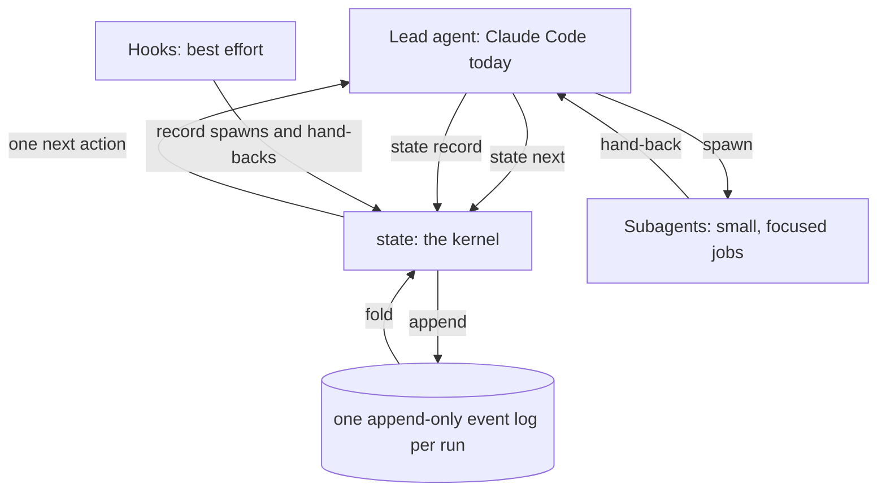

# kategory: reliable agents through state machines



## What kategory is

- **A harness-wrapper, not a low-level harness.** It wraps an agent
  harness and does not rebuild the agent loop. It is agent-agnostic: today
  it wraps Claude Code (`claude-kategory`); OpenCode and Codex are planned.
- **Reliable through deterministic flows.** Each flow is a state machine.
  Hooks enforce it, best effort.
- **The best tooling for the job.** Each step hands the agent the command,
  the context and the checks it needs.
- **Named after Category Theory.** Flows are objects and arrows that
  compose, and each rule is a law with a test
  ([CATEGORY-THEORY](CATEGORY-THEORY.md)).

Install and quickstart: [docs/KATEGORY.md](../KATEGORY.md).

## Why it is different

Other harnesses bet everything on prose: skills and instructions that a
model may or may not follow. kategory moves every rule it can out of prose:

| | Prose-only harness | kategory |
|---|---|---|
| Where a rule lives | skills, instructions | the kernel (`state`) and hooks |
| A rule holds when | the model reads and obeys it | the code runs; a test pins it |
| A broken rule | goes unnoticed | is refused, with a `fix:` line |
| What prose keeps | everything | judgment and taste only |

Fewer rules in prose means fewer mistakes a model can make. The detail,
row by row: [COMPARISON](COMPARISON.md).

## How it works: a state machine

1. `state init` starts a run: an append-only event log.
2. `state next` folds the log into the run's state and prints one next
   action.
3. The agent does it.
4. The agent records the outcome with `state record`, or a hook does
   (spawns, hand-backs). `state` refuses an outcome that is not an arrow out
   of the current state.

It is event sourcing, in Fowler's terms:

- The event log is the only truth. The state is never stored: each call
  rebuilds it by replay.
- A line is never edited. A line logged in error gets a `Voided` reversal
  event, and replay drops both.
- Outside facts, such as a PR's state on GitHub, enter only as logged
  events, before the advice is made.

What that buys:

| Payoff | How |
|---|---|
| **Deterministic** | Same log, same state; same state and facts, same advice. Replay and advice are pure functions. |
| **Replayable** | Any run rebuilds from its log alone ([replay is a fold](RUN-LOOP.md#replay-is-a-fold)). |
| **Observable** | `state show` (where the run is), `state dump` (every event, with time, seq, head sha and session), `state pending` (open questions), `state render` (the flow as a diagram). |

The loop in detail: [RUN-LOOP](RUN-LOOP.md).

## The reliability pyramid

```text
            /\
           /CI\             per project: just check, tests, lint
          /----\
         / pure \           kernel pure code: decides, laws, property tests
        /--------\
       / effectful\         kernel effect shell: git, files, clock, store
      /------------\
     / best-effort  \       hooks: see the moment, gate the start
    /     hooks      \
   /------------------\
  /       prose        \    skills, roles, instructions: judgment and taste
 /----------------------\
 top = most deterministic, bottom = most flexible
```

CI is each project's own gate, outside the harness. The lower four levels
are the logic ladder: each rule lives on the most deterministic of them that
can hold it. What each level holds and how it is tested:
[ARCHITECTURE](ARCHITECTURE.md#the-logic-ladder).

## Principles

From the [vision](../../programs/agents/VISION.md#principles), which owns
them:

- **Lean subagents.** Each does one small, focused task with a small
  context: fast and cheap.
- **Separation of concerns.** The kernel decides, hooks see the moment,
  prose holds judgment.
- **Single responsibility.** One role, one job.

## Where to start

| You want | Run |
|---|---|
| One task to a ready PR, or an existing PR finished. **Start here.** | `/engineer <task>` |
| Many requests in one session, a discussion, a direct fix | `/chief <prompt>` |
| An epic: many PRs, built in parallel | `/10x-engineer` (factory only) |
| A read-only design talk, maybe ending in a GitHub issue | `/architect` |
| The app driven in a headless browser, the proof posted on the PR | `/qa <PR>` |
| A branch or PR cleaned up or reviewed | `/refactor`, `/pragmatic-review` |

When a top-level lead's context runs past its budget, the context guard
tells it to stop and to ask you to run `/chief resume` in a fresh session.

## What it guarantees

The [vision](../../programs/agents/VISION.md#properties-draft)'s
properties. Replayable is above; the other five follow. They hold
whatever the model. A weaker model lowers the quality of the judgment
steps, never these.

| Property | In one line | Read |
|---|---|---|
| **Bounded** | Every loop has a cap set by the run's Fuel; every cap refuses the spend past it; the cap's mode only picks the exits offered (stop, or ask the user to extend). | [GUARDRAILS](GUARDRAILS.md#fuel-and-caps) |
| **Resumable** | The run lives in its log, not in an agent's context, so a fresh agent goes on after a crash or a full context. | [RUN-LOOP](RUN-LOOP.md#resume-after-a-crash-or-a-lost-context) |
| **Lawful composition** | Flows are typed terms built from small flows; a wrong wiring does not compile, and each rule of the algebra has a test. | [FLOWS](FLOWS.md), [CATEGORY-THEORY](CATEGORY-THEORY.md#laws-and-tests) |
| **Authority as code** | Who may answer each kind of question is a table in the kernel, not a sentence in a prompt. | [GUARDRAILS](GUARDRAILS.md#who-answers-which-question) |
| **Nothing waits silently** | Every wait is a named line (`AWAIT`, `HANDBACK`); a loop that repeats itself becomes a question; blind sleeps are denied. | [RUN-LOOP](RUN-LOOP.md#what-state-next-prints), [GUARDRAILS](GUARDRAILS.md#the-stuck-rule) |

## Map of the docs

| Doc | Type | Read it to learn |
|---|---|---|
| [KATEGORY](../KATEGORY.md) | how-to | install, quickstart, update |
| [WALKTHROUGH](WALKTHROUGH.md) | tutorial | one real `/engineer` run, step by step |
| [COMPARISON](COMPARISON.md) | explanation | what the harness does that prose and bare Claude Code do not, and what it costs |
| [ARCHITECTURE](ARCHITECTURE.md) | explanation | where each rule lives, the kernel's layers, the agent compiler, the ADRs |
| [CATEGORY-THEORY](CATEGORY-THEORY.md) | explanation | the categories, the maps between them, and each law with its test |
| [RUN-LOOP](RUN-LOOP.md) | reference | how a run moves, what `state next` prints, the run store, resume |
| [FLOWS](FLOWS.md) | reference | each flow as a diagram drawn by the kernel, who runs each step, the caps |
| [GUARDRAILS](GUARDRAILS.md) | reference | Fuel and caps, the stuck rule, the authority table, hooks and guards |

Only CATEGORY-THEORY assumes category theory. The rest are engineering docs.
