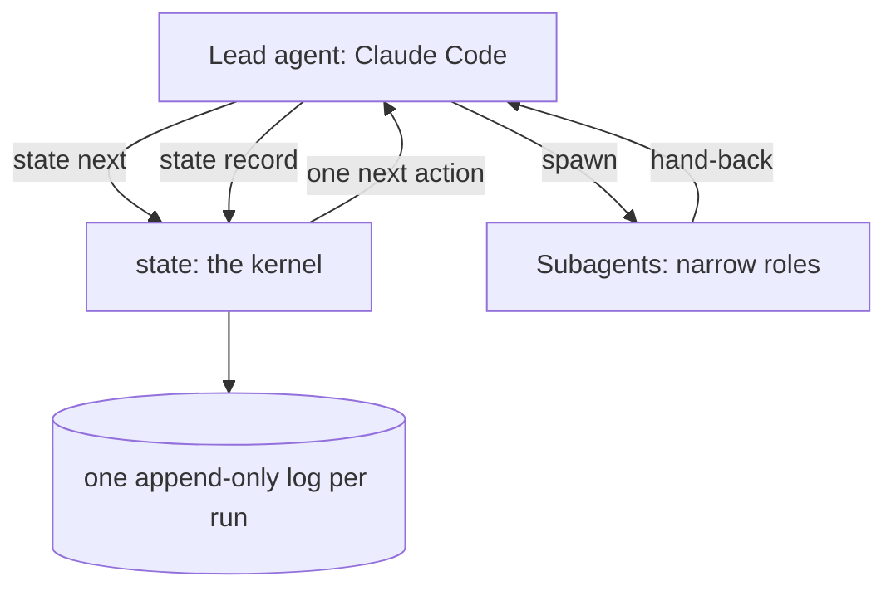
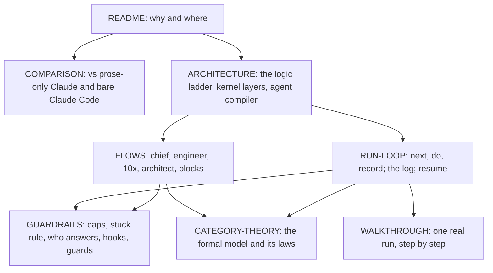

# How the claude-kategory harness works

claude-kategory is Claude Code plus a small program, `state`.

- `state` holds each task as a run with an append-only log.
- It tells the agents the next step.
- Skills and roles carry the judgment.
- `state` holds the rules that must not bend: caps, waits, who answers
  what, and what happens next.

Install and quickstart: [docs/KATEGORY.md](../KATEGORY.md).

## What it guarantees

Six properties from the [vision](../../programs/agents/VISION.md#properties-draft).
They hold whatever the model. A weaker model lowers the quality of the
judgment steps, never these.

| Property | In one line | Read |
|---|---|---|
| **Bounded** | Every loop has a cap set by the run's Fuel; past it the run refuses the step, stops, or asks the user. | [GUARDRAILS](GUARDRAILS.md#fuel-and-caps) |
| **Resumable** | The run lives in its log, not in an agent's context, so a fresh agent goes on after a crash or a full context. | [RUN-LOOP](RUN-LOOP.md#resume-after-a-crash-or-a-lost-context) |
| **Lawful composition** | Flows are typed terms built from small flows; a wrong wiring does not compile, and each rule of the algebra has a test. | [FLOWS](FLOWS.md), [CATEGORY-THEORY](CATEGORY-THEORY.md#9-properties) |
| **Authority as code** | Who may answer each kind of question is a table in the kernel, not a sentence in a prompt. | [GUARDRAILS](GUARDRAILS.md#who-answers-which-question) |
| **Nothing waits silently** | Every wait is a named line (`AWAIT`, `HANDBACK`); a loop that repeats itself becomes a question; blind sleeps are denied. | [RUN-LOOP](RUN-LOOP.md#what-state-next-prints), [GUARDRAILS](GUARDRAILS.md#the-stuck-rule) |
| **Replayable** | What a run knows is a pure fold over its log: same log, same state. | [RUN-LOOP](RUN-LOOP.md#replay-is-a-fold) |

## Map of the docs

| Doc | Read it to learn |
|---|---|
| [COMPARISON](COMPARISON.md) | what the harness does that prose and bare Claude Code do not, and what it costs |
| [ARCHITECTURE](ARCHITECTURE.md) | where each rule lives, the kernel's layers, how the agent config is compiled |
| [RUN-LOOP](RUN-LOOP.md) | how a run moves, what `state next` prints, where the log lives, how a run resumes |
| [FLOWS](FLOWS.md) | each flow as a diagram drawn by the kernel, who runs each step, the caps |
| [GUARDRAILS](GUARDRAILS.md) | Fuel and caps, the stuck rule, the authority table, hooks and guards |
| [CATEGORY-THEORY](CATEGORY-THEORY.md) | the categories, the maps between them, and each law with its test |
| [WALKTHROUGH](WALKTHROUGH.md) | one real `/chief` run, step by step, each step linked to the doc above that explains it |

Only CATEGORY-THEORY assumes category theory. The rest are engineering docs.
