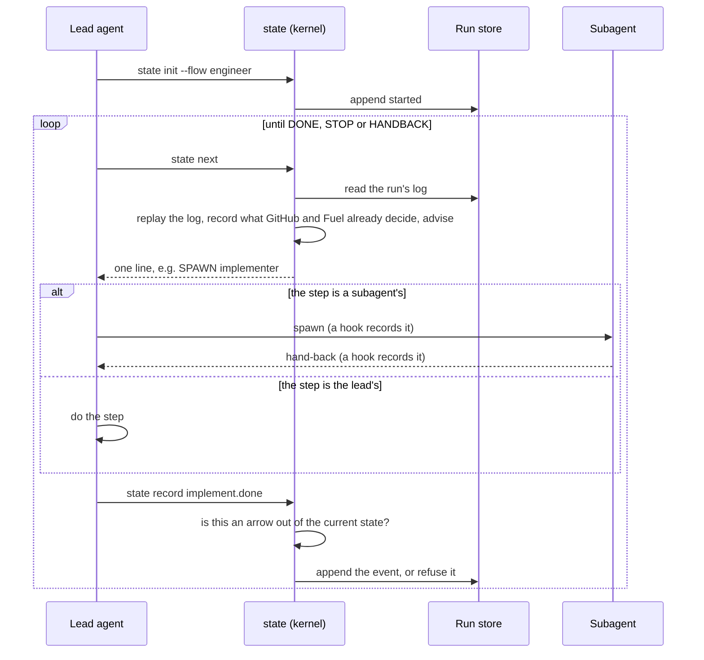
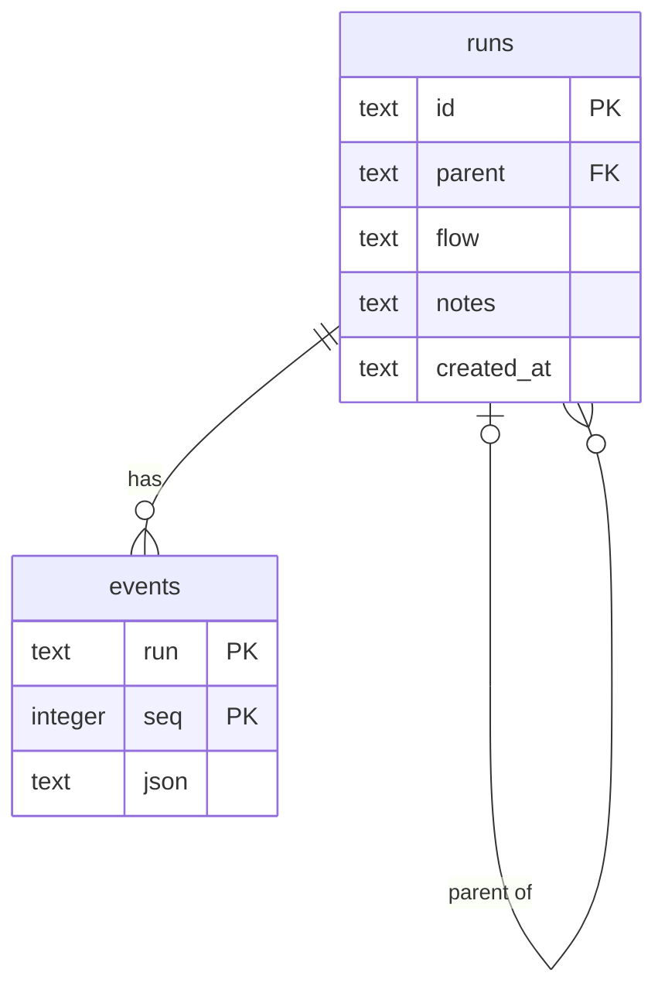
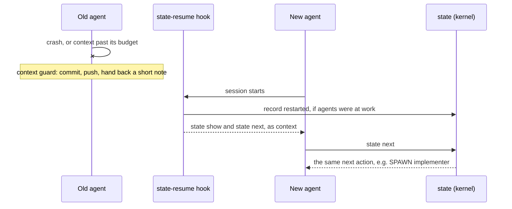

# The run loop

## The loop



Every run moves the same way: the lead asks `state` what to do, does it,
records what happened, and asks again. `state` keeps one log per run and
decides the next step from that log alone. Four things make the loop safe:

- **One step at a time.** `state next` prints one action. The lead never
  decides the order of steps; the flow's graph does.
- **Recording is checked.** `state record <step>.<outcome>` is refused (exit
  2, with a `fix:` line) unless that outcome is an arrow out of the state the
  run is in and no cap refuses it. A refused event is not stored.
- **Facts are not trusted to memory.** Before it advises, `state next`
  records what is already decided: the draft PR or its readiness seen on
  GitHub, a skip the Fuel makes, a plan settled by a parent
  ([`due`](https://github.com/ILIYANGERMANOV/nixos/blob/2c6ba6df6c2a9cc70bbd299cdbd8efd1b6df1edc/programs/agents/kernel/src/State/Protocol/Advice.hs#L198), run until nothing is left by
  [`settledAdvice`](https://github.com/ILIYANGERMANOV/nixos/blob/2c6ba6df6c2a9cc70bbd299cdbd8efd1b6df1edc/programs/agents/kernel/src/State/Cli/Shell.hs#L890)).
- **Advice is pure.** [`advise`](https://github.com/ILIYANGERMANOV/nixos/blob/2c6ba6df6c2a9cc70bbd299cdbd8efd1b6df1edc/programs/agents/kernel/src/State/Protocol/Advice.hs#L263) reads the
  run's state and the facts, nothing else. It never reads who started the run;
  only [`deliver`](https://github.com/ILIYANGERMANOV/nixos/blob/2c6ba6df6c2a9cc70bbd299cdbd8efd1b6df1edc/programs/agents/kernel/src/State/Protocol/Advice.hs#L724) turns the advice into
  the line that reader needs.

## What `state next` prints

| Line | Means | The lead then |
|---|---|---|
| `SPAWN <role>` | the step is a subagent's | spawns that role with `state brief`'s text |
| `ASK <kind> <question>` | the run must ask a question | asks it (`state ask --kind <kind>`), or, waiting on an answer from above, waits |
| `RUN <command>` | one command to run, or several options below | runs it, or picks one |
| `PARKED <question>` | the run's own question waits above it | waits for the answer |
| `AWAIT <what> <refs>` | the run waits on something outside it: CI, a merge, a worker, children | ends its turn; a hook or the parent wakes it |
| `RESUME <child> <with>` | a child run can go on: its answer came, or its CI | resumes that child |
| `STOP <reason> <why>` | the run stopped (`blocked`, `failed`, `replan`, `rounds`) | reports it |
| `DONE <refs>` | the run reached its end | reports what it names (a PR url, notes) |
| `HANDBACK <line>` | a child run's own form of ASK, AWAIT, STOP or DONE | hands back to its parent with `<line>` |

The first line of `state next` is one action; its first word says what kind.
Each kind is a case of [`Action`](https://github.com/ILIYANGERMANOV/nixos/blob/2c6ba6df6c2a9cc70bbd299cdbd8efd1b6df1edc/programs/agents/kernel/src/State/Protocol/Advice.hs#L150),
printed by [`deliver`](https://github.com/ILIYANGERMANOV/nixos/blob/2c6ba6df6c2a9cc70bbd299cdbd8efd1b6df1edc/programs/agents/kernel/src/State/Protocol/Advice.hs#L724).

A child run cannot talk to the user, so wherever a top-level run would print
`ASK`, `AWAIT`, `STOP` or `DONE`, a child prints `HANDBACK` and the
hand-back token its parent reads: `READY`, `NEEDS_DECISION <Kind>`, `AWAIT`,
`BLOCKED` or `FAILED` ([`TokenWord`](https://github.com/ILIYANGERMANOV/nixos/blob/2c6ba6df6c2a9cc70bbd299cdbd8efd1b6df1edc/programs/agents/kernel/src/State/Protocol/Handback.hs#L94)).
A lead whose worker is still at work never hands back: it is told to wait
for the worker first ([`heldBy`](https://github.com/ILIYANGERMANOV/nixos/blob/2c6ba6df6c2a9cc70bbd299cdbd8efd1b6df1edc/programs/agents/kernel/src/State/Protocol/Advice.hs#L709)).

## The run store



All runs of a machine user live in one SQLite database,
`$XDG_STATE_HOME/state/kernel.db` (else `~/.local/state/state/kernel.db`;
[`runStore`](https://github.com/ILIYANGERMANOV/nixos/blob/2c6ba6df6c2a9cc70bbd299cdbd8efd1b6df1edc/programs/agents/kernel/src/State/Protocol/Binding.hs#L89)).

| Property | How | Code |
|---|---|---|
| Many readers, one writer | WAL mode; a writer waits up to 5 s for another | [`Store.hs`](https://github.com/ILIYANGERMANOV/nixos/blob/2c6ba6df6c2a9cc70bbd299cdbd8efd1b6df1edc/programs/agents/kernel/src/Effects/Store.hs#L57) |
| No two events share a number | each write is `BEGIN IMMEDIATE`: read, decide, append under one lock; a misnumbered batch throws | [`locked`](https://github.com/ILIYANGERMANOV/nixos/blob/2c6ba6df6c2a9cc70bbd299cdbd8efd1b6df1edc/programs/agents/kernel/src/Effects/Store.hs#L83) |
| Append-only | a line is never edited. A line logged in error gets a `Voided` line; replay drops both | [`Event.hs`](https://github.com/ILIYANGERMANOV/nixos/blob/2c6ba6df6c2a9cc70bbd299cdbd8efd1b6df1edc/programs/agents/kernel/src/State/Run/Event.hs#L1) |
| Hook records are idempotent | a hook can fire twice; its record is keyed on a hash of the run, agent and message, and a second copy is a no-op | [`Source`](https://github.com/ILIYANGERMANOV/nixos/blob/2c6ba6df6c2a9cc70bbd299cdbd8efd1b6df1edc/programs/agents/kernel/src/State/Run/Event.hs#L100), [`fold`](https://github.com/ILIYANGERMANOV/nixos/blob/2c6ba6df6c2a9cc70bbd299cdbd8efd1b6df1edc/programs/agents/kernel/src/State/Run/Fold.hs#L387) |
| Parent and child runs | the first event of a run adds its `runs` row with its parent; a 10x's engineers and a chief's delegates are children | [`children`](https://github.com/ILIYANGERMANOV/nixos/blob/2c6ba6df6c2a9cc70bbd299cdbd8efd1b6df1edc/programs/agents/kernel/src/Effects/Store.hs#L117) |
| One wire format | each event is one JSON line, version 4; older logs are refused, not guessed at | [`Codec.hs`](https://github.com/ILIYANGERMANOV/nixos/blob/2c6ba6df6c2a9cc70bbd299cdbd8efd1b6df1edc/programs/agents/kernel/src/State/Run/Codec.hs#L1) |
| Schema migrations | `PRAGMA user_version` counts the migrations applied | [`migrations`](https://github.com/ILIYANGERMANOV/nixos/blob/2c6ba6df6c2a9cc70bbd299cdbd8efd1b6df1edc/programs/agents/kernel/src/Effects/Store.hs#L156) |

`state dump` prints a run's log, one JSON line per event; `state show`
prints where the run is and what it holds.

## Replay is a fold

```text
state = fold apply started [e2, e3, ..., en]
fold (log1 ++ log2) = fold log1, then fold log2 from where it stopped
```

A run's state is never stored. It is computed each time by applying the
log's events in turn, from the first: a fold. A step event moves the run
along one arrow of the flow's graph, so a log the fold accepts is a valid
walk through the flow
([`Fold.hs`](https://github.com/ILIYANGERMANOV/nixos/blob/2c6ba6df6c2a9cc70bbd299cdbd8efd1b6df1edc/programs/agents/kernel/src/State/Run/Fold.hs#L1)).

- [`replay`](https://github.com/ILIYANGERMANOV/nixos/blob/2c6ba6df6c2a9cc70bbd299cdbd8efd1b6df1edc/programs/agents/kernel/src/State/Run/Fold.hs#L337) reads a whole log, less voided lines.
- [`fold`](https://github.com/ILIYANGERMANOV/nixos/blob/2c6ba6df6c2a9cc70bbd299cdbd8efd1b6df1edc/programs/agents/kernel/src/State/Run/Fold.hs#L378) continues from a state with more events,
  so reading a log in two parts gives the same state as reading it whole.
- The fold can refuse a line (`Either Refusal`): a log that breaks the graph
  is reported, not silently repaired.

So the same log always gives the same state, on any machine, at any time.
The formal statement is in [CATEGORY-THEORY](CATEGORY-THEORY.md).

## Resume after a crash or a lost context



The state is the log, so there is nothing to rebuild: a new agent reads the
log and goes on from the same state.

- **A crash or a new session.** At session start the
  [`state-resume`](https://github.com/ILIYANGERMANOV/nixos/blob/2c6ba6df6c2a9cc70bbd299cdbd8efd1b6df1edc/programs/agents/kernel/hooks.nix#L13) hook prints the run's
  `state show` and `state next`. A fresh or resumed session has lost the
  agents the lead had at work, so the hook records `Restarted` and the advice
  sends them again; a compacted session lost none and records nothing
  ([`restartOf`](https://github.com/ILIYANGERMANOV/nixos/blob/2c6ba6df6c2a9cc70bbd299cdbd8efd1b6df1edc/programs/agents/kernel/src/State/Protocol/Hook.hs#L582)).
- **A context past its budget.** The context guard tells the agent to commit,
  push and hand back a short note
  ([`context-guard.py`](https://github.com/ILIYANGERMANOV/nixos/blob/2c6ba6df6c2a9cc70bbd299cdbd8efd1b6df1edc/programs/agents/hooks/guards/context-guard/context-guard.py#L1)). A
  subagent's caller spawns a fresh one; the top-level chief is resumed with
  `/chief resume` in a fresh session. Either way the run's log is untouched.
- **A child run.** A 10x or chief wakes a child that waits with `RESUME
  <child>`; the parent's log records `Resumed`.

What the agent remembers is a convenience; what the log says is the truth.
The limits that end a run on purpose are in [GUARDRAILS](GUARDRAILS.md).

## Decisions

[ADR 0014](../adr/0014-pure-core-event-sourced-flow.md) (pure core, event
log), [ADR 0015](../adr/0015-state-program.md) (the `state` program),
[ADR 0016](../adr/0016-hooks-drive-the-state-record.md) (hooks write the
derivable records), [ADR 0017](../adr/0017-pr-state-from-github.md) (PR facts
read from GitHub) and [ADR 0022](../adr/0022-sqlite-run-store.md) (the SQLite
store). The flows themselves are in [FLOWS](FLOWS.md).
