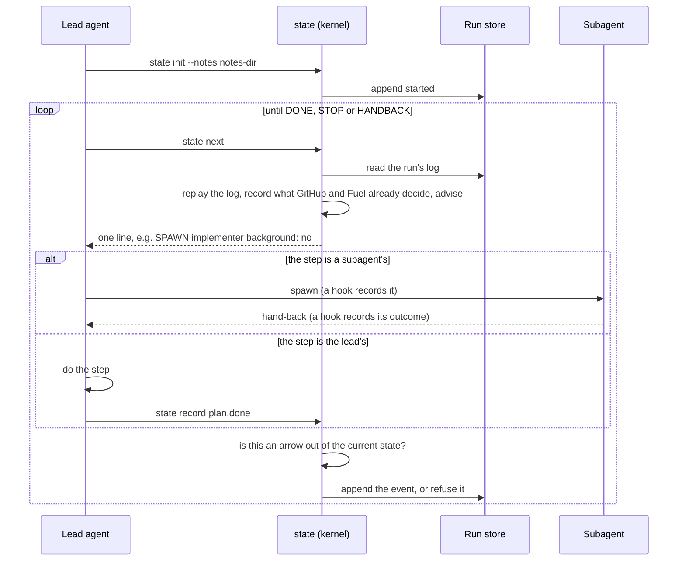
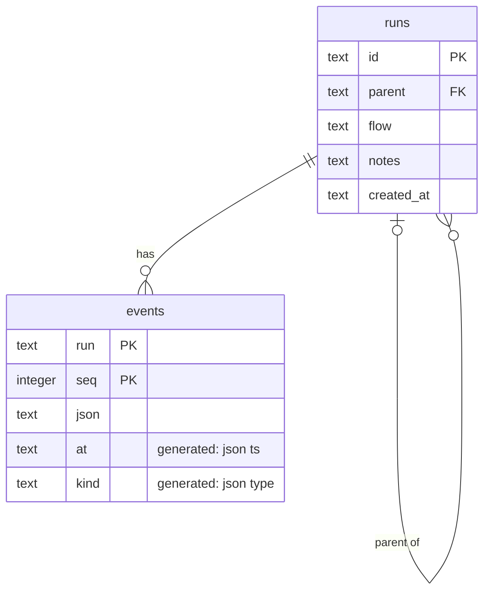
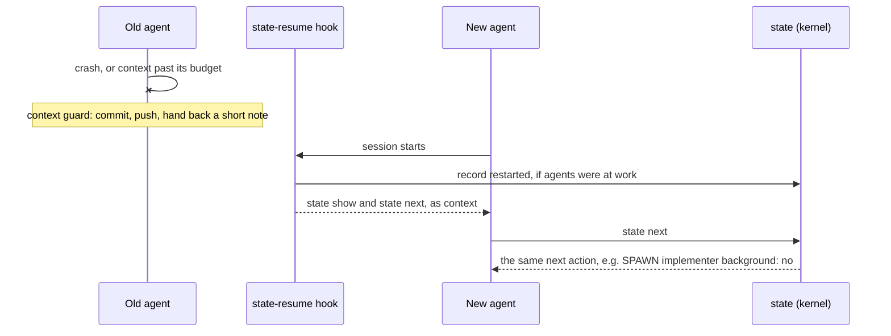

# The run loop

## The loop



Every run moves the same way: the lead asks `state` what to do, does it,
records what happened, and asks again. `state` keeps one event log per run
and decides the next step from that log alone. Five things make the loop
safe:

- **One step at a time.** `state next` prints one action. The lead never
  decides the order of steps; the flow's graph does.
- **Recording is checked.** `state record <step>.<outcome>` is refused (exit
  2, with a `fix:` line) unless that outcome is an arrow out of the state the
  run is in and no cap refuses it. A refused step is not stored; the refusal
  is logged as a `Refused` event, so the next read warns about it.
- **Subagent steps are recorded by a hook.** When a worker hands back, the
  `state-handback` hook records its outcome. If no line was recorded, the
  lead pipes the hand-back into `state handback <role>`.
- **Outside facts enter as events.** Before it advises, `state next`
  records what is already decided: the draft PR or its readiness seen on
  GitHub, a skip the Fuel makes, a plan settled by a parent. [`due`][due]
  names the next such event, and [`settledAdvice`][settled] records them
  until none is left. A due event the fold refuses is told
  (`PR sync refused`), not stored.
- **Advice is pure.** [`advise`][advise] reads the run's state and the
  facts, nothing else. [`heldBy`][heldby] holds a hand-back while a worker
  is still at work. Only [`deliver`][deliver] turns the advice into the line
  its reader needs.

```text
state next = load the log -> settledAdvice (record due events) -> advise -> heldBy -> deliver
```

## What `state next` prints

| Line | Means | The lead then |
|---|---|---|
| `SPAWN <role> [--task <id>] background: yes\|no` | the step is a subagent's; a 10x names the task | spawns that role with `state brief`'s text |
| `ASK <Kind> <question>` | the run must ask a question of its own | asks it with `state ask --kind <Kind>` |
| `ASK <question> - <how>` | a forwarded question waits on the user | asks the user, then records `state answer` |
| `RUN state rule <qid> ... \| state forward <qid> - <question>` | a question from a worker or child waits on this run | rules on it, or forwards it up |
| `RUN state retry <task> ... \| state ask ... --from <who> ...` | a stopped child or a worker's hand-back waits on triage | retries the task, or asks about it |
| `RUN <command>` | one command to run | runs it |
| `RUN one option below` | several options, listed below | picks one |
| `PARKED <qid> <why>` | the run's own question is parked above it | waits for the answer |
| `AWAIT <ci\|merge\|worker\|children> <refs>` | the run waits on something outside it | ends its turn; a hook or the parent wakes it |
| `RESUME <child> <with>` | a child run can go on: its answer came, or its CI | resumes that child |
| `STOP <reason> <why>` | the run stopped (`blocked`, `failed`, `replan`, `rounds`) | reports it |
| `DONE <refs>` | the run reached its end | reports what it names (a PR url, notes) |
| `HANDBACK <line>` | a run with a caller: its own form of ASK, AWAIT, STOP or DONE | hands back to its caller with `<line>` |

The first line of `state next` is one action; its first word says what
kind. Each kind is a case of [`Action`][action], printed by
[`deliver`][deliver]. Lines below it give where the run is (`at <state>:`),
the options or outcomes, the Fuel, the meters and the step's task.

A run that has a caller cannot talk to the user: a child run of a 10x or
a chief, or a run a spawning agent started. Wherever a top-level run would
print `ASK`, `AWAIT`, `STOP` or `DONE`, such a run prints `HANDBACK` and
the hand-back token its caller reads: `READY`, `NEEDS_DECISION <Kind>`,
`AWAIT`, `BLOCKED` or `FAILED` ([`TokenWord`][tokenword], [`upTo`][upto]).
An `AWAIT` also becomes `HANDBACK AWAIT` when the run cannot be woken.
A lead whose worker is still at work never hands back: it is told to wait
for the worker first ([`heldBy`][heldby]).

## The run store



All runs of a machine user live in one SQLite database,
`$XDG_STATE_HOME/state/kernel.db` (else `~/.local/state/state/kernel.db`;
[`runStore`][runstore]).

| Property | How | Code |
|---|---|---|
| Many readers, one writer | WAL mode; a writer waits up to 5 s for another | [`withStore`][busy] |
| No two events share a number | each write is `BEGIN IMMEDIATE`: read, decide, append under one lock; a misnumbered batch throws | [`locked`][locked] |
| Append-only | a line is never edited. A line logged in error gets a `Voided` reversal line; replay drops both | [`unvoided`][unvoided] |
| Hook records are idempotent | a hook can fire twice; its record is keyed on a hash of the run, agent and message, and a second copy is a no-op | [`Source`][source], [`append`][append] |
| Parent and child runs | the first event of a run adds its `runs` row with its parent; a 10x's engineers and a chief's delegates are children | [`children`][children] |
| One wire format | each event is one JSON line, version 4: `v`, `id`, `seq`, `ts`, `run`, `head` (the git sha), `session`, `type`, `data`. Older logs are refused, not guessed at | [`Codec.hs`][codec] |
| Queries without parsing | `at` and `kind` are generated from each line's `ts` and `type`, so they cannot drift from it | [`migrations`][migrations] |
| Schema migrations | `PRAGMA user_version` counts the migrations applied | [`migrations`][migrations] |

To look inside a run:

| Command | Prints |
|---|---|
| `state show` | where the run is and what it holds: step, facts, questions, rulings, gaps |
| `state dump <run>` | the run's log, one JSON envelope per line, with each `ts` |
| `state pending` | the questions awaiting an answer |
| `state tasks` | each request's card and its resume advice |
| `state render mermaid --flow <f>` | the flow's graph (the flow, not one run's walk through it) |

## Replay is a fold

```text
replay g (started :| rest) = the state after every line, less voided lines
fold g (log1 <> log2)     = fold g log1 >=> fold g log2
```

A run's state is never stored. It is rebuilt on each call by applying the
log's events in turn, from the first: a fold. A step event moves the run
along one arrow of the flow's graph, so a log the fold accepts is a valid
walk through the flow ([`Fold.hs`][foldhs]).

- [`replay`][replay] reads a whole log from its `started` line, less each
  void and the line it names.
- [`fold`][fold] continues from a state with more events, so reading a log
  in two parts gives the same state as reading it whole.
- The fold can refuse a line (`Either Refusal`): a log that breaks the graph
  is reported, not silently repaired.

So the same log always gives the same state, on any machine, at any time.
The formal statement is in [CATEGORY-THEORY](CATEGORY-THEORY.md).

## Resume after a crash or a lost context



The state is the log, so a new agent rebuilds it by replay and goes on
from the same state.

- **A crash or a new session.** At session start the
  [`state-resume`][resumehook] hook prints the run's `state show` and
  `state next`. A fresh or resumed session has lost the agents the lead had
  at work, so the hook records `Restarted` and the advice sends them again;
  a compacted session lost none and records nothing
  ([`restartOf`][restartof]).
- **A context past its budget.** The context guard tells the agent to
  commit, push and hand back a short note
  ([`context-guard.py`](../../programs/agents/hooks/guards/context-guard/context-guard.py)).
  A subagent's caller spawns a fresh one. A top-level lead is told to ask
  the user to run `/chief resume` in a fresh session. Either way the run's
  log is untouched.
- **A child run.** A 10x or chief wakes a child that waits with `RESUME
  <child>`; the parent's log records `Resumed`.

What the agent remembers is a convenience; what the log says is the truth.
The limits that end a run on purpose are in [GUARDRAILS](GUARDRAILS.md).

## Decisions

[ADR 0014](../adr/0014-pure-core-event-sourced-flow.md) (a run is a pure
fold over an event log in one SQLite store) and
[ADR 0016](../adr/0016-hooks-drive-the-state-record.md) (hooks drive the
record; PR state comes from GitHub). All ADRs:
[ARCHITECTURE](ARCHITECTURE.md#the-adrs). The flows themselves are in
[FLOWS](FLOWS.md).

[due]: https://github.com/ILIYANGERMANOV/nixos/blob/1d114af7f556b904900b6aea70b733cabfd3ab32/programs/agents/kernel/src/State/Protocol/Advice.hs#L360
[settled]: https://github.com/ILIYANGERMANOV/nixos/blob/1d114af7f556b904900b6aea70b733cabfd3ab32/programs/agents/kernel/src/State/Cli/Shell.hs#L1536
[advise]: https://github.com/ILIYANGERMANOV/nixos/blob/1d114af7f556b904900b6aea70b733cabfd3ab32/programs/agents/kernel/src/State/Protocol/Advice.hs#L455
[heldby]: https://github.com/ILIYANGERMANOV/nixos/blob/1d114af7f556b904900b6aea70b733cabfd3ab32/programs/agents/kernel/src/State/Protocol/Advice.hs#L1158
[deliver]: https://github.com/ILIYANGERMANOV/nixos/blob/1d114af7f556b904900b6aea70b733cabfd3ab32/programs/agents/kernel/src/State/Protocol/Advice.hs#L1186
[action]: https://github.com/ILIYANGERMANOV/nixos/blob/1d114af7f556b904900b6aea70b733cabfd3ab32/programs/agents/kernel/src/State/Protocol/Advice.hs#L312
[upto]: https://github.com/ILIYANGERMANOV/nixos/blob/1d114af7f556b904900b6aea70b733cabfd3ab32/programs/agents/kernel/src/State/Protocol/Advice.hs#L1259
[tokenword]: https://github.com/ILIYANGERMANOV/nixos/blob/1d114af7f556b904900b6aea70b733cabfd3ab32/programs/agents/kernel/src/State/Protocol/Handback.hs#L146
[runstore]: https://github.com/ILIYANGERMANOV/nixos/blob/1d114af7f556b904900b6aea70b733cabfd3ab32/programs/agents/kernel/src/State/Protocol/Binding.hs#L94
[busy]: https://github.com/ILIYANGERMANOV/nixos/blob/1d114af7f556b904900b6aea70b733cabfd3ab32/programs/agents/kernel/src/Effects/Store.hs#L77
[locked]: https://github.com/ILIYANGERMANOV/nixos/blob/1d114af7f556b904900b6aea70b733cabfd3ab32/programs/agents/kernel/src/Effects/Store.hs#L112
[unvoided]: https://github.com/ILIYANGERMANOV/nixos/blob/1d114af7f556b904900b6aea70b733cabfd3ab32/programs/agents/kernel/src/State/Run/Fold.hs#L462
[source]: https://github.com/ILIYANGERMANOV/nixos/blob/1d114af7f556b904900b6aea70b733cabfd3ab32/programs/agents/kernel/src/State/Run/Event.hs#L145
[append]: https://github.com/ILIYANGERMANOV/nixos/blob/1d114af7f556b904900b6aea70b733cabfd3ab32/programs/agents/kernel/src/State/Run/Fold.hs#L495
[children]: https://github.com/ILIYANGERMANOV/nixos/blob/1d114af7f556b904900b6aea70b733cabfd3ab32/programs/agents/kernel/src/Effects/Store.hs#L169
[codec]: ../../programs/agents/kernel/src/State/Run/Codec.hs
[migrations]: https://github.com/ILIYANGERMANOV/nixos/blob/1d114af7f556b904900b6aea70b733cabfd3ab32/programs/agents/kernel/src/Effects/Store.hs#L232
[foldhs]: ../../programs/agents/kernel/src/State/Run/Fold.hs
[replay]: https://github.com/ILIYANGERMANOV/nixos/blob/1d114af7f556b904900b6aea70b733cabfd3ab32/programs/agents/kernel/src/State/Run/Fold.hs#L434
[fold]: https://github.com/ILIYANGERMANOV/nixos/blob/1d114af7f556b904900b6aea70b733cabfd3ab32/programs/agents/kernel/src/State/Run/Fold.hs#L486
[resumehook]: https://github.com/ILIYANGERMANOV/nixos/blob/1d114af7f556b904900b6aea70b733cabfd3ab32/programs/agents/kernel/hooks.nix#L13
[restartof]: https://github.com/ILIYANGERMANOV/nixos/blob/1d114af7f556b904900b6aea70b733cabfd3ab32/programs/agents/kernel/src/State/Protocol/Hook.hs#L676
