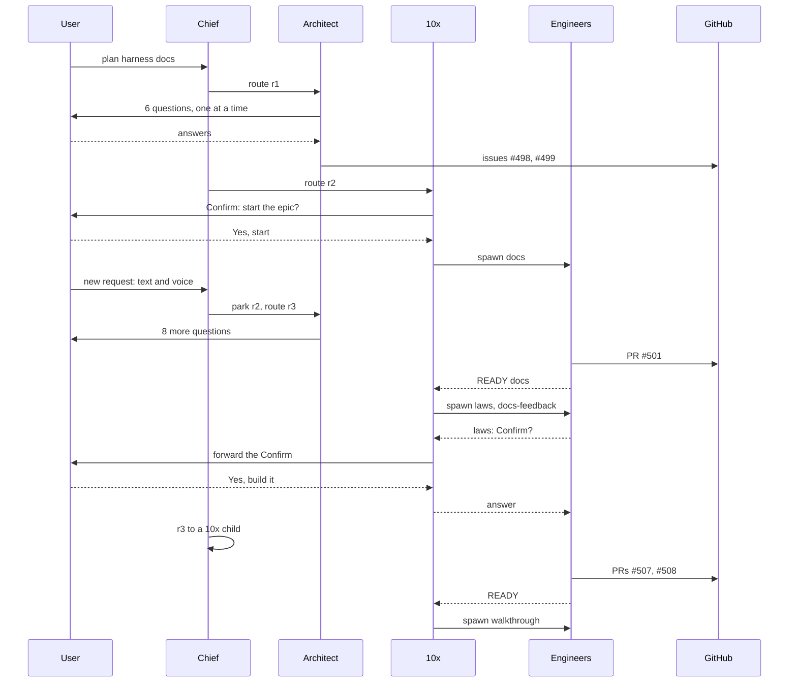

# Walkthrough: one real `/chief` run

The run `bb43f184` planned and built these very docs. This page follows it
step by step, up to the spawn of the task that wrote this page.



Architect and 10x run inline in the chief's run, one request each. Each
engineer is a child run with its own log.

Each step shows two blocks:

- **`state next`**: the line the kernel prints there, rebuilt from the
  events (the log does not store it).
- **Log**: real events from `state dump`, trimmed as in
  [About the excerpts](#about-the-excerpts).

| # | Time (UTC) | Step |
|---|---|---|
| 1 | 10:32 | [Start and route](#1-start-and-route) |
| 2 | 10:33 | [Research](#2-research) |
| 3 | 10:33 | [Interview](#3-interview) |
| 4 | 10:41 | [Tickets](#4-tickets) |
| 5 | 10:42 | [10x plan and Confirm](#5-10x-plan-and-confirm) |
| 6 | 10:46 | [Breakdown and spawn](#6-breakdown-and-spawn) |
| 7 | 10:46 | [An engineer child](#7-an-engineer-child) |
| 8 | 10:53 | [A second request](#8-a-second-request) |
| 9 | 11:27 | [A forwarded Confirm](#9-a-forwarded-confirm) |
| 10 | 11:29 | [Delegate an epic](#10-delegate-an-epic) |
| 11 | 12:03 | [Merge, spawn the next](#11-merge-spawn-the-next) |

## 1 Start and route

```text
state next:  RUN state record fuel.set <low|balanced|max>
state next:  RUN one option below    (picked: state record route.architect)
```

The user asks to plan the harness docs. The chief sets the Fuel and routes
to the architect.

```json
{"seq":1,"ts":"10:32:51","type":"started","data":{"flow":"chief","notes":"...","principal":"user","interface":["ask_user","await","notify","hooks","background"]}}
{"seq":2,"ts":"10:32:59","type":"fuel.set","data":{"level":"balanced"}}
{"seq":3,"ts":"10:32:59","type":"route.architect","data":{}}
```

Read: [FLOWS: the chief routes requests](FLOWS.md#the-chief-routes-requests),
[RUN-LOOP: the loop](RUN-LOOP.md#the-loop).

## 2 Research

```text
state next:  RUN one option below    (picked: state record architect.research)
state next:  SPAWN researcher background: no
```

Three researchers read the repo. Hooks record each spawn and hand-back; the
lead writes none of these lines.

```json
{"seq":5,"ts":"10:33:15","type":"architect/architect.research","data":{}}
{"seq":7,"ts":"10:33:41","type":"worker_spawned","data":{"role":"researcher","agent":"aca53a1eaea68cf9f"}}
{"seq":25,"ts":"10:35:32","type":"worker_returned","data":{"role":"researcher","agent":"af5b291d7077cfc90"}}
```

Read: [FLOWS: architect](FLOWS.md#architect), [GUARDRAILS: hooks](GUARDRAILS.md#hooks).

## 3 Interview

```text
lead:        state ask --kind Scope "Which doc set for docs/harness/?"
state next:  ASK user
```

A Scope question is the user's, so the kernel forwards it. Six questions,
one at a time.

```json
{"seq":15,"ts":"10:33:55","type":"asked","data":{"qid":"bb43f184:1","kind":"Scope","question":"Which doc set for docs/harness/?","step":"architect/discuss","from":"self"}}
{"seq":16,"ts":"10:33:55","type":"forwarded","data":{"qid":"bb43f184:1","to":"user"}}
{"seq":17,"ts":"10:34:40","type":"answered","data":{"qid":"bb43f184:1","reply":"chose","answer":"C: A + COMPARISON.md (7 docs)","by":"user"}}
```

Read: [GUARDRAILS: who answers which question](GUARDRAILS.md#who-answers-which-question),
[CATEGORY-THEORY: who answers](CATEGORY-THEORY.md#4-ifc-who-answers).

## 4 Tickets

```text
state next:  RUN one option below    (picked: state record architect.ticket)
```

The design goes into two issues: #498 (docs) and #499 (laws).

```json
{"seq":41,"ts":"10:41:39","type":"architect/ticket.written","data":{"url":"https://github.com/ILIYANGERMANOV/nixos/issues/498"}}
{"seq":43,"ts":"10:41:42","type":"architect/ticket.written","data":{"url":"https://github.com/ILIYANGERMANOV/nixos/issues/499"}}
{"seq":45,"ts":"10:41:49","type":"architect/architect/notes.done","data":{}}
```

Read: [FLOWS: architect](FLOWS.md#architect).

## 5 10x plan and Confirm

```text
state next:  RUN state record plan.done <path>
state next:  ASK Confirm the simplified plan: confirmed, or adjusted?
```

The user asks to build the issues. The chief routes to the 10x, which
plans, simplifies, and asks to start. One late record is refused: the run
had moved on.

```json
{"seq":48,"ts":"10:41:51","type":"route.10x","data":{}}
{"seq":60,"ts":"10:44:35","type":"refused","data":{"message":"10x/simplify_plan.done - no such arrow out of 10x/confirm","fix":"..."}}
{"seq":61,"ts":"10:44:37","type":"asked","data":{"qid":"bb43f184:8","kind":"Confirm","question":"Start the harness-docs epic as planned?","step":"10x/confirm","from":"self"}}
{"seq":63,"ts":"10:45:46","type":"answered","data":{"qid":"bb43f184:8","reply":"chose","answer":"Yes, start","by":"user"}}
{"seq":64,"ts":"10:45:46","type":"10x/confirm.confirmed","data":{}}
```

Read: [FLOWS: 10x](FLOWS.md#10x), [RUN-LOOP: the loop](RUN-LOOP.md#the-loop)
(recording is checked).

## 6 Breakdown and spawn

```text
state next:  RUN state record breakdown.done --tasks <file.json>
state next:  SPAWN engineer --task docs background: yes
```

Three tasks in a chain: docs, then laws, then walkthrough. Each builds on
the branch `epic/harness-docs`.

```json
{"seq":65,"ts":"10:46:00","type":"10x/breakdown.done","data":{"tasks":[{"id":"docs","deps":[],"base":"epic/harness-docs","branch":"harness-docs","fuel":"balanced",...}]}}
{"seq":66,"ts":"10:46:22","type":"spawning","data":{"task":"docs"}}
{"seq":67,"ts":"10:46:27","type":"spawned","data":{"child":"c2a08b34","task":"docs","worktree":"~/.10x/2026-11-19-harness-docs/worktrees/docs"}}
```

Read: [RUN-LOOP: what `state next` prints](RUN-LOOP.md#what-state-next-prints),
[FLOWS: 10x](FLOWS.md#10x).

## 7 An engineer child

```text
state next:  SPAWN implementer background: no
state next:  HANDBACK READY https://github.com/ILIYANGERMANOV/nixos/pull/501
```

The docs child `c2a08b34` runs the engineer flow in its own log. The plan
came from the parent (`planDecided`), so its Confirm needs no question.
Three slices, a review, one fix, green CI.

```json
{"seq":1,"ts":"10:46:27","type":"started","data":{"flow":"engineer","notes":"...","principal":{"run":"bb43f184","task":"docs","planDecided":true},"interface":[]}}
{"seq":7,"ts":"10:46:45","type":"confirm.confirmed","data":{}}
{"seq":8,"ts":"10:47:04","type":"draft.done","data":{"url":"https://github.com/ILIYANGERMANOV/nixos/pull/501","base":"epic/harness-docs","branch":"harness-docs"}}
{"seq":12,"ts":"10:54:00","type":"overridden","data":{"to":"implement","why":"slices 2 and 3 of 3 remain"}}
{"seq":42,"ts":"11:20:39","type":"ready.done","data":{"url":"https://github.com/ILIYANGERMANOV/nixos/pull/501"}}
```

Read: [FLOWS: engineer](FLOWS.md#engineer),
[RUN-LOOP: what `state next` prints](RUN-LOOP.md#what-state-next-prints).

## 8 A second request

```text
state next:  RUN one option below    (picked: state record route.architect)
```

While docs builds, a new request comes: text questions and voice. The
chief parks r2 with a summary, routes r3, and later switches back for
docs' hand-back.

```json
{"seq":68,"ts":"10:53:04","type":"suspended","data":{"request":"r2","summary":"10x epic harness-docs: docs engineer running (#498); laws (#499), walkthrough (#500) queued"}}
{"seq":70,"ts":"10:53:04","type":"route.architect","data":{}}
{"seq":109,"ts":"11:21:18","type":"focused","data":{"request":"r2"}}
{"seq":111,"ts":"11:21:35","type":"handed_back","data":{"child":"c2a08b34","token":"READY","ref":"https://github.com/ILIYANGERMANOV/nixos/pull/501","qid":null}}
```

Read: [FLOWS: the chief routes requests](FLOWS.md#the-chief-routes-requests),
[RUN-LOOP: the run store](RUN-LOOP.md#the-run-store).

## 9 A forwarded Confirm

```text
state next (child):  HANDBACK NEEDS_DECISION Confirm 1309d68e:1: laws (#499) plan, ...
state next (chief):  ASK user
```

The laws child asks to confirm its plan. The chief tries to rule it; the
kernel refuses and the question goes to the user.

```json
{"seq":136,"ts":"11:27:21","type":"refused","data":{"message":"a ruling on Confirm - this run forwards a Confirm question","fix":"state forward <qid>"}}
{"seq":138,"ts":"11:27:27","type":"forwarded","data":{"qid":"1309d68e:1","to":"user"}}
{"seq":139,"ts":"11:27:39","type":"answered","data":{"qid":"1309d68e:1","reply":"chose","answer":"Yes, build it","by":"user"}}
```

Read: [GUARDRAILS: who answers which question](GUARDRAILS.md#who-answers-which-question).
Why it was not ruled: [Friction](#friction).

## 10 Delegate an epic

```text
state next:  RUN one option below    (picked: state record route.delegate)
```

The user confirms r3 and asks to build it now, in parallel. The chief
starts a second 10x as a child run. It later hands back `AWAIT` on its PR.

```json
{"seq":151,"ts":"11:29:49","type":"route.delegate","data":{}}
{"seq":152,"ts":"11:30:12","type":"spawned","data":{"child":"837f3cef","untasked":true,"worktree":"~/.10x/2026-11-19-text-and-voice"}}
{"seq":154,"ts":"11:43:48","type":"handed_back","data":{"child":"837f3cef","token":"AWAIT","ref":"https://github.com/ILIYANGERMANOV/nixos/pull/510","qid":null}}
```

Read: [FLOWS: the chief routes requests](FLOWS.md#the-chief-routes-requests).

## 11 Merge, spawn the next

```text
state next:  SPAWN engineer --task walkthrough background: yes
```

docs-feedback (#507) and laws (#508) merge into the epic. The chain moves
on to the walkthrough: the run that wrote this page.

```json
{"seq":156,"ts":"11:47:26","type":"task","data":{"task":"docs-feedback","state":"merged","why":null,"pr":"https://github.com/ILIYANGERMANOV/nixos/pull/507"}}
{"seq":160,"ts":"12:02:46","type":"task","data":{"task":"laws","state":"merged","why":null,"pr":"https://github.com/ILIYANGERMANOV/nixos/pull/508"}}
{"seq":163,"ts":"12:03:10","type":"spawned","data":{"child":"e01679a1","task":"walkthrough","worktree":"~/.10x/2026-11-19-harness-docs/worktrees/walkthrough"}}
```

At that point `state show` reads:

```text
run: bb43f184 (chief)
step: 10x/engineers
Rounds: 0 of 9 used, 9 left
Requests: 2 of 100 used, 98 left
```

Read: [GUARDRAILS: Fuel and caps](GUARDRAILS.md#fuel-and-caps),
[RUN-LOOP: replay is a fold](RUN-LOOP.md#replay-is-a-fold).

## Friction

The run recorded its own gaps.

| What | Where | Effect |
|---|---|---|
| Child started untied | gap 137, [#511](https://github.com/ILIYANGERMANOV/nixos/issues/511) | laws began while focus was on r3, so it named no task; its Confirm could not be ruled by the breakdown, so the user was asked (step 9) |
| Hand-back refused twice | seq 162, 164 | the chief had no record of spawning laws |
| Hooks gate by focus | gap 153 | a merge for r2 was denied while r3 had focus |
| Hand-backs reach the top | gap 159 | a nested engineer's workers handed back to the chief |
| Question hidden on the phone | answer to `bb43f184:10` | text before a tool call does not show on the phone |

The untied start, side by side:

```json
{"seq":1,"ts":"10:46:27","type":"started","data":{"flow":"engineer","notes":"...","principal":{"run":"bb43f184","task":"docs","planDecided":true},"interface":[]}}
{"seq":1,"ts":"11:22:04","type":"started","data":{"flow":"engineer","notes":"...","principal":{"run":"bb43f184"},"interface":[]}}
```

docs (first) names its task; laws (second) does not. So `state show` later
said `task laws: not started, PR merged`, and the chief refused its
hand-back:

```json
{"seq":162,"ts":"12:03:08","type":"refused","data":{"message":"the hand-back of 1309d68e - no such child was spawned","fix":"state show"}}
```

The phone bug came up inside an answer, not as its own question:

```json
{"seq":85,"ts":"11:03:34","type":"answered","data":{"qid":"bb43f184:10","reply":"chose","answer":"A: kernel outcome explained, own cap, AtCap Extend so the user can keep asking. Also: a rule for the Claude Code bug where text before a tool call is hidden on the phone","by":"user"}}
```

A question that was ruled, by contrast: in the delegated 10x `837f3cef`, a
Scope question from a child passed the rule test, so the 10x answered it
with a why and a cost.

```json
{"seq":16,"ts":"11:43:36","type":"ruled","data":{"qid":"6bf4739f:1","answer":"A) Yes, deny AskUserQuestion in settings.base for every flavor","why":"User: text 'should be the default' and 'simple rules without exceptions'; one line, reversible","cost":"...","basis":null}}
```

Read: [GUARDRAILS: the stuck rule](GUARDRAILS.md#the-stuck-rule) and
[guards](GUARDRAILS.md#guards) for what stops a run going wrong silently.

## About the excerpts

- Source: `state dump bb43f184` and its children `c2a08b34` (docs),
  `1309d68e` (laws), `fed2656d` (docs-feedback), `837f3cef` (text and
  voice), `e01679a1` (walkthrough); `state show` run in the chief's
  worktree.
- Each event keeps its `seq`, `type` and `data`. The envelope (`v`, `id`,
  `run`, `head`, `session`) is dropped and times are cut to `HH:MM:SS`, all
  on 2026-11-19.
- `...` marks a cut value: notes paths, long lists, long text.
- Home paths show as `~`.
- The run was still going when this page was written; it covers seq 1 to
  164 of 164.
- How a run's log is stored and replayed: [RUN-LOOP](RUN-LOOP.md#the-run-store),
  [CATEGORY-THEORY: log](CATEGORY-THEORY.md#6-log-memory).
