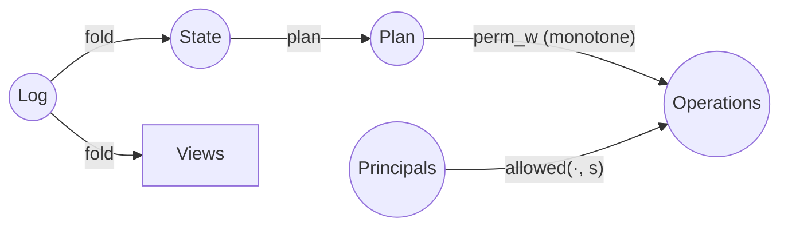
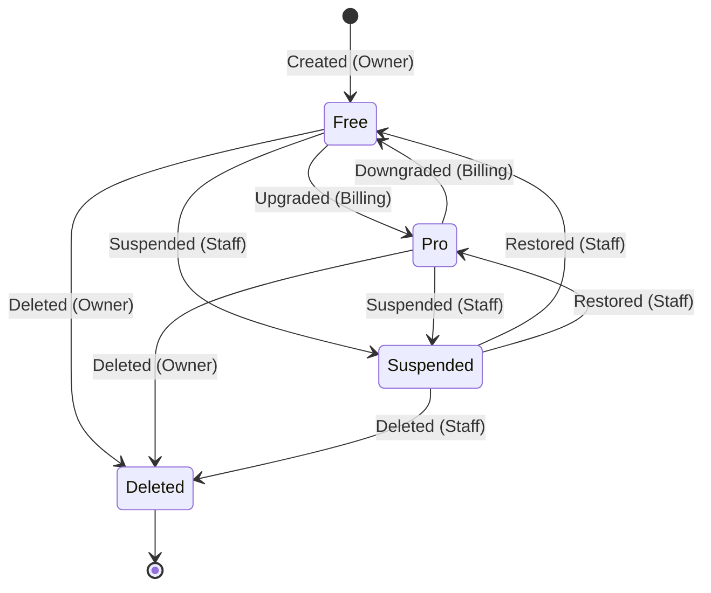
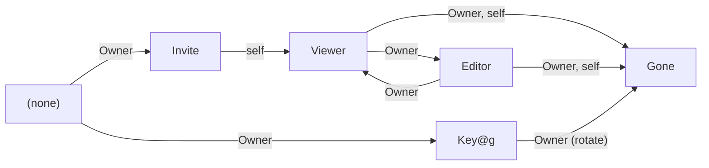

# Example: a Category Theory model of a shared-notes app

The app: people keep notes in **workspaces**. A workspace has members with a
role, API keys for scripts, and a plan that billing sets. Support staff can
suspend a workspace. Every change is an event in an append-only log.

## 0. Model at a glance

Two ordered sets, one state machine, one log and one graph:

| Structure | Objects | Kind |
|---|---|---|
| **Operations** | sets of operations, ordered by `⊆` | Boolean algebra |
| **Plan** | `suspended ≤ free ≤ pro` | chain (poset) |
| **Lifecycle** | workspace states and transitions | labelled state machine |
| **Log** | words of events | free monoid |
| **Principals** | members and API keys, edges labelled by actor | labelled graph |



Only `perm_w` is a functor: it preserves `≤`. `plan` is a plain function,
because the suspend transition moves a workspace down the chain (section 3).

## 1. Env

The whole model is defined per region. Nothing crosses regions.

| Region | Database | API key prefix |
|---|---|---|
| `eu` | `notes_eu` | `nk_eu_` |
| `us` | `notes_us` | `nk_us_` |

- A `WorkspaceId` is unique only inside one region. The model cannot tell
  `w` in `eu` from the same id in `us`: every set below is per region.
- That two regions never mix is an **assumption**, checked by P8.

## 2. Objects and the operation lattice

The base object is an **operation**: one thing a principal asks to do.

| Attribute | Type | Meaning |
|---|---|---|
| `ws(o)` | `WorkspaceId` | the workspace it acts on |
| `kind(o)` | `{read, write, share, manage}` | what it does |
| `note(o)` | `NoteId ⊔ {none}` | the note, absent for workspace-wide ones |

Edge cases are still operations: listing notes is a `read` with
`note = none`; removing a member or deleting the workspace is a `manage`.

The lattice is `(𝒫(Operations), ⊆)` with `∩`, `∪` and complement. Named sets:

| Set | Definition | In words |
|---|---|---|
| `All(w)` | `{o : ws(o) = w}` | everything on workspace `w` |
| `Reads` | `{o : kind(o) = read}` | look, never change |
| `Writes` | `{o : kind(o) = write}` | create, edit, delete notes |
| `Shares` | `{o : kind(o) = share}` | make a public link |
| `Manage` | `{o : kind(o) = manage}` | members, keys, deletion |
| `R(viewer)` | `Reads` | what a viewer may do |
| `R(editor)` | `Reads ∪ Writes ∪ Shares` | what an editor may do |
| `R(owner)` | `Reads ∪ Writes ∪ Shares ∪ Manage` | what the owner may do |
| `Keys` | `Reads ∪ Writes` | what any API key may do |

Derived facts:

- Each operation has exactly one `kind`, so `Reads`, `Writes`, `Shares` and
  `Manage` are pairwise disjoint and cover all operations.
- Hence `R(viewer) ∩ Writes = ∅` and `Keys ∩ (Shares ∪ Manage) = ∅`.
- Each operation has exactly one `ws`, so `All(w) ∩ All(w') = ∅` for `w ≠ w'`.

## 3. Order

The plan is a chain, `suspended ≤ free ≤ pro`. The map into the lattice is an
intersection with a set that grows with the plan:

```text
perm_w(p)       = All(w) ∩ G(p)
G(suspended)    = Reads ∪ Manage
G(free)         = G(suspended) ∪ Writes
G(pro)          = G(free) ∪ Shares
```

In words: a suspended workspace can read and manage, free adds writing, and
pro adds public links.

- `G` grows, so `p ≤ q ⇒ perm_w(p) ⊆ perm_w(q)`: `perm_w` is monotone, a
  functor between the two posets.
- Every inclusion is strict: each step adds a non-empty, disjoint kind.

**Why `plan` is not a functor.** Read the lifecycle as a category whose arrows
are paths of transitions. A functor into `(Plan, ≤)` would need every
transition `s → t` to give `plan(s) ≤ plan(t)`. The `Suspended` transition
takes `pro` to `suspended`, and `pro ≤ suspended` is false. So `plan` is a
plain function on states, and access may shrink over time.

## 4. Lifecycle and log

**State.** Stored fields only:

| Field | Type |
|---|---|
| `tier` | `{free, pro}`, the paid plan |
| `status` | `Active ⊔ Suspended ⊔ Deleted` |
| `members` | `UserId → {owner, editor, viewer}`, exactly one owner |
| `keyGen` | `ℕ`, the live API key generation |

Derived, never stored:

```text
plan(s)   = tier(s)               if status(s) = Active
          = suspended             if status(s) = Suspended
                                  (undefined once Deleted)
access(s) = perm_w(plan(s))       if status(s) ≠ Deleted
          = ∅                     if status(s) = Deleted
```

In words: suspension hides the tier without losing it, and a deleted
workspace allows nothing.



Preconditions:

- `Upgraded` carries a paid invoice id, and one invoice upgrades once (P6).
- `Restored` returns to the stored `tier`, so it lands on `Free` or `Pro`,
  never a new tier.
- `Deleted` is terminal: no transition leaves it.
- Member and key events (`MemberAdded`, `RoleChanged`, `MemberRemoved`,
  `KeyIssued`, `KeysRotated`) keep `status`; they apply only when
  `status ≠ Deleted`.

**Log.** An event is `e = (id, ws, actor, name, at)`. The log of a workspace
is a word `e₁ e₂ … eₙ` in the free monoid `E*`: concatenation appends, the
empty word `ε` is a new workspace. The log holds only accepted events, so
`step` is total on it.

```text
state(log) = foldl step init log
access now = access(state(log))
```

In words: replay the events in order; the current state, and so current
access, is the result. Freeness means: say what one event does and the
effect of any log follows.

**Views** are folds over the same log, each fixed by what it does on one
event:

| View | On one event |
|---|---|
| audit trail | append `(at, actor, name)` |
| member count | `+1` on `MemberAdded`, `-1` on `MemberRemoved` |
| notifications | send one email on `MemberAdded` |

**What freeness does not give.** Views agree only if they read the same
committed log and apply each event once. Delivery to views is
at-least-once, so each projection must be idempotent per event id: the
member count and the email are keyed on `id`.

## 5. Principals

Edge `X →a Y`: actor `a` can turn `X` into `Y`. A holder follows only the
edges whose actor is itself.

| Principal | Meaning |
|---|---|
| `(none)` | no credential yet |
| `Invite` | a pending invitation to one email |
| `Viewer`, `Editor` | a member with that role |
| `Owner` | the one member who owns the workspace |
| `Key@g` | an API key issued at generation `g` |
| `Gone` | a removed member or a dead key |



Not edges:

- Plan changes and suspension act on the workspace, not on a principal.
  Their actors are `Billing` and `Staff`, who hold no credential here.
- No edge carries the label `Key`: a key cannot invite, change roles or
  issue keys.
- Ownership transfer is not an edge (see Open in the model).

What each principal may do in state `s`:

```text
allowed(member u, s) = access(s) ∩ R(role(u))
allowed(key k, s)    = access(s) ∩ Keys    if gen(k) = keyGen(s)
                     = ∅                   otherwise
```

In words: a member gets what the plan allows and the role allows; a key gets
reads and writes only, and nothing once rotated.

Rate limits are keyed on `(region, ws, principal id)`, with the limit a
monotone function of `plan(s)`. The key holds the key id, never the secret.

## 6. Properties

| # | Property | Statement | Status |
|---|---|---|---|
| P1 | Viewers never write | `role(u) = viewer ⇒ allowed(u, s) ⊆ R(viewer)`, and `R(viewer) ∩ Writes = ∅` | Holds (derived in section 2) |
| P2 | Suspended is read and manage only | `status(s) = Suspended ⇒ access(s) ⊆ Reads ∪ Manage` | Holds |
| P3 | Upgrading never loses access | `Upgraded: s → t ⇒ access(s) ⊆ access(t)`, as `free ≤ pro` and `perm_w` is monotone | Holds |
| P4 | Rotation kills old keys | after `KeysRotated`, `gen(k) < keyGen(s) ⇒ allowed(k, s) = ∅` | Holds if every check reads `keyGen` from the primary, not a replica or cache |
| P5 | Only billing changes the tier | every `Upgraded` and `Downgraded` event has actor `Billing` | Holds |
| P6 | An invoice upgrades once | no two `Upgraded` events carry the same invoice id | Needs a unique constraint on invoice id |
| P7 | Views agree with state | member count `= size(members(state(log)))` | Holds if each projection is idempotent per event id |
| P8 | Regions do not mix | an `nk_us_` key is rejected in `eu` | Assumed |
| P9 | Deleted is final | no transition leaves `Deleted`, and `access = ∅` there | Holds |
| P10 | Keys never share or manage | `allowed(k, s) ⊆ Keys`, and `Keys ∩ (Shares ∪ Manage) = ∅` | Holds |

## 7. Notes

- P1, P10: the role and key checks intersect with one table of kinds, and
  each operation has one kind (verified).
- P4: the key check joins the workspace row and compares generations in the
  same query, on the primary, with no cache in front (verified).
- P5: the tier is written only by the billing webhook handler (verified).
- P6: events have a primary key on `(ws, id)`, but upgrades get a fresh id,
  not the invoice id (verified). Hence `Needs`.
- P7: the email sender and the member count both upsert on event id
  (verified). A new view must do the same.
- P8: the test checks the key prefix only; the two regions share no
  database, but nothing tests a forged prefix (verified).

## 8. Open in the model

- Should ownership transfer be an edge, and is its actor the old owner, the
  new one, or both?
- On `Downgraded`, do existing public links stop working, or does the model
  only block new `share` operations? Links are not objects yet.
- Should keys keep their reads while the workspace is suspended? Today
  `allowed(key, s)` gives them `Reads`.
- Is the rate limit for a key per key or shared with its workspace?
